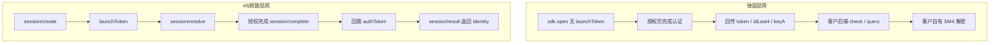
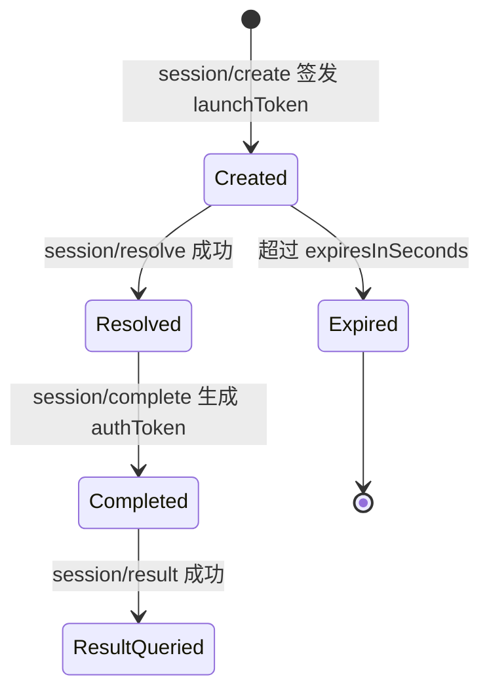
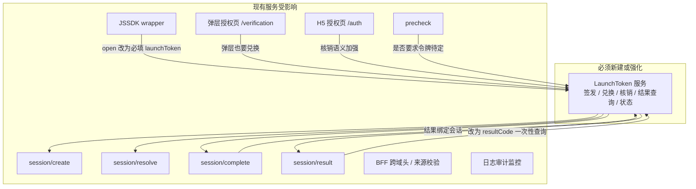
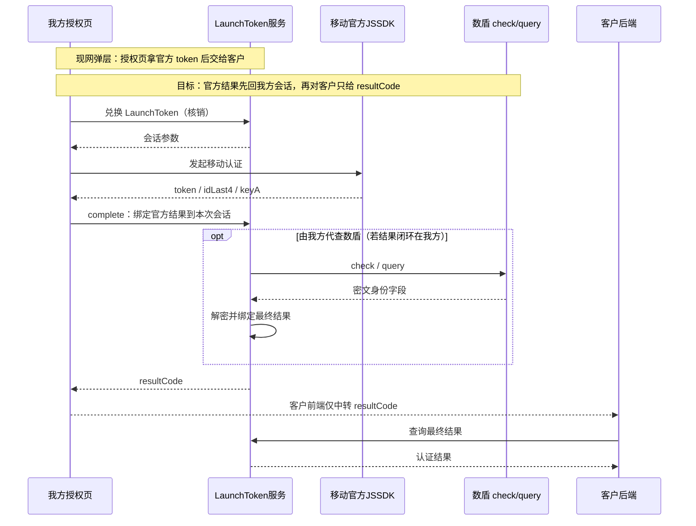
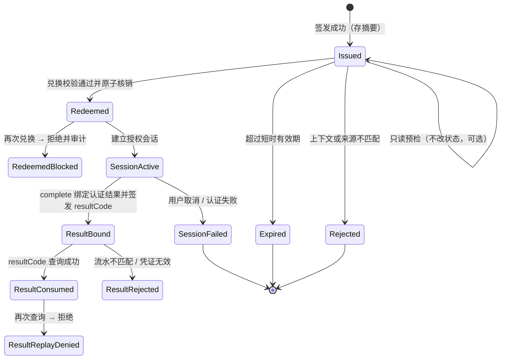
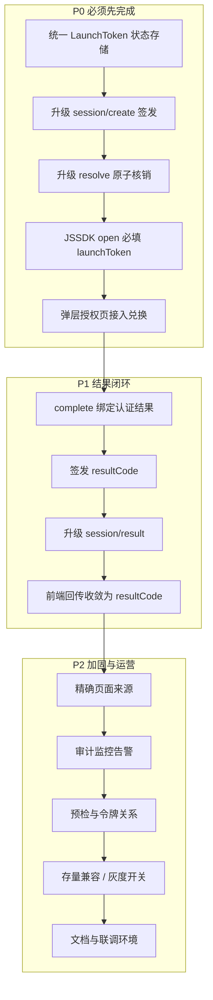
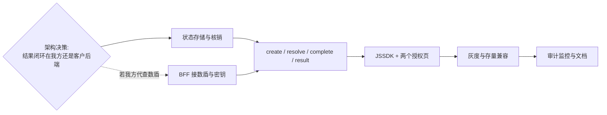

# LaunchToken 服务与令牌状态对我方现有服务的影响及改造范围

> 分析对象：银杏助理现网接入（JSSDK v1.4）与《LaunchToken 安全接入方案》的差异  
> 范围：仅覆盖**我方**现有服务、前端组件与令牌状态；客户侧改造另见接入方案第八章  
> 依据：`银杏助理 JSSDK 接入说明 v1.4`、`银杏助理LaunchToken安全接入方案.md`

---

## 目录

1. [结论先行](#一结论先行)
2. [现网服务与令牌现状](#二现网服务与令牌现状)
3. [新方案要求对照](#三新方案要求对照)
4. [LaunchToken 服务对现有服务的影响](#四launchtoken-服务对现有服务的影响)
5. [令牌状态对现有服务的影响](#五令牌状态对现有服务的影响)
6. [我方改造范围](#六我方改造范围)
7. [风险与建议决策](#七风险与建议决策)

---

## 一、结论先行

新方案不是在现网上「加一个字段」，而是把 **JSSDK 弹层主链路从“无 LaunchToken、前端回传 token/idLast4/keyA、客户直连数盾 check/query”**，改成 **“必须先签发 LaunchToken、兑换核销后才能进入授权、前端只回传一次性 resultCode、结果由我方会话闭环查询”**。

对现网的冲击可以概括为三点：

1. **弹层主链路被改写。** v1.4 明确「弹层改为无 launchToken 启动」；新方案要求 `sdk.open({launchToken})` 必填，且不允许降级回无令牌流程。
2. **H5 转跳链路需要升级，而不是新建。** 现网已有 `session/create → resolve → complete → result` 和 `launchToken / authToken`，但绑定上下文、原子核销、摘要存储、页面来源校验、结果凭证一次性查询均未达到新方案强度。
3. **令牌体系从「多类短期凭证并存」变为「启动令牌 + 结果凭证」双状态机。** 现网 `token / keyA / authToken / authResultId` 与新方案 `LaunchToken / resultCode` 必须明确映射或收敛，否则会出现双链路结果、重复核销和审计断裂。

**建议建设方式：** 在现有 `/sign-pay-pro/api/sdk/session/*` 上演进为统一 LaunchToken 服务，而不是另起一套平行服务；弹层与 H5 共用同一套签发、兑换、状态与结果查询。

```mermaid
flowchart LR
    subgraph 现网 v1.4
        A1[弹层: 无 LaunchToken] --> A2[前端回传 token/idLast4/keyA]
        A2 --> A3[客户直连数盾 check/query]
        B1[H5: session/create] --> B2[launchToken / authToken]
        B2 --> B3[session/result]
    end

    subgraph 目标方案
        C1[弹层与 H5 均须 LaunchToken] --> C2[兑换核销后进入授权]
        C2 --> C3[前端只回传 resultCode]
        C3 --> C4[客户后端向我方查询最终结果]
    end

    现网 v1.4 --> 目标方案
```

---

## 二、现网服务与令牌现状

### 2.1 我方现有服务边界

现网前缀为 `https://ginkgo.chinaums.com/sign-pay-pro/`，我方已落地的能力如下。

| 现有组件 | 路径 / 能力 | 当前职责 |
| --- | --- | --- |
| 我方 BFF / 会话服务 | `/api/sdk/session/create` | H5 转跳签发 `launchToken`；绑定 `appId/appKey/scene/redirectUrl`；有效期约 600 秒 |
| 会话解析 | `/api/sdk/session/resolve` | 授权页用 `launchToken` 换取授权页参数；业务方前端不得直调 |
| 会话完成 | `/api/sdk/session/complete` | 授权完成后生成 `authToken`，兼容 `authResultId / authCode` |
| 结果查询 | `/api/sdk/session/result` | 客户后端凭 `appId/appKey + authToken` 换取身份结果 |
| JSSDK wrapper | `assistance-mobile-auth` | 弹层拉起 `/verification`；`open({scene, requestId})` **不要求** launchToken |
| 弹层授权页 | `/verification` | 嵌入业务页；postMessage 回传 `token / idLast4 / keyA` |
| H5 授权页 | `/auth?launchToken=` | 整页授权；回跳 `redirectUrl?authToken=` |
| 预检 | `sdk.precheck()` | 不展示授权页、不消耗授权结果；**当前不要求** launchToken |
| 内部演示 | `/business-demo/check`、`/business-demo/query` | 仅测试，非正式对外接口 |
| 下游能力 | 移动官方 JSSDK、数盾 check/query | 弹层成功后由**客户后端**直连数盾；我方 BFF 不代解密弹层结果 |

### 2.2 现网两类接入与令牌



现网同时存在多类令牌，职责不同，不能混用：

| 令牌 | 所属链路 | 签发方 | 使用次数 / 寿命（现网口径） | 前端是否可见 | 换取内容 |
| --- | --- | --- | --- | --- | --- |
| `launchToken` | 仅 H5 | 我方 `session/create` | 短时，一次授权使用一次 | 是 | 换授权页参数 |
| `authToken` | 仅 H5 | 我方 `session/complete` | 回跳后由后端查询 | 是（URL） | 换身份结果 |
| `token` | 仅弹层 | 移动官方 JSSDK | 由数盾 check/query 约束 | 是 | 客户直连数盾 |
| `keyA` | 仅弹层 | 官方回调 `encryptPublicKey` | 随本次授权 | 是 | check 入参 |
| `idLast4` | 仅弹层 | 授权页用户输入 | 随本次授权 | 是 | check 入参 |
| `authResultId / authCode` | 旧兼容 | `session/complete` | 兼容残留 | 视链路 | 旧结果换取 |
| `resultCode` | **新方案** | 尚不存在 | 一次性查询凭证 | 计划仅前端中转 | 向我方查最终结果 |

### 2.3 现网会话状态（H5 已有、弹层基本没有）

H5 链路可近似看成轻量状态机；弹层链路**没有**对等的我方会话状态。



与新方案相比，现网缺口主要是：

- 无「原子核销」语义：`resolve` 后同一 `launchToken` 是否禁止再次兑换，文档未作为硬约束写死。
- 绑定维度不足：现有绑定主要是 `appId / scene / redirectUrl`，缺少业务流水、精确页面来源、客户侧幂等请求标识。
- 存储形态未声明「只存摘要、不存明文」。
- 弹层完全绕开会话服务，因此也没有可审计的启动态、核销态、结果绑定态。
- 结果查询一次性、查询后立即失效，现网未作为硬规则落地。
- 失败默认拒绝且不降级，现网弹层仍可无令牌直接 `open()`。

---

## 三、新方案要求对照

| 能力点 | 现网 v1.4 | 新方案 | 差异等级 |
| --- | --- | --- | --- |
| 弹层启动 | `sdk.open({scene, requestId})`，禁止传 launchToken | `sdk.open({launchToken})` 必填 | **高：主链路反转** |
| H5 启动 | 已有 launchToken | 继续使用，但加强绑定与核销 | 中：升级 |
| 签发主体 | 客户后端调 `session/create`（仅 H5） | 所有接入方式均须服务端签发 | **高** |
| 绑定上下文 | appId / scene / redirectUrl | 客户应用、场景、业务流水、精确页面来源、请求标识 | **高** |
| 兑换 | `session/resolve`（仅 H5 授权页） | 弹层授权页也必须兑换；成功即原子核销 | **高** |
| 前端回传 | 弹层：`token/idLast4/keyA`；H5：`authToken` | 仅一次性 `resultCode` | **高：结果模型变更** |
| 结果查询 | 弹层走数盾；H5 走 `session/result` | 统一由客户后端向我方查询 | **高** |
| 页面来源 | JSSDK 内部固定来源校验；未与令牌绑定 | 令牌绑定精确页面来源，兑换时强校验 | 中高 |
| 预检 precheck | 不需要 launchToken | 方案写「不回退无令牌流程」，预检是否豁免未定义 | 中：需决策 |
| 失败策略 | 弹层可直接 open；H5 失败可重新 create | 缺令牌/过期/已用/不匹配一律终止，不降级 | **高** |
| 存储 | 未声明摘要存储 | 服务端只存令牌摘要和状态 | 中 |
| 审计监控 | 有会话日志，强度不足 | 令牌状态、接口调用、异常事件全量审计 | 中 |

---

## 四、LaunchToken 服务对现有服务的影响

### 4.1 总体影响图



### 4.2 对会话服务（BFF）的影响

现网 `session/*` 已承担 H5 的「签发—解析—完成—查询」。新方案要求把这套能力升级为面向**全部接入方式**的 LaunchToken 服务。

| 现网接口 | 新方案对应能力 | 影响 |
| --- | --- | --- |
| `POST /api/sdk/session/create` | LaunchToken 签发 | 必须对弹层开放；增加业务流水、页面来源、幂等请求标识；服务端身份认证从「appId/appKey 入参」升级为更严格的服务端凭证（密钥不得出现在浏览器，现网口径已要求，但弹层签发入口需新建） |
| `session/resolve` | LaunchToken 兑换 | 从「换参数」升级为「原子校验 + 核销 + 建立授权会话」；失败码要区分缺失/过期/已使用/上下文不匹配/来源不匹配 |
| `session/complete` | 认证结果绑定会话 | 移动认证结果先绑本次服务端会话，再签发一次性 `resultCode`；不能再把 `token/idLast4/keyA` 作为弹层对前端的主回传 |
| `session/result` | 认证结果查询 | 入参从 `authToken` 收敛或并存为 `resultCode + 业务流水`；必须二次校验客户身份、流水、凭证状态；查询成功后凭证失效 |

**关键冲突：**

- 现网弹层明确「业务方无需 session/create」。新方案相反，弹层也必须先签发。
- 现网 `session/create` 目前带 `redirectUrl`，是 H5 专属字段。弹层签发需要可空或改用 `origin/pageUrl`。
- 现网 `session/result` 可直接返回 `identity` 明文（H5）。新方案要求结果最小化、查询一次性；若继续对 H5 返回明文 identity，需确认是否仅服务端可见、以及是否允许重复查询。
- 现网 appKey 放在 `session/create` 请求体。新方案强调「仅向已完成服务端身份认证的客户应用签发」，更宜改为网关签名 / mTLS / 服务端凭证，而不是长期把 appKey 明文 POST 到 BFF。

### 4.3 对 JSSDK wrapper 的影响

`assistance-mobile-auth` 是冲击最大的前端组件。

| 现网行为 | 新方案要求 | 改造点 |
| --- | --- | --- |
| `open({scene, requestId})` | `open({launchToken})` 必填 | 入参模型变更；无令牌直接失败 |
| 内部固定生成 `/verification` | 打开前或打开后由授权页兑换令牌 | 必须把 launchToken 传入授权页 |
| 成功回传 `token/idLast4/keyA` | 只回传 `resultCode` | onSuccess / Promise 载荷变更，属**破坏性变更** |
| 错误码如 `KEY_A_MISSING` | 新增令牌缺失、过期、已核销、来源不匹配 | 错误码表扩展 |
| 文档与示例均示范无令牌启动 | 不允许降级 | 接入文档、测试页、demo 同步改 |

兼容策略必须单独立项：若存量客户已按 v1.4 弹层上线，强制必填会直接中断现网。需要版本开关或按 appId 灰度。

### 4.4 对授权页的影响

| 页面 | 现网 | 新方案影响 |
| --- | --- | --- |
| `/verification`（弹层） | 不调用 resolve；样式经 postMessage 下发 | **必须新增兑换调用**；校验页面来源与令牌绑定来源一致；兑换失败不得加载官方 JSSDK / 不得进入取号 |
| `/auth`（H5） | 已用 launchToken 调 resolve | 核销必须原子化；来源/流水/场景校验补齐；complete 后改发 `resultCode`（或 `authToken` 映射为 resultCode） |

授权页在兑换成功前不应渲染可提交的授权控件。这与现网「先加载页面再通信」的时序不同，需要调整 ready 时机：`onReady` 应发生在兑换成功之后。

### 4.5 对 precheck 的影响

现网 `precheck()` 会真实触发一次移动取号，但不进入授权、不回传 token。新方案未点名预检，但写了「校验失败不回退到无令牌流程」。

存在两种口径，必须在改造前拍板：

| 方案 | 含义 | 影响 |
| --- | --- | --- |
| A. 预检豁免 | precheck 仍可无 LaunchToken | 改动小；存在「未授权页面先取号」窗口，与新方案目标不完全一致 |
| B. 预检也要令牌 | precheck 必须带未核销的 LaunchToken，且预检**不得核销** | 状态机要支持「已签发可预检、预检不改变状态」；同一令牌仍留给后续 open 兑换 |

**建议采用 B 的弱形式：** 预检可使用同一 LaunchToken 只读校验（校验签发态、来源、场景），但不核销；正式 `open()` 才核销。避免预检把一次性令牌消耗掉。

### 4.6 对下游移动认证 / 数盾的影响

新方案不替代移动官方 JSSDK，也不替代数盾 check/query 的密码学能力，但改变了**谁来调用、何时调用、结果落在哪**：



这里有一个必须明确的架构分叉：

1. **结果闭环在我方：** complete 后由我方持有 `token/keyA`，由我方调数盾 check/query 并保存最终结果；客户只查 resultCode。客户不再直连数盾。对现网弹层是**职责上收**。
2. **结果闭环在客户：** 我方只保证启动受控，complete 后仍把续调参数交给客户走数盾。这与新方案「前端只收 resultCode、最终结果服务端闭环」不完全同构，除非 resultCode 查询时再把续调参数返回给客户后端。

按新方案字面（「最终结果保持服务端闭环」「前端不直接承载最终身份信息」），**更接近方案 1，或方案 2 的「resultCode 换续调参数仅限客户后端」**。无论选哪个，现网「前端可见 token/keyA」都必须取消。

对现网 BFF 的直接影响：

- 若选方案 1：我方必须具备数盾调用、SM4 解密、身份结果存储与脱敏日志。这与 v1.4「我方 BFF 不再代业务方解密 JSSDK 弹层结果」**相反**，属于产品职责回摆。
- 若选方案 2：`session/result` 对客户后端返回 `token/idLast4/keyA`（或已校验通过的身份），前端仍然只见 resultCode。我方改造较小，但要保证 resultCode 一次性、与业务流水绑定。

### 4.7 对网关、跨域、来源校验的影响

现网已由 JSSDK 内部做消息来源校验，服务端补跨域响应头。新方案要求「精确页面来源」写入令牌并在兑换时校验。

影响：

- `session/create` 必须接收并固化 `pageOrigin` / `pageUrl`（精确到约定页面，而不是仅域名）。
- 弹层兑换时用 `document.referrer` 或 postMessage 源与绑定值比对；H5 用当前页 URL 与绑定值比对。
- 现网域名白名单仍要保留，但**白名单通过不等于令牌来源通过**。
- 客户前端若在多个页面复用同一 launchToken，会被拒绝；这会影响现网测试页、聚合入口页的用法。

### 4.8 对监控、限流、审计的影响

新服务会带来新的高频接口和状态变更事件：

- 签发、兑换失败、重复兑换、过期、来源不匹配、结果重复查询，均需独立指标和告警。
- 日志不得打印 LaunchToken / resultCode / 官方 token 明文；只记摘要、状态、appId、流水号。
- 现网若已有会话日志，字段结构要扩展状态机，而不是另写一套互不相通的日志。

---

## 五、令牌状态对现有服务的影响

### 5.1 目标状态机（建议落地）

LaunchToken 与 resultCode 是两条寿命不同的状态机，必须拆开，不能把「已核销」当成「结果已查询」。



### 5.2 各状态对现有接口的约束

| 状态 | create | resolve/兑换 | 授权页继续 | complete | result 查询 | 对现网的具体影响 |
| --- | --- | --- | --- | --- | --- | --- |
| 未签发 / 未知 | 可新建 | 拒绝 | 禁止加载官方 SDK | 拒绝 | 拒绝 | 弹层现网无此拦截，必须新增 |
| 已签发 Issued | 幂等请求可返回原令牌或拒绝重复 | 允许一次兑换 | 否 | 拒绝 | 拒绝 | H5 resolve 需改成 CAS 核销 |
| 已核销 Redeemed | 新请求应发新令牌 | 拒绝重复兑换 | 允许 | 允许 | 拒绝（尚无 resultCode） | 现网 resolve 可能未禁用重放 |
| 会话中 SessionActive | 无关 | 拒绝 | 允许 | 允许一次 | 拒绝 | complete 必须防重复提交 |
| 结果已绑定 ResultBound | 无关 | 拒绝 | 可关闭页面 | 拒绝重复绑定 | 允许一次 | 新状态，现网没有 |
| 结果已查询 ResultConsumed | 无关 | 拒绝 | 否 | 拒绝 | 拒绝 | H5 现网 result 是否可重复查未硬约束 |
| 已过期 Expired | 需重新签发 | 拒绝 | 终止 | 拒绝 | 拒绝 | 弹层现网无过期概念 |
| 校验失败 Rejected | 视错误类型 | 拒绝 | 终止 | 拒绝 | 拒绝 | 需可观测，避免被当成系统异常 |

### 5.3 状态存储对现有架构的影响

新方案要求「服务端保存受保护的令牌摘要及状态，不记录令牌明文」。现网会话存储若直接保存 `sft_launch_xxx` 明文，需要改为：

- 只存 `SHA-256(launchToken)` 或 HMAC 摘要、状态、过期时间、绑定上下文、关联 sessionId。
- 兑换时对入参做同样摘要后查询；比较与更新必须在同一原子操作中完成（Redis `GET + Lua` 或 DB 条件更新）。
- resultCode 同样只存摘要；查询成功即标记 `consumedAt`。
- 官方 `token/keyA` 若由我方代持，属敏感凭证，须加密存储、短 TTL、查询后销毁或不可再读。

对现网的影响：

- 现有 Redis/DB 会话模型大概率要扩表或重建，不能只加字段。
- 多实例 BFF 必须共享状态存储，本地内存不可作为核销依据。
- 时钟偏差会影响过期判断，签发与兑换节点需 NTP 一致。

### 5.4 状态机与现网并发场景

| 场景 | 现网可能表现 | 新状态机要求 | 改造要点 |
| --- | --- | --- | --- |
| 用户连点两次 open | 弹层可能打开两个授权窗 | 同一 LaunchToken 只能兑换一次 | JSSDK 侧也要防重入；第二次必须失败 |
| 刷新 H5 授权页 | 可能再次 resolve | 已核销则直接失败，需重新申请 | 授权页要提示「请返回业务页重试」 |
| 预检后再 open | 无状态关联 | 预检不得核销 | 预检走只读校验 |
| 授权成功后前端重放 resultCode | H5 是否可重复查未写死 | 第二次查询拒绝 | result 接口加 consumed 状态 |
| 客户用过期 launchToken 调 open | 弹层根本没有该参数 | 终止，不进官方取号 | 避免无效取号消耗配额 |
| 跨页面复用令牌 | 现网不校验精确页面 | 来源不匹配拒绝 | create 时绑定精确 URL |

### 5.5 状态与错误码对现有错误表的影响

现网错误码以移动认证/数盾码为主（如 `103000`、`KEY_A_MISSING`）。LaunchToken 状态失败应使用**我方会话错误码**，避免和下游码混用。建议独立命名空间，例如：

| 建议错误码 | 对应状态 / 场景 | 对前端 / 授权页行为 |
| --- | --- | --- |
| `LT_MISSING` | 未提供 | 不打开授权页 |
| `LT_INVALID` | 摘要查无 | 终止 |
| `LT_EXPIRED` | Expired | 提示客户后端重新申请 |
| `LT_USED` | Redeemed / 重放 | 记审计，不进认证 |
| `LT_CTX_MISMATCH` | 客户/场景/流水不匹配 | 拒绝 |
| `LT_ORIGIN_MISMATCH` | 页面来源不匹配 | 拒绝建立会话 |
| `LT_SERVICE_UNAVAILABLE` | 状态存储不可用 | 统一失败，禁止降级无令牌 |
| `RC_INVALID` / `RC_USED` | resultCode 无效或已查询 | 不返回认证结果 |

`KEY_A_MISSING` 等官方续调错误应内收：若结果闭环在我方，该错误不再暴露给客户前端。

---

## 六、我方改造范围

### 6.1 改造总图



### 6.2 分组件改造清单

#### A. LaunchToken 服务 / 现网会话服务（核心，新建能力 + 改造现网）

| 项 | 改造内容 | 类型 | 优先级 |
| --- | --- | --- | --- |
| A1 | 令牌摘要存储、状态机、TTL、原子 CAS 核销 | 新建/重构 | P0 |
| A2 | `session/create` 增加业务流水、页面来源、幂等请求标识；弹层与 H5 共用 | 改造 | P0 |
| A3 | 服务端身份认证强化（签名/凭证，避免 appKey 长期明文入参） | 改造 | P1 |
| A4 | `session/resolve` 改为原子兑换：校验状态、上下文、来源后核销并返回会话参数 | 改造 | P0 |
| A5 | `session/complete` 绑定官方认证结果，签发一次性 resultCode | 改造 | P0 |
| A6 | `session/result` 改为 resultCode + 业务流水查询，校验客户身份，查询后作废 | 改造 | P0 |
| A7 | 幂等：相同请求标识在有效期内是否返回同一 LaunchToken，需产品确认后实现 | 改造 | P1 |
| A8 | H5 `authToken` 与 `resultCode` 映射或废弃兼容期 | 改造 | P1 |

#### B. JSSDK wrapper（`assistance-mobile-auth`）

| 项 | 改造内容 | 类型 | 优先级 |
| --- | --- | --- | --- |
| B1 | `open()` 增加 `launchToken` 必填校验，缺失即失败 | 改造 | P0 |
| B2 | 将 launchToken 安全传递给授权页（query 或受控 postMessage，避免落入第三方脚本日志） | 改造 | P0 |
| B3 | `onSuccess` / Promise 改为 `resultCode`（及回显 requestId）；移除对前端暴露 token/idLast4/keyA | 破坏性变更 | P0 |
| B4 | 新增令牌类错误码，映射到 `onError` | 改造 | P0 |
| B5 | 防重复 open：同一令牌或同一实例仅允许一次进行中的授权 | 改造 | P0 |
| B6 | 版本与灰度：旧版无令牌弹层是否限期兼容 | 产品决策 | P0 |
| B7 | `precheck` 是否携带 / 只读校验 LaunchToken | 改造 | P1 |
| B8 | 静态资源版本号、接入示例、测试页同步 | 文档/发布 | P1 |

#### C. 弹层授权页 `/verification`

| 项 | 改造内容 | 类型 | 优先级 |
| --- | --- | --- | --- |
| C1 | 启动时调用兑换接口，失败则不加载官方 JSSDK | 新建 | P0 |
| C2 | 校验当前嵌入来源与令牌绑定来源 | 新建 | P0 |
| C3 | `onReady` 延后到兑换成功 | 改造 | P0 |
| C4 | 认证完成后走 complete，只向父页面回传 resultCode | 改造 | P0 |
| C5 | 样式 postMessage 与令牌会话绑定，避免无会话也能套样式拉起 | 改造 | P1 |

#### D. H5 授权页 `/auth`

| 项 | 改造内容 | 类型 | 优先级 |
| --- | --- | --- | --- |
| D1 | resolve 改为原子核销，重复刷新失败 | 改造 | P0 |
| D2 | 补齐流水、场景、来源校验 | 改造 | P0 |
| D3 | 回跳参数从 `authToken` 过渡到 `resultCode`（或双写兼容） | 改造 | P1 |
| D4 | 取消/失败不得生成可用结果凭证 | 改造 | P0 |

#### E. 结果闭环与下游调用

| 项 | 改造内容 | 类型 | 优先级 |
| --- | --- | --- | --- |
| E1 | 拍板：我方代调数盾 vs 仅向客户后端交付续调参数 | 架构决策 | P0 |
| E2 | 若我方代调：BFF 增加 check/query、密钥托管、解密、结果落库 | 新建 | P1 |
| E3 | 敏感字段加密存储与查询后销毁 | 新建 | P1 |
| E4 | 内部 `/business-demo/*` 不得作为正式结果通道，但测试环境要接到新状态机 | 改造 | P1 |

#### F. 安全、审计、运维

| 项 | 改造内容 | 类型 | 优先级 |
| --- | --- | --- | --- |
| F1 | HTTPS、脱敏日志、令牌明文禁入日志 | 改造 | P0 |
| F2 | 签发/兑换/查询限流，重复兑换告警 | 新建 | P1 |
| F3 | 状态看板：签发量、核销率、过期率、重放次数、来源不匹配次数 | 新建 | P1 |
| F4 | 服务不可用时的统一失败响应，配置上禁止「跳过令牌」开关进入生产 | 改造 | P0 |

#### G. 文档与联调（我方交付物）

| 项 | 改造内容 | 优先级 |
| --- | --- | --- |
| G1 | 修订 JSSDK 接入说明：弹层恢复 launchToken，回调改为 resultCode | P0 |
| G2 | 错误码、有效期、页面来源白名单、幂等规则 | P0 |
| G3 | 提供测试环境的签发、兑换、过期、重放、来源不匹配用例 | P0 |
| G4 | 明确与 v1.4 的不兼容清单，给存量客户迁移窗口 | P1 |

### 6.3 建议不在本次改造的范围

- 客户后端登录态、订单校验、幂等申请（客户侧职责）。
- 移动官方 JSSDK 控件样式协议（现有 `styleOption` 可保持）。
- 数盾加解密算法本身（SM4/RSA）；变的是调用主体和时机。
- Android / iOS 原生 SDK 产品包（本次方案针对 H5/JSSDK；若后续统一安全基线再单独立项）。

### 6.4 工作量与依赖（相对排序）



没有「结果闭环」决策，A5/A6/B3/C4 无法定接口字段；没有状态存储，兑换核销无法做对。

---

## 七、风险与建议决策

### 7.1 主要风险

| 风险 | 原因 | 后果 | 缓解 |
| --- | --- | --- | --- |
| 破坏现网弹层客户 | v1.4 刚去掉 launchToken | 已上线客户 `open()` 全部失败 | appId 灰度；双版本 SDK |
| 双结果模型并存过久 | token/keyA 与 resultCode 同时存在 | 前端仍能截获身份续调参数 | 弹层成功路径只回 resultCode |
| 预检消耗一次性令牌 | 误在 precheck 中核销 | 用户随后 open 失败 | 预检只读，不改状态 |
| resolve 非原子 | 并发双开授权页 | 一令多用、审计失真 | Redis Lua / DB CAS |
| 状态存储故障被降级 | 临时绕过令牌以保活 | 直接违反新方案 | 故障时统一失败 |
| 我方代解密回摆 | 与 v1.4 BFF 不代解密相反 | 密钥与合规责任上收 | 先决策再开发，不两边都做 |

### 7.2 需要产品 / 架构拍板的事项

1. **弹层是否与 H5 强制统一 LaunchToken。** 建议：是，否则安全方案对主流量无效。
2. **resultCode 查询返回什么。** 身份明文（H5 现状）还是仅允许客户后端再走数盾的续调参数。建议：对客户后端返回最终认证结果，前端永不落地身份与官方 token。
3. **存量弹层兼容窗口。** 建议：按 appId 开关，默认新客户强制，旧客户限期迁移。
4. **precheck 与令牌关系。** 建议：只读校验，不核销。
5. **LaunchToken 有效期。** 现网 H5 为 600 秒；弹层用户交互更短，可考虑更短 TTL（如 60–120 秒），联调确认。
6. **`authToken` 是否废弃。** 建议：新接口统一 resultCode，H5 回跳双写一个版本后下线 authToken。

### 7.3 对我方现有服务的一句话总结

LaunchToken 服务应作为现网 `session/*` 的**强化主链路**，而不是旁路组件；令牌状态会成为弹层授权页、H5 授权页、JSSDK 和结果查询的**共同前置条件**。影响面集中在会话 BFF、两个授权页和 JSSDK wrapper；下游移动认证能力可复用，但启动门槛和结果出口必须按状态机收口。未完成核销与结果闭环之前，不能宣称已满足安全接入方案。
