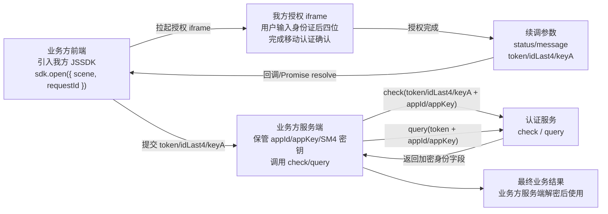
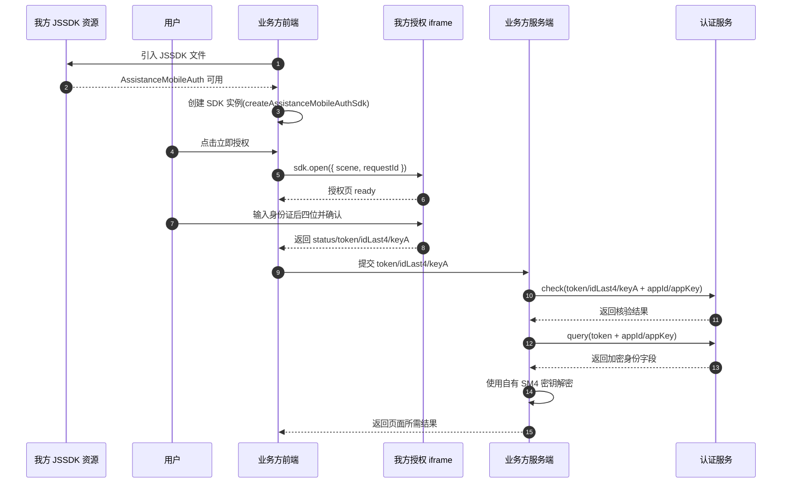

# 助填认证 JSSDK 接入说明

**文档版本：** v0.5
**适用对象：** 接入助填认证 H5 能力的业务方前端、后端开发人员  
**当前状态：** JSSDK 尚未正式发布，本文中的脚本地址、授权域名、接口地址均为占位符。正式联调时，请以我方最终提供的发布地址、版本号、接口清单和接口规则为准。

> **notification-only 版本边界：** 当前源码、Zhongguan TEMP `/sign-pay-pro-temp/assist/0.2.3/` 与本次生成的正式冻结 `0.2.3` 静态包使用相同的 `onBeforeLogin` / `onStateChange` 通知合同。TEMP 验收不等于正式部署；本任务只冻结本地正式包，不部署 `/sign-pay-pro/`。`/sign-pay-pro/assist/0.2.3/` 仍须完成独立发布和线上验收后才能交付接入方。

## 一、接入前说明

助填认证 JSSDK 用于帮助业务方在自有 H5 页面中发起移动认证授权。业务方页面只需引入我方 JSSDK，由我方 JSSDK 创建并管理授权窗口，授权页及移动认证控件在我方托管页面内完成加载。

业务方不需要、也不应在自有页面中直接引入移动认证官方控件节点，例如 `ydrzPhoneControl`、`ydrzSubmitControl`、`ydrzAgreementControl` 等。上述控件由我方托管授权页统一处理。

### 1.1 接入角色与调用边界

业务方接入时只需要关注三层职责：

1. 业务方前端负责引入我方 JSSDK、拉起授权窗口、承接标准化续调参数。
2. 业务方服务端负责保存 `appId/appKey`、调用 `check/query`，并使用自有 SM4 密钥解密 `query` 返回的密文字段。
3. 我方 JSSDK、授权页和我方服务端负责处理移动认证参数解析、授权页展示、认证完成和续调参数回传。



### 1.2 JSSDK + iframe 整体接入链路

1. 业务方前端引入我方 JSSDK wrapper。
2. 业务方前端初始化 SDK，并调用 `sdk.open({ scene: 'native-number', requestId })`。
3. 我方 JSSDK 在当前页面内拉起授权 iframe。
4. 用户在授权窗口内输入身份证后四位并完成移动认证确认。
5. 我方 JSSDK 向业务方前端返回 `status`、`token`、`idLast4`、`keyA`、`requestId`、`message`。
6. 业务方前端将上述字段提交给业务方服务端。
7. 业务方服务端使用自有 `appId/appKey` 和接口签名能力调用 `check` 和 `query`。
8. `query` 返回的身份字段由业务方使用自己的 SM4 密钥解密。

> 注：`launchToken` 仅用于 H5 转跳链路；弹层方式通过 `sdk.open({ scene, requestId? })` 发起授权。`token/idLast4/keyA` 是本次认证动态字段；`keyA` 对应移动官方 JSSDK 成功回调中的 `encryptPublicKey`。`appId`、`appKey`、签名密钥、平台公钥、业务私钥、SM4 密钥等固定配置应由业务方服务端保存。

### 1.3 H5 转跳链路

H5 转跳认证使用 `launchToken` 模式：业务方后端先创建授权会话，前端跳转到我方 H5 授权页，授权页完成后按回跳方式返回结果。该链路与 JSSDK + iframe 的 `token/idLast4/keyA -> check/query` 链路分开理解。

### 1.4 授权主流程时序图

下图用于说明 JSSDK + iframe 模式从“拉起授权”到“业务方后端续调 check/query”的主流程。正式接口路径、字段名称和异常分支以后续联调确认为准。



## 二、接入准备

业务方在接入前应先完成以下准备：

1. 向我方申请业务接入信息，包括业务标识、回调地址、授权场景、授权范围等。
2. 配置业务方服务端与我方服务端的接口调用能力。
3. 在业务方前端页面确认可以加载我方 JSSDK 静态资源。
4. 在业务页面中预留发起授权的入口按钮或业务动作。
5. 如需在生产环境使用，应按我方要求配置域名白名单、回调地址、环境标识等信息。

## 三、JSSDK 集成说明

### 3.1 引用 JSSDK 文件

当前 wrapper 构建产物包含两个入口：

- UMD：`assistance-mobile-auth.umd.cjs`
- ESM：`assistance-mobile-auth.js`

当前 JSSDK 尚未正式发布，以下地址仅为占位符：

```html
<script
  type="text/javascript"
  src="https://{JSSDK发布域名}/assistance-mobile-auth/assistance-mobile-auth.umd.cjs"
></script>
```

正式发布后，请将 `{JSSDK发布域名}` 替换为我方提供的实际静态资源域名。

### 3.2 创建授权实例

业务方前端通过 `window.AssistanceMobileAuth.createAssistanceMobileAuthSdk` 创建授权实例，并在授权成功后把续调参数提交给业务方自有后端：

```html
<button id="authButton">立即授权</button>

<script>
  const sdk = window.AssistanceMobileAuth.createAssistanceMobileAuthSdk({
    appId: 'your-app-id',
    verificationBaseUrl: 'https://{授权页域名}',
    verificationPath: '/verification',
    authWindowTitle: '移动认证验证窗口',
    onBeforeLogin: function () {
      // 后四位变为完整时的零参数通知；如需提示，应在这里同步展示业务方 UI
      if (!businessAgreementChecked) showAgreementNotice()
    },
    onStateChange: function (event) {
      // 仅包含 idLast4Complete / idLast4Incomplete，不包含输入值
      console.info('认证输入状态', event.type)
    },
    onCancel: function (payload) {
      console.log('用户取消授权', payload)
    },
    onError: function (error) {
      console.log('授权失败', error)
    },
    onErrorNotice: function (notice) {
      // 非终态错误提示：授权窗口保持打开，用户可在窗口内重试
      console.log('授权过程提示', notice.code, notice.message)
    },
    onPhoneReady: function ({ maskedMobile, rawText }) {
      console.info('当前授权手机号', maskedMobile, rawText)
    },
    onClose: function () {
      console.log('授权窗口已关闭')
    },
  })

  document.getElementById('authButton').onclick = async function () {
    const result = await sdk.open({
      scene: 'native-number',
      requestId: 'merchant-request-202606300001',
    })

    await fetch('/api/mobile-auth/check', {
      method: 'POST',
      headers: { 'Content-Type': 'application/json' },
      body: JSON.stringify({
        token: result.token,
        idLast4: result.idLast4,
        keyA: result.keyA,
        requestId: result.requestId,
      }),
    })

    await fetch('/api/mobile-auth/query', {
      method: 'POST',
      headers: { 'Content-Type': 'application/json' },
      body: JSON.stringify({
        token: result.token,
        requestId: result.requestId,
      }),
    })
  }
</script>
```

### 3.3 授权页展示方式

默认 `display: 'modal'`：JSSDK 自动创建遮罩层与底部授权窗口，打开/关闭播放弹层动画，打开期间锁定页面滚动。

也可在创建实例时选择 `display: 'inline'`，把 iframe 直接挂入业务页面预留容器：

```html
<div id="ums-auth-slot"></div>

<script>
  const sdk = window.AssistanceMobileAuth.createAssistanceMobileAuthSdk({
    appId: '8a9481c79c05c8bd019ed8d7ab571df3',
    display: 'inline',
    renderTo: '#ums-auth-slot',
  })

  sdk.open({ scene: 'native-number' })
</script>
```

- `renderTo` 可传 DOM 元素或选择器；inline 在创建阶段要求它存在且匹配。缺失或未命中会直接报错，不降级为 modal。
- inline 不创建遮罩、不锁 `body` 滚动、不播放弹层动画；iframe 直接成为 `renderTo` 的子元素。
- 此承载能力只覆盖 `open()` / `openVerification()`。旧 `container` 仍只服务 `authorize()` 直渲路径，二者互不替代。
- 成功、取消或业务错误等终态后，inline iframe 默认保留在容器；调用 `sdk.close()`、`sdk.destroy()` 或同一实例下一次 `open()` 才移除。页面卸载时应调用 `sdk.destroy()`。
- 只有 appId `8a9481c79c05c8bd019ed8d7ab571df3` 且 `display: 'inline'` 同时成立时使用海客定制卡片；该 appId 的 modal 以及其他 appId 继续沿用当前皮肤。

正式移动认证仍由用户直接点击移动官方 submit 控件触发。本文的 stub/自动化覆盖不构成真实移动 JSSDK 或运营商 provider 行为保证，接入环境须另行真机联调。

### 3.4 关闭授权页

业务方如需主动关闭授权窗口，可调用：

```js
sdk.close()
```

页面销毁时建议同步调用：

```js
sdk.destroy()
```

`closable: false` 的公开行为是：授权 iframe 在收到父页面的配置消息后隐藏左上角用户关闭入口；`sdk.close()` 仍然可用。首次渲染到收到配置消息之间若短暂出现关闭按钮，属于可接受范围，不作为兼容性问题。

## 四、参数说明

### 4.1 createAssistanceMobileAuthSdk 参数

| 参数 | 说明 | 参数类型 | 是否必填 |
| --- | --- | --- | --- |
| `appId` | 我方分配的业务标识。用于授权页内容和皮肤分流。 | `string` | 是 |
| `verificationBaseUrl` | 授权页所在域名，例如 `https://{授权页域名}`。同源部署时可不传；跨域托管时建议明确传入。 | `string` | 否 |
| `verificationPath` | 授权页路径，当前默认值为 `/verification`。 | `string` | 否 |
| `authWindowTitle` | 授权窗口标题，默认值为 `移动认证验证窗口`。 | `string` | 否 |
| `display` | 授权 iframe 承载方式：`'modal'`（默认）或 `'inline'`。inline 直接挂入 `renderTo`，不创建遮罩、滚动锁或弹层动画。 | `'modal' \| 'inline'` | 否 |
| `renderTo` | inline iframe 的宿主容器，支持 DOM 元素或选择器。仅与 `display: 'inline'` 配套；缺失/未命中在创建阶段报错且不回退 modal。与 `container` / `authorize()` 独立。 | `HTMLElement \| string` | 条件必填 |
| `ui` | 授权页可选 UI 配置。支持主题色、部分非移动官方 JSSDK 文案、顶部/底部图片、业务方自定义协议。未传时使用默认样式和默认协议区。 | `Object` | 否 |
| `closable` | 是否展示验证页左上角用户关闭入口。默认 `true`；传 `false` 时仅隐藏用户界面的 X，业务方仍可调用 `sdk.close()` 关闭弹窗。 | `boolean` | 否 |
| `authWindowHeight` | 验证 iframe 弹窗高度。默认 `92dvh`（不支持时回退 `92vh`）。`number` 按 px；`string` 支持安全 CSS 长度，如 `'80vh'`、`'620px'`、`'calc(100dvh - 80px)'`。非法值回退默认。 | `number \| string` | 否 |
| `authWindowMaxHeight` | 验证 iframe 弹窗最大高度。默认 `'820px'`。如需要超过 820px 的弹窗高度，请与 `authWindowHeight` 同步设置。 | `number \| string` | 否 |
| `useCustomKeyboard` | 是否使用我方自绘身份证后四位安全键盘。默认 `true`；传 `false` 时隐藏自绘键盘，用户点击四格输入区后使用系统原生键盘输入。 | `boolean` | 否 |
| `formHeaderImg` | 版本 23 标题图 URL，仅 appId `8a9481c79c05c8bd019f6f42956924a0` 使用。只接受 `http` / `https`；非法、缺失或加载失败时回退内置标题图。 | `string` | 否 |
| `allowedOrigin` | 允许接收 postMessage 的来源域名。跨域集成时建议配置。 | `string` | 否 |
| `onReady` | 授权页 ready 回调。 | `Function` | 否 |
| `onBeforeLogin` | 身份证后四位从不足变为完整时触发的零参数通知。返回值、Promise 和异常均被忽略，不能阻断登录。仅覆盖 `open()` / `openVerification()` iframe 流程。 | `Function` | 否 |
| `onStateChange` | 身份证后四位完整状态变化通知。事件仅为 `{ type: 'idLast4Complete' }` 或 `{ type: 'idLast4Incomplete' }`，不携带输入值。 | `Function` | 否 |
| `onSuccess` | 授权成功回调，返回安全结果。 | `Function` | 否 |
| `onPhoneReady` | 手机号脱敏组件可读时触发，返回移动官方 JSSDK 手机号组件内展示的脱敏手机号，如 `138****1234`。该回调为非终态通知，不影响 `open()` 的 resolve/reject。 | `Function` | 否 |
| `onCancel` | 用户取消授权回调。 | `Function` | 否 |
| `onError` | 授权失败或通信异常回调。触发后授权流程终止，`open()` 的 Promise 会 reject。 | `Function` | 否 |
| `onErrorNotice` | 实时非终态错误提示回调。授权窗口内出现可恢复错误（如运营商不匹配、资源加载失败）时立即触发；授权窗口保持打开、流程可继续，`open()` 的 Promise 不会 reject。 | `Function` | 否 |
| `onClose` | 授权窗口关闭回调。 | `Function` | 否 |

### 4.2 open / openVerification 参数

`open(request)` 与 `openVerification(request)` 当前等价，JSSDK + iframe 模式参数说明如下：

| 参数 | 说明 | 参数类型 | 是否必填 |
| --- | --- | --- | --- |
| `scene` | 当前授权场景。现阶段仅使用 `native-number`。 | `string` | 否 |
| `requestId` | 业务方自定义请求流水号，便于链路排查；成功结果中可能回显。 | `string` | 否 |

> `launchToken` 仅用于 H5 转跳链路；弹层方式通过 `sdk.open({ scene, requestId? })` 发起授权，不应向 `sdk.open()` 或 `sdk.precheck()` 传入 `launchToken`。

### 4.3 ui 参数

`ui` 是实例级配置，传给 `createAssistanceMobileAuthSdk`。同一个 SDK 实例后续每次 `open()` 都使用同一套 UI 配置；如需切换配置，请创建新的 SDK 实例。

```js
const sdk = window.AssistanceMobileAuth.createAssistanceMobileAuthSdk({
  authWindowTitle: '移动认证验证窗口',
  ui: {
    themeColor: '#1677ff',
    texts: {
      headerTitle: {
        text: '确认身份信息',
        fontSize: '17px',
        color: '#111827',
        bold: true,
      },
      idTitle: {
        text: '输入身份证后4位',
        fontSize: '18px',
        color: '#111827',
        bold: true,
      },
      phoneTopNotice: {
        text: '请确认本机号码为本人实名手机号',
        fontSize: '18px',
        color: '#111827',
        bold: true,
      },
      footerNote: {
        text: '为方便您快速完成实名认证，您同意授权相关方核验必要信息。',
        fontSize: '12px',
        color: '#9aa0a6',
        bold: false,
      },
    },
    images: {
      top: 'https://merchant.example/top.png',
      bottom: {
        url: 'https://merchant.example/bottom.png',
        alt: '活动说明',
        height: 120,
        fit: 'cover',
      },
    },
    agreements: [
      {
        title: '《客户隐私政策》',
        url: 'https://merchant.example/privacy',
      },
      {
        title: '《客户用户协议》',
        url: 'https://merchant.example/terms',
      },
    ],
  },
})
```

| 参数 | 说明 | 参数类型 | 是否必填 |
| --- | --- | --- | --- |
| `themeColor` | 主题色，影响授权按钮、协议链接和勾选框选中态；0.2.6 默认样式的当前数字输入框边框也跟随此颜色。仅支持 `#RGB` / `#RRGGBB`。 | `string` | 否 |
| `texts.headerTitle` | 授权页顶部标题栏标题（默认「确认身份信息」）。支持 `text`、`fontSize`、`color`、`bold`。 | `Object` | 否 |
| `texts.idTitle` | 身份证后四位输入区标题。支持 `text`、`fontSize`、`color`、`bold`。 | `Object` | 否 |
| `texts.phoneTopNotice` | 手机号组件上方说明文案。不传或空文本不展示。支持 `text`、`fontSize`、`color`、`bold`。 | `Object` | 否 |
| `texts.footerNote` | 协议区底部说明文案。支持 `text`、`fontSize`、`color`、`bold`。 | `Object` | 否 |
| `images.top` | 顶部图片，展示在标题栏下方、手机号组件上方。可传 URL 字符串或 `{ url, alt, height, fit }`。 | `string \| Object` | 否 |
| `images.bottom` | 底部图片，展示在协议和授权提交区域之后。可传 URL 字符串或 `{ url, alt, height, fit }`。 | `string \| Object` | 否 |
| `agreements` | 业务方自定义协议数组。按传入顺序追加在默认协议下方；每条都必须包含 `title` 和 `url`，且用户需逐条勾选后才能授权。 | `Array` | 否 |

`texts.*` 中，`fontSize` 仅支持校验通过的 `px` / `rem` 值，`color` 仅支持 `#RGB` / `#RRGGBB`，`bold` 必须为布尔值。图片对象中的 `height` 仅支持正数 px 值或正数 px 字符串，`fit` 仅支持 `cover` / `contain`。协议和图片 URL 仅支持 `http` / `https`；自定义协议仅使用前 50 条有效项。

`ui` 参数校验失败时不会阻断授权流程；非法字段会被忽略并使用默认值，浏览器控制台会输出提示信息。

### 4.4 onBeforeLogin / onStateChange 通知规则与隐私边界

两个回调是所有 appId 可用的实例级公共能力，但只作用于 `open()` /
`openVerification()` iframe 流程（modal 或 inline）；不改变 `authorize()`、直接 `/auth`、初始化和 iframe 首次出现时机。

```ts
type AssistanceAuthStateChangeEvent =
  | { type: 'idLast4Complete' }
  | { type: 'idLast4Incomplete' }

interface AssistanceMobileAuthSdkOptions {
  onBeforeLogin?(): void
  onStateChange?(event: AssistanceAuthStateChangeEvent): void
}
```

| 输入状态变化 | `onStateChange` | `onBeforeLogin` |
| --- | --- | --- |
| 不足四位 -> 完整四位 | `idLast4Complete` | 通知一次 |
| 完整四位 -> 不足四位 | `idLast4Incomplete` | 不通知 |
| 删除后再次补齐四位 | 再次通知 `idLast4Complete` | 再次通知 |
| 不足四位之间变化 / 完整四位保持完整 | 不通知 | 不通知 |

两个回调均为 fire-and-forget 通知。无返回、任意返回值（包括旧写法 `{ preventLogin: true }`）、Promise、同步抛错和 Promise reject 都不会被等待，也不会延迟、取消或阻断登录；一个回调出错也不会阻止另一个回调。回调和跨窗消息不会携带身份证后四位、手机号、token、协议状态或 provider 对象。

如果业务方需要阻止自己的业务交互，应在收到通知后同步展示自己的提示、弹窗或遮罩，而不是依赖回调返回值控制认证流程。最终登录动作必须由用户直接点击移动官方 submit 控件；业务方异步检查不能插入该次官方点击链路。

### 4.5 版本 23 appId 与 formHeaderImg

只有 appId `8a9481c79c05c8bd019f6f42956924a0` 使用银杏助填版本 23 UI。其他 appId 保留原有页面和提交语义，不会消费 `formHeaderImg`。不实现客户端 AB 分流。

```js
const sdk = window.AssistanceMobileAuth.createAssistanceMobileAuthSdk({
  appId: '8a9481c79c05c8bd019f6f42956924a0',
  formHeaderImg: 'https://merchant.example.com/ginkgo-v23-header.png',
  onBeforeLogin: function () {
    if (!businessAgreementChecked) showAgreementNotice()
  },
  onStateChange: function (event) {
    console.info('认证输入状态', event.type)
  },
})
```

版本 23 使用持续可见的虚拟键盘，输入满四位后展示小手提示；通知回调不会锁定输入或等待调用方结果。“同意并登录”区域由移动官方 submit 控件直接承接用户点击，不经过我方程序化二次点击。“选择其他方式”与左上角 X 都关闭整个 JSSDK 弹窗。

### 4.6 onSuccess 返回结果

当前成功返回结果示例：

```json
{
  "status": "success",
  "message": "认证已完成",
  "token": "token_xxx",
  "idLast4": "1234",
  "keyA": "encrypt_public_key_xxx",
  "requestId": "merchant-request-202606300001"
}
```

正式接入时，业务方前端只应依赖 `status`、`message`、`token`、`idLast4`、`keyA`、`requestId`。其中 `keyA` 对应移动官方 JSSDK 成功回调中的 `encryptPublicKey`，业务方后端调用 `check` 时必填。

### 4.7 iframe 弹窗行为选项示例

以下选项用于控制我方授权 iframe 的展示和输入行为，不属于移动官方 JSSDK 的 `styleOption`：

```ts
import { createAssistanceMobileAuthSdk } from 'https://{JSSDK发布域名}/assistance-mobile-auth/assistance-mobile-auth.js'

const sdk = createAssistanceMobileAuthSdk({
  closable: false,
  authWindowHeight: '80vh',
  authWindowMaxHeight: '90dvh',
  useCustomKeyboard: false,
  onSuccess(result) {
    console.info('[assistance-auth] success', result)
  },
  onPhoneReady(payload) {
    console.info('[phone-ready]', payload)
  },
  onError(error) {
    console.info('[assistance-auth] error', error)
  },
})

sdk.open({ scene: 'native-number' })
```

### 跨域 iframe 录制

授权页使用 `rrweb@2.0.0-alpha.4`。如业务方需要把跨域授权 iframe 合并到自己的会话录制，父页面必须使用相同版本并启用跨域 iframe 录制：

```html
<script
  src="https://cdn.jsdelivr.net/npm/rrweb@2.0.0-alpha.4/dist/rrweb.min.js"
  integrity="sha384-UpKcjeLZtEcYxELLISURK3MAcN3KQdTx8iygewcEWVl8LqgVrftgiMtuMHod7D8e"
  crossorigin="anonymous"
></script>
<script>
  const stopRecord = window.rrweb.record({
    emit(event) {
      // 业务方在此把统一事件流交给自己的存储或上报逻辑。
    },
    recordCrossOriginIframes: true,
  })
  window.addEventListener('beforeunload', () => stopRecord?.())
</script>
```

我方 iframe 仅负责生成并转发录制事件，不保存或上传事件。rrweb 加载或启动失败不会中断认证。

## 五、回调结果说明

### 5.1 onSuccess

用户完成授权后触发，同时 `sdk.open()` 的 Promise 也会 resolve 为同一份安全结果。

业务方前端收到 `token/idLast4/keyA` 后，应提交给业务方服务端，由业务方服务端继续调用 `check/query` 并完成 SM4 解密。前端不应展示或长期保存原始认证参数、密钥、密文身份字段或解密后的实名结果。

### 5.2 onPhoneReady

移动官方手机号脱敏组件渲染并可读取后触发，payload 包含 `maskedMobile`、`rawText`、`source`，用于业务方调试或展示当前授权手机号。该回调独立于 `onReady` 和 `onSuccess`，属于非终态通知，不影响 `open()` 的 resolve/reject。

如官方手机号组件未渲染出可读脱敏号，`onPhoneReady` 可能不触发；业务方不得将该回调缺失视为授权失败，应继续以 `onSuccess`、`onCancel`、`onError` 和 `open()` Promise 结果判断授权流程状态。

### 5.3 onCancel

用户主动关闭或取消授权时触发。当前取消场景可能携带可选 payload，也可能仅通过回调 / Promise reject 表达取消结果，业务方不应依赖固定字段结构。

### 5.4 onError

授权失败、会话过期、授权页加载失败或通信异常时触发，示例：

```json
{
  "code": "SESSION_RESOLVE_FAILED",
  "message": "JSSDK 验证会话已失效，请重新发起。"
}
```

业务方可根据 `code` 和 `message` 展示业务化提示，不建议直接透出底层技术异常。

### 5.5 onErrorNotice

授权窗口内出现非终态错误时实时触发，例如当前号码非目标运营商、移动认证控件初始化失败、授权页资源加载失败等，示例：

```json
{
  "code": "110031",
  "message": "当前网络环境非中国移动，请切换网络后重试。",
  "phase": "initControl",
  "carrier": "YD"
}
```

与 `onError` 不同，`onErrorNotice` 是提示性回调：授权窗口不会关闭，用户可在窗口内重试或自行关闭，`open()` 的 Promise 也不会 reject。一次授权过程中该回调可能触发多次。`onSuccess`、`onCancel`、`onError`、`onClose` 的终态语义保持不变。

`phase` 表示错误发生阶段（`resourceLoad` / `showAuthPage` / `initControl`），`carrier` 为可选的运营商标识。若用户在出错后选择关闭窗口，`onCancel` 的 payload 中会附带 `lastError`（最近一次错误的 `code` / `message`），便于业务方区分“看到错误后放弃”与“单纯取消”。

### 5.6 onClose

授权窗口被关闭后触发。业务方可用该回调恢复页面状态、埋点或重置交互。

## 六、Vue 项目接入示例

以下示例以 Vue 3 为例。弹层方式通过 `sdk.open({ scene, requestId? })` 发起授权，前端负责拉起授权并把 `token/idLast4/keyA` 提交给业务方服务端；`launchToken` 仅用于 H5 转跳链路。

```vue
<template>
  <button type="button" @click="startAuth">立即授权</button>
</template>

<script setup>
import { onBeforeUnmount } from 'vue'
import { createAssistanceMobileAuthSdk } from 'https://{JSSDK发布域名}/assistance-mobile-auth/assistance-mobile-auth.js'

const sdk = createAssistanceMobileAuthSdk({
  verificationBaseUrl: 'https://{授权页域名}',
  verificationPath: '/verification',
  authWindowTitle: '移动认证验证窗口',
  closable: false,
  authWindowHeight: '80vh',
  authWindowMaxHeight: '90dvh',
  useCustomKeyboard: false,
  onCancel(payload) {
    console.log('用户取消授权', payload)
  },
  onError(error) {
    console.log('授权失败', error)
  },
  onErrorNotice(notice) {
    console.log('授权过程提示', notice.code, notice.message)
  },
  onPhoneReady({ maskedMobile, rawText }) {
    console.info('当前授权手机号', maskedMobile, rawText)
  },
})

async function startAuth() {
  const result = await sdk.open({
    scene: 'native-number',
    requestId: 'merchant-request-202606300001',
  })

  await fetch('/api/mobile-auth/check', {
    method: 'POST',
    headers: { 'Content-Type': 'application/json' },
    body: JSON.stringify({
      token: result.token,
      idLast4: result.idLast4,
      keyA: result.keyA,
      requestId: result.requestId,
    }),
  })

  await fetch('/api/mobile-auth/query', {
    method: 'POST',
    headers: { 'Content-Type': 'application/json' },
    body: JSON.stringify({
      token: result.token,
      requestId: result.requestId,
    }),
  })
}

onBeforeUnmount(() => {
  sdk.destroy()
})
</script>
```

如项目暂未支持远程 ESM，可在 `index.html` 中先通过 `script` 标签引入 UMD 文件，再使用 `window.AssistanceMobileAuth.createAssistanceMobileAuthSdk(...)`。

## 七、React 项目接入示例

以下示例以 React 函数组件为例。

```tsx
import { useEffect, useRef } from 'react'
import { createAssistanceMobileAuthSdk } from 'https://{JSSDK发布域名}/assistance-mobile-auth/assistance-mobile-auth.js'

export function MobileAuthButton() {
  const sdkRef = useRef<ReturnType<typeof createAssistanceMobileAuthSdk> | null>(null)

  useEffect(() => {
    sdkRef.current = createAssistanceMobileAuthSdk({
      verificationBaseUrl: 'https://{授权页域名}',
      verificationPath: '/verification',
      authWindowTitle: '移动认证验证窗口',
      closable: false,
      authWindowHeight: '80vh',
      authWindowMaxHeight: '90dvh',
      useCustomKeyboard: false,
      onCancel(payload) {
        console.log('用户取消授权', payload)
      },
      onError(error) {
        console.log('授权失败', error)
      },
      onErrorNotice(notice) {
        console.log('授权过程提示', notice.code, notice.message)
      },
      onPhoneReady(payload) {
        console.info('[phone-ready]', payload)
      },
    })

    return () => {
      sdkRef.current?.destroy()
      sdkRef.current = null
    }
  }, [])

  async function startAuth() {
    const result = await sdkRef.current?.open({
      scene: 'native-number',
      requestId: 'merchant-request-202606300001',
    })

    if (!result) {
      return
    }

    await fetch('/api/mobile-auth/check', {
      method: 'POST',
      headers: { 'Content-Type': 'application/json' },
      body: JSON.stringify({
        token: result.token,
        idLast4: result.idLast4,
        keyA: result.keyA,
        requestId: result.requestId,
      }),
    })

    await fetch('/api/mobile-auth/query', {
      method: 'POST',
      headers: { 'Content-Type': 'application/json' },
      body: JSON.stringify({
        token: result.token,
        requestId: result.requestId,
      }),
    })
  }

  return (
    <button type="button" onClick={startAuth}>
      立即授权
    </button>
  )
}
```

## 八、业务方服务端配合

业务方服务端需要按接入方式区分后续链路。JSSDK + iframe 模式走 `check/query`；H5 转跳模式使用 `launchToken/authToken` 的会话链路。

### 8.1 JSSDK + iframe：承接前端续调参数

业务方前端收到成功结果后，提交业务方服务端：

```text
POST /api/mobile-auth/check
```

前端提交内容建议至少包含：

```json
{
  "token": "token_xxx",
  "idLast4": "1234",
  "keyA": "encrypt_public_key_xxx",
  "requestId": "merchant-request-202606300001"
}
```

业务方服务端使用自有 `appId/appKey`、接口签名能力和上述动态字段调用 `check`。其中 `keyA` 对应移动官方 JSSDK 的 `encryptPublicKey`。

### 8.2 JSSDK + iframe：query 与 SM4 解密

`check` 通过后，业务方服务端继续调用 `query`：

```text
POST /api/mobile-auth/query
```

前端可只提交本次授权 `token`，业务方服务端再使用自有 `appId/appKey` 调用正式 `query` 接口。`query` 返回的 `name` / `mobile` / `idCard` 等身份字段为密文，业务方应使用自己的 SM4 密钥在服务端解密。

> 内部 `/business-demo/check`、`/business-demo/query` 仅用于我方基座页面测试演示，不是客户正式对外接入步骤，也不应作为客户生产接口依赖。

### 8.3 H5 转跳：launchToken 会话链路

H5 转跳认证使用 `launchToken` 模式。业务方后端先创建授权会话，前端跳转到我方 H5 授权页；授权完成后回跳业务方页面，再按 H5 链路约定换取结果。

```json
{
  "kind": "created",
  "launchToken": "sft_launch_xxx",
  "expiresInSeconds": 600,
  "message": "H5 转跳授权会话已创建。"
}
```

业务方应将 `appId/appKey`、签名密钥、平台公钥、业务私钥、SM4 密钥等固定配置保存在服务端，不得下发到浏览器。

## 九、上线注意事项

1. 业务方前端应通过我方 JSSDK 打开授权页，不应自行拼装授权流程或绕过约定链路。
2. 业务方不得通过技术手段干预授权页的展示、遮罩、授权按钮和协议交互。
3. 业务方前端不得保存、打印或展示 `appKey`、原始移动认证参数、敏感 token、实名结果等敏感信息。
4. 弹层方式通过 `sdk.open({ scene, requestId? })` 发起授权；H5 转跳模式中的 `launchToken` 应短期有效，建议一次授权使用一次。
5. `appKey`、业务私钥、平台公钥、SM4 密钥只应保存在业务方服务端，不应下发到浏览器。
6. 业务方前端收到 `token/idLast4/keyA` 后，应继续走“前端 -> 业务方服务端 -> check/query -> 服务端解密”的链路，不应期待在前端直接拿到身份信息。
7. 授权页域名、JSSDK 静态资源域名、业务方接入域名应按我方要求完成白名单配置。
8. 正式上线前，应在目标移动容器、目标网络环境、目标业务域名下完成真机验证。
9. 如当前接入方式在目标环境中受限，应以后续联调确认的替代方案为准。

## 十、文档状态说明

本文档为当前阶段的测试说明文档，用于辅助业务方理解 JSSDK 接入方式、请求链路和前后端职责划分，不代表最终正式发布的接入方式。

当前文档中的 JSSDK 文件地址、授权页域名、业务接口路径、参数名称、回调字段和示例代码均为测试占位内容。正式接入时，应以我方最终发布的接入文档、版本说明、接口清单和联调确认结果为准。

当前阶段重点验证以下内容：

1. 业务方页面通过我方 JSSDK 发起授权流程的基本调用方式。
2. 业务方服务端按 JSSDK + iframe 模式调用 `check/query`，或按 H5 转跳模式创建授权会话和换取业务结果。
3. 前端只接收安全续调参数，身份数据由业务方服务端按约定接口获取并解密。
4. Vue、React 等常见前端项目中的接入写法是否便于理解和落地。

如后续联调或真机验证发现当前接入方式存在兼容性、容器限制或业务场景约束，我方可能调整为双方另行确认的接入方案。
