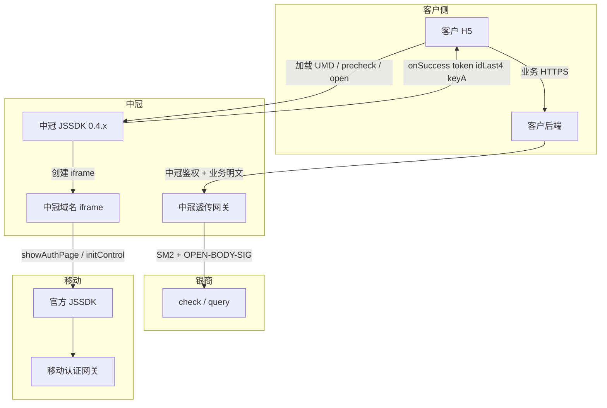

# 中冠银杏助理转售接入解决方案

> 版本：v1.0  
> 日期：2026-10-16  
> 现状代码：`assistance-mobile-auth`（前端 JSSDK / iframe）、`backend`（银商 check／query 联调样例）  
> 目标：对最终用户只暴露 **中冠前端 SDK + 中冠后端服务**；中冠服务再调用银商；SDK 大逻辑不变，继续对接 **移动官方前端 JSSDK**。  
> 银商对客契约仍见 `银杏助理客户接入文档（JSSDK前端＋银商后端）.md`。本文是在其之上增加中冠一层，不推翻 iframe／本机号／三要素链路。

---

## 目录

1. [需求与结论](#一需求与结论)
2. [现状](#二现状)
3. [目标架构](#三目标架构)
4. [中冠后端服务](#四中冠后端服务)
5. [中冠前端 SDK](#五中冠前端-sdk)
6. [密钥、appId 与域名](#六密钥appid-与域名)
7. [客户接入（改后）](#七客户接入改后)
8. [改造范围](#八改造范围)
9. [发布与版本](#九发布与版本)
10. [风险与待确认](#十风险与待确认)
11. [里程碑](#十一里程碑)

---

## 一、需求与结论

| 需求 | 落法 |
| --- | --- |
| 在银商接口上封装中冠服务工程，**透传**并调用银商 | 新建中冠网关：对外收 `token`／`idLast4`／`keyA`，对内按 `backend/Test2.java`、`Test3.java` 及现有 BFF `chinaums-assistant-client.ts` 调银商 check／query |
| `assistance-mobile-auth` 出新版本作为中冠前端 SDK | 以 0.3.2 专用包为基线打 **中冠发行包**（新 CDN／新 iframe 域名），对外工厂名与 `precheck` → `open` 保持不变 |
| 用户只和中冠 SDK、中冠服务交互 | 客户 H5 只加载中冠 SDK URL；客户后端只调中冠 check／query；银商 `appId`／`appKey`／SM2 私钥不出中冠 |
| SDK 大逻辑不变，只和中冠后端、移动前端交互 | iframe 内仍调移动 `showAuthPage`／`initControl`；浏览器**不直连**银商开放平台；若需服务端能力（演示核验、后续会话）只打中冠网关 |

**一句话：** 中冠做银商的转售层。取号授权仍在中冠 SDK 的 iframe 里走移动官方控件；身份核验查询由中冠服务代客调用银商。

```text
现网：  用户 ↔ 银商 SDK / 银商 check·query ↔ 移动
改后：  用户 ↔ 中冠 SDK / 中冠网关 ↔ 银商 check·query
                         ↕
                      移动官方 JSSDK（仍在 iframe 内）
```

---

## 二、现状

### 2.1 前端 `assistance-mobile-auth`

- 客户：`createAssistanceMobileAuthSdk` → `precheck({ scene: 'native-number' })` → `open`。  
- SDK 自建 iframe，内部生成移动参数并签名，调移动官方 `showAuthPage`（取号）、`initControl`（授权）。  
- 成功回 `{ token, idLast4, keyA }`。**wrapper 本身不调银商 check／query。**  
- 静态资源与 iframe 现网基址：`https://ginkgo.chinaums.com/sign-pay-pro/…`（0.3.2 专用包同此域）。  
- 仓库内 BFF（`bff/src/chinaums-assistant-client.ts`）已实现银商 SM2 加密 + `OPEN-BODY-SIG`，供演示页 `/mobile-assistant/verify`、`/identity` 使用，不是客户现网主路径。

### 2.2 后端 `backend`

- `Test2.java` → `POST …/encrypted/assistant/info/check`  
  明文：`requestId`、`token`、`servidL4`、`keyA`（另可有 `userNo`）  
- `Test3.java` → `POST …/encrypted/assistant/info/query`  
  明文：`requestId`、`token`（可有 `userNo`）  
- 共同机制：平台公钥 SM2 加密为 `{data}`；`Authorization: OPEN-BODY-SIG AppId, Timestamp, Nonce, Signature`；响应 `data` 用商户私钥 SM2 解密。  
- 成功：外层 `errCode=20000000`，解密后 `respCode=00`、`detailRespCode=0000`；query 还要求 `mobile`、`idCard` 非空。

### 2.3 现网职责缺口（改后要补上）

最终客户今天若直连银商，必须持有银商 `appId`／`appKey`／SM2 私钥。转售后这些只能留在中冠；客户只拿中冠颁发的调用凭据。

---

## 三、目标架构



| 边界 | 允许 | 禁止 |
| --- | --- | --- |
| 客户浏览器 | 中冠 SDK、中冠 iframe、移动官方脚本 | 银商 `appKey`、银商开放平台 URL、客户自绘号码栏 |
| 客户后端 | 调中冠 `/check`、`/query` | 直连 `api-mop.chinaums.com` / `test-api-open.chinaums.com` |
| 中冠网关 | 持有银商凭据，透传业务字段 | 把银商私钥返回给客户 |
| 中冠 iframe | 调移动前端、本机号取号授权 | 在浏览器里调银商 check／query |

SDK「和中冠后端交互」的含义：

1. **主路径（与 0.3.2 测试页相同）：** SDK 不发 check／query；客户后端发到中冠。  
2. **若发行带演示核验的 H5／BFF：** `VITE_MOBILE_ASSISTANT_API_BASE` 改成中冠网关，不再打银商演示 BFF。  
3. **iframe 资源、BOOT、postMessage origin：** 全部改为中冠静态域，不再依赖 `ginkgo.chinaums.com`（除非明确选择「SDK 仍托管在银商 CDN、仅后端走中冠」——见第十章）。

推荐：**前后端都切到中冠域名**，用户感知上不再出现银商。

---

## 四、中冠后端服务

### 4.1 定位

独立工程（建议 Java，便于直接复用 `backend` 的 SM2／`OPEN-BODY-SIG`；亦可把现有 Nest `chinaums-assistant-client.ts` 抽成中冠 Node 服务）。  
对客户是**业务透传网关**，对银商是**唯一调用方**。

「透传」指：**check／query 的业务语义、字段、成功码与银商一致**，不在中冠改核验规则。不指把银商密文信封原样丢给客户——银商密钥封装必须由中冠完成。

```text
客户后端                    中冠网关                         银商
  明文 { token, idLast4, keyA, … }
  + 中冠调用认证
        →  校验中冠调用方
           映射 requestId / userNo
           SM2(平台公钥) → {data}
           OPEN-BODY-SIG(银商 appId/appKey)
                →  POST …/info/check 或 query
           解 SM2 data
           验 20000000 + 00/0000
        ←  业务结果（可再加密给客户）
```

### 4.2 对外接口（给中冠的客户后端）

建议与银商同构两条，降低客户改造：

| 中冠路径（示例） | 对应银商 | 客户上送明文 |
| --- | --- | --- |
| `POST /v1/assistant/info/check` | `…/encrypted/assistant/info/check` | `token`、`idLast4`（→ `servidL4`）、`keyA`、可选业务 `requestId` |
| `POST /v1/assistant/info/query` | `…/encrypted/assistant/info/query` | 同一 `token`，不带后四位／`keyA` |

调用顺序不变：仅 check 业务成功后才允许 query。网关侧强制该顺序，防止客户跳过核验。

中冠调用认证（与银商凭据分离）：

| 方案 | 说明 | 建议 |
| --- | --- | --- |
| A. 中冠 `appId` + `appKey` 做与银商同形的 `OPEN-BODY-SIG` | 客户接入形态接近现网银商文档 | 若客户已有银商对接经验 |
| B. 网关 AK/SK 或 mTLS | 不把长期密钥放进 JSON | 新客户默认 |

**银商 `appId`／`appKey` 只配在中冠环境变量，不发给下游客户。**

### 4.3 对内调用（银商）

实现直接对齐 `backend/Test2.java`、`Test3.java` 与 `bff/src/chinaums-assistant-client.ts`：

1. 组装明文：check 含 `requestId`、`userNo`、`token`、`servidL4`、`keyA`；query 含 `requestId`、`userNo`、`token`。  
2. `requestId`／`userNo`：由中冠按商户配置映射，**不要假定等于**前端 `open({ requestId })`。  
3. SM2 加密、`OPEN-BODY-SIG`、HTTPS POST。  
4. 判断外层 `errCode` 与业务 `respCode`／`detailRespCode`。  
5. query：`mobile`、`idCard` 非空才算身份可用；`name` 可空。  
6. 将银商业务码与身份字段映射回中冠响应。身份字段默认继续以加密形态返回；若中冠代客做 SM4 解密，明文不得进入访问日志、不得默认回传到客户浏览器。

配置项（中冠私有）：

```text
测试套：CHINAUMS_TEST_APP_ID / APP_KEY / PRIVATE_KEY（可选 PLATFORM_PUBLIC_KEY、USER_NO）
生产套：CHINAUMS_PROD_APP_ID / APP_KEY / PRIVATE_KEY（可选 PLATFORM_PUBLIC_KEY、USER_NO）
```

测试／生产 URL 按《银杏盾开放平台 v2.0.1》，网关用 Spring Profile 切换（默认测试，避免误打生产）：

- 测试 `ums-test`：`https://test-api-open.chinaums.com/v1/datacenter/smartverification/encrypted/assistant/info/{check\|query}`  
- 生产 `ums-prod`：`https://api-mop.chinaums.com/v1/datacenter/smartverification/encrypted/assistant/info/{check\|query}`

### 4.4 网关附加能力（透传之上、建议做）

| 能力 | 原因 |
| --- | --- |
| 调用方鉴权与按商户限流 | 防止绕过客户业务、刷银商配额 |
| 审计：商户号、摘要、银商 `errCode`，禁止记 token／keyA／三要素明文 | 安全与排障 |
| 幂等键（客户 `requestId`） | 避免重复 check 消耗移动 token |
| 超时与错误码映射 | 银商 HTTP／业务失败转成中冠稳定码，同时保留原始码供联调 |
| 强制 check→query | 合同与风控 |

不在一期做：LaunchToken、改移动授权结果模型、前端只回 `resultCode`。

---

## 五、中冠前端 SDK

### 5.1 原则

**整体大逻辑不变。** 复制 0.3.2 专用包路径（`create` → 隐藏预检 iframe → 授权 iframe → 移动 `showAuthPage`／`initControl` → `{ token, idLast4, keyA }`）。

只改「资源归谁、origin 是谁、演示 API 打谁」：

| 保持 | 改为中冠 |
| --- | --- |
| `createAssistanceMobileAuthSdk`、五个回调 | 静态资源与 `custom-verification.html` 的 CDN／域名 |
| `precheck` → `open`、`scene: 'native-number'` | `VITE_SFT_PUBLIC_BASE_URL`、`trustedBusinessBaseUrl`、postMessage 允许的 parent／iframe origin |
| 不传移动 `authParams`（iframe 内签名） | 包名／文件名带中冠或新版本号 |
| 移动官方 JSSDK 取号授权 | 演示核验 API Base 指向中冠网关（若保留演示页） |
| 号码栏／确认／协议在 iframe 内 | 测试页文案与品牌（中冠，不再写银商助理测试页） |

客户浏览器与银商后端无直连；与移动的交互仍只发生在 iframe 内的官方 JSSDK。

### 5.2 建议交付物

参照 `vite.duodian-health032.config.ts` 增加中冠 flavor（示例）：

```text
assistance-mobile-auth.zhongguan.0.4.0.umd.cjs
assistance-mobile-auth.zhongguan.0.4.0.js
custom-verification.html          ← iframe 入口，部署在中冠域
```

测试页：克隆 `银商助理测试页 · 多点健康 TEMP 0.3.2.html`，仅替换 SDK URL 与品牌，接入代码段落保持「动态 script、不传 appId、precheck → open」。

全局名建议 **仍用** `window.AssistanceMobileAuth`，便于从 0.3.2 样例平滑替换 URL。若产品要求品牌隔离，可另导出 `ZhongguanMobileAuth` 作为别名，内部同一实现。

### 5.3 SDK 与中冠后端的关系

主接入路径下 SDK **仍然不调用** check／query（与现网一致，密钥不进浏览器）。

需要 SDK 调中冠后端的仅限后续增量，例如：

- 中冠签发短时配置／域名校验  
- 演示页一键核验  

一期可以不做。文档口径先固定：**授权结果由客户后端交给中冠网关。**

### 5.4 移动前端

iframe 继续加载中国移动官方 JSSDK（现材料为 1.0.6 能力：`showAuthPage`、`initControl`）。  
移动 `providerAppId`、取号签名材料仍在 iframe 内生成，**不由客户传入**。  
该移动应用归属（银商名下或中冠名下）由商务／运营商报备决定，不改变前端调用方式。

---

## 六、密钥、appId 与域名

| 凭据 | 持有 | 出现位置 |
| --- | --- | --- |
| 移动 `providerAppId` + 移动 sign 材料 | 中冠 iframe 运行时 | 仅 iframe → 移动 JSSDK |
| 银商开放平台 `appId`／`appKey` | 中冠网关 | 仅中冠 → 银商 `OPEN-BODY-SIG` |
| 银商 SM2 平台公钥／中冠解密私钥 | 中冠网关 | 加密请求／解密响应 |
| 中冠开放 `appId`／`appKey`（或 AK/SK） | 中冠颁发、客户后端持有 | 客户 → 中冠网关 |
| 前端 `token`／`idLast4`／`keyA` | 短时经过客户前端 | 不得写日志／storage；尽快交给客户后端 |

域名：

| 主机 | 用途 |
| --- | --- |
| 中冠 SDK CDN | UMD、样式、iframe HTML |
| 客户业务 H5 | 宿主页，需纳入中冠／移动侧域名白名单 |
| 中冠 API | check／query 网关 |
| 移动官方脚本域 | iframe 内加载，不经中冠改写 |

**若 iframe 从 `ginkgo.chinaums.com` 迁到中冠域：** 必须向移动报备新 origin，否则 `showAuthPage` 会失败。这是本方案最大联调风险。

---

## 七、客户接入（改后）

与现网 0.3.2 相比，客户只换两处地址。

**前端**

```js
const sdkUrl = 'https://<中冠CDN>/assist/0.4.0/assistance-mobile-auth.zhongguan.0.4.0.umd.cjs'
// create / precheck / open 与 TEMP 0.3.2 测试页相同，不传 appId、authParams
```

**后端**

```text
原：客户 → 银商 check / query（客户持有银商 appKey、SM2）
现：客户 → 中冠 check / query（客户持有中冠凭据）
     中冠 → 银商 check / query（中冠持有银商凭据）
```

成功判定对客户文档仍写：先 check 三码，再 query，且 `mobile`／`idCard` 非空。中冠响应字段与银商业务体对齐，便于对照联调。

---

## 八、改造范围

### 8.1 中冠网关（新建）

| 编号 | 项 |
| --- | --- |
| G1 | 工程骨架、配置、密钥托管（银商凭据不入库明文日志） |
| G2 | 复用 Test2／Test3 或 `chinaums-assistant-client` 调银商 |
| G3 | 对外 check／query、调用方鉴权 |
| G4 | `requestId`／`userNo` 按商户映射 |
| G5 | 错误码透传 + 中冠包装 |
| G6 | 测试／生产环境与联调账号 |

### 8.2 `assistance-mobile-auth`（新版本，不改 0.3.2 现网包行为）

| 编号 | 项 |
| --- | --- |
| F1 | 中冠 flavor 构建配置（对齐 `vite.duodian-health032.config.ts`） |
| F2 | 替换 `VITE_SFT_PUBLIC_BASE_URL`、iframe URL、origin 白名单 |
| F3 | 中冠测试页（由 0.3.2 HTML 改 URL／文案） |
| F4 | 构建产物与发布脚本 |
| F5 | 回归：precheck、open、移动控件、成功三字段、destroy |
| F6 | 可选：演示 identityFlow 的 API Base 指向中冠 |

**不改：** `showAuthPage`／`initControl` 时序、15 秒展示期限、预检 12 秒、成功载荷形状、客户不传 `authParams`。  
**不改文档：** `银杏助理JSSDK完整页面嵌入自有H5落地方案.md`（mount 仍后续）。

### 8.3 不改银商

银商 check／query 协议、移动官方 JSSDK、客户三要素业务含义均不改。

---

## 九、发布与版本

| 包 | 版本建议 | 说明 |
| --- | --- | --- |
| 银商现网专用包 | 保持 0.3.2 | 多点等已接客户不受影响 |
| 中冠 SDK | `0.4.0` 或 `zhongguan.0.4.0` | 从 0.3.2 打标签分支出去 |
| 中冠网关 | 独立服务版本 | 与 SDK 约定兼容矩阵（先 0.4.0 ↔ 网关 v1） |

发布顺序：网关联通银商测试环境 → 中冠 SDK 打 TEMP 包 → 中冠测试页走通授权 → 客户后端打中冠 check／query → 生产白名单与密钥。

---

## 十、风险与待确认

| 项 | 说明 | 需要拍板 |
| --- | --- | --- |
| 移动域名白名单 | iframe 换中冠域必须报备 | 是否一期就迁 iframe 域，或 SDK 暂时仍走银商 CDN、仅网关中冠化 |
| 移动应用归属 | `providerAppId` 用银商的还是中冠新申请 | 商务／运营商 |
| 中冠对外协议 | 简化 HTTPS JSON vs 再包一层 SM2 | 推荐一期简化 JSON + 中冠 AK/SK |
| 身份解密 | query 加密字段由中冠解还是客户解 | 推荐中冠解信封后，把银商业务字段按约定（仍加密或脱敏）回给客户后端 |
| 品牌与全局名 | 是否保留 `AssistanceMobileAuth` | 推荐保留以降低接入成本 |
| 配额与责任 | 银商限流记在中冠名下 | 中冠需按客户做配额 |

备选（不推荐做默认）：SDK 继续加载 `ginkgo.chinaums.com` iframe，只把 check／query 换成中冠。用户浏览器仍会出现银商域，与「只和中冠交互」不完全一致，但可规避一期移动白名单。

---

## 十一、里程碑

1. **M1 网关打通银商测试 check／query**（用现有 `backend` 样例数据验证封装）。  
2. **M2 中冠 SDK 0.4.0 TEMP + 测试页**（授权成功仍回三字段，不调银商）。  
3. **M3 客户样例后端改打中冠网关**，走完 check→query。  
4. **M4 移动白名单／生产密钥／限流审计**。  
5. **M5 客户接入文档（中冠版）** 从银商客户文档改地址与凭据说明后发布。

---

## 附录 A 调用链（改后）

```text
客户点击
  → 中冠 SDK.load + create + precheck(native-number)
  → 中冠 iframe.showAuthPage（移动取号，掩码号）
  → open → initControl → 用户确认
  → 移动签发 token + encryptPublicKey
  → onSuccess { token, idLast4, keyA }
  → 客户后端 POST 中冠 /check
  → 中冠 SM2+OPEN-BODY-SIG → 银商 /check
  → 中冠 POST 银商 /query
  → 客户后端拿到加密三要素，继续业务
```

## 附录 B 现成可复用代码

| 代码 | 用于中冠 |
| --- | --- |
| `backend/Test2.java`、`Test3.java` | 银商 check／query 报文与签名 |
| `backend/OpenDemo/.../util/SM2.java` | SM2 加解密 |
| `assistance-mobile-auth/bff/src/chinaums-assistant-client.ts` | 同一协议的 Node 实现与成功码解析 |
| `assistance-mobile-auth` 0.3.2 duodian flavor | 中冠 SDK 构建模板 |
| `iframe/银商助理测试页 · 多点健康 TEMP 0.3.2.html` | 中冠测试页模板 |

## 附录 C 相关文档

| 文档 | 关系 |
| --- | --- |
| `银杏助理客户接入文档（JSSDK前端＋银商后端）.md` | 银商直连契约；中冠版对外文档的底稿 |
| `银杏助理JSSDK＋iframe新方案架构.md` | iframe／移动取号内部时序，中冠 SDK 保持该逻辑 |
| LaunchToken 方案 | 不纳入本期中冠转售 |
