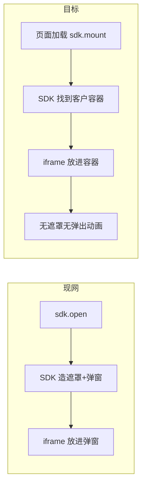

# 银杏助理 JSSDK：完整页面嵌入自有 H5 落地方案

> 版本：v1.0  
> 日期：2026-09-01  
> 依据：现网《银杏助理 JSSDK 接入说明 v1.4.3》；客户诉求「去掉弹窗跳转感，授权区成为业务页一部分」  
> 范围：前端展示形态。认证结果仍走现网弹层链路（`token / idLast4 / keyA` → 客户后端 check / query）。LaunchToken 若同期上线，见第八章。

---

## 目录

1. [方案目标](#一方案目标)
2. [现状与目标形态](#二现状与目标形态)
3. [核心原则（不可突破）](#三核心原则不可突破)
4. [JSSDK 接口设计](#四jssdk-接口设计)
5. [客户前端接入步骤](#五客户前端接入步骤)
6. [我方改造清单](#六我方改造清单)
7. [页面元素与样式](#七页面元素与样式)
8. [与 LaunchToken / 现网弹层的关系](#八与-launchtoken--现网弹层的关系)
9. [异常与降级](#九异常与降级)
10. [联调与验收](#十联调与验收)

---

## 一、方案目标

### 1.1 客户痛点

当前 `sdk.open()` 后，JSSDK 在客户页上盖遮罩、播底部弹出动画，再加载跨域授权页。用户感知为卡顿、延迟、突兀。

### 1.2 落地目标

把授权完整页嵌进客户自有 H5 的指定区域：

- 不要遮罩、不要底部弹层、不要弹出动画。
- 业务页加载时即可看到授权区（骨架先出，真实掩码号随取号完成填入）。
- 区内保留：掩码手机号、中间段固定文案、四位输入框、确认按钮、底部协议。

### 1.3 非目标（明确不做）

| 不做 | 原因 |
| --- | --- |
| 把号码栏、协议、确认按钮做成客户自己的 DOM | 移动认证禁止破解/隐藏号码栏、隐私栏、品牌露出；容器自定义已因域名/资质对外关闭 |
| 客户页面首屏像素级同步出真实掩码号 | 掩码号依赖移动网关取号，必须等网络 |
| 改变 check / query 结果链路 | 本次只改展示形态 |
| 废弃现网弹层模式 | 存量客户继续用 `display: 'overlay'`（默认） |

---

## 二、现状与目标形态

### 2.1 现网（弹层 overlay）

iframe **仍是我们 JSSDK 创建的**。客户不写 iframe。SDK 在 `open()` 时把 iframe 放进自己做的遮罩弹窗里。

```text
客户 H5（URL 不变）
  └─ JSSDK 动态插入：全屏遮罩
        └─ 底部弹窗
              └─ iframe → https://ginkgo.chinaums.com/sign-pay-pro/verification
```

### 2.2 目标（容器内嵌 inline）

iframe **还是我们 JSSDK 创建、还是加载同一授权页**。只是放到客户预留的 DOM 节点里，不再造遮罩和弹窗。

```text
客户 H5
  ├─ 客户标题 / 办理说明
  ├─ <div id="ums-auth-slot">          ← 客户预留容器
  │     └─ iframe（JSSDK 插入）→ 同一授权页 /verification
  └─ 客户其它业务模块
```



**「容器内嵌 iframe」一句话：** 客户在页面上留一个空盒子；我们的 SDK 把授权 iframe 塞进这个盒子，成为业务排版的一部分。

---

## 三、核心原则（不可突破）

1. 授权 UI 必须在我方域名的 iframe 内渲染（官方号码栏、确认、协议）。
2. 客户不得用 CSS/遮罩覆盖 iframe 内号码栏、协议、品牌露出。
3. 客户不得自行配置授权页 URL。
4. 同一页面只引一种模块格式，只创建一个 SDK 实例。
5. `appKey` 不得下发浏览器；`appId` 只在创建实例时传入。

---

## 四、JSSDK 接口设计

在现网 `createAssistanceMobileAuthSdk` / `open` / `close` / `destroy` / `precheck` 上增量，默认行为保持弹层，存量客户无感。

### 4.1 创建实例：新增展示模式

```js
const sdk = createAssistanceMobileAuthSdk({
  appId: '<your_app_id>',
  display: 'inline',                 // 新增。默认 'overlay'（现网弹层）
  container: '#ums-auth-slot',       // display=inline 时必填。CSS 选择器或 HTMLElement
  authWindowHeightMode: 'auto',      // 建议内嵌用 auto，高度随内容/键盘变化
  authWindowMaxHeight: '100%',       // 内嵌时相对容器，不再默认 820px 弹窗上限（实现时与容器约定）
  useCustomKeyboard: true,           // 与现网一致；false 则用系统键盘
  onReady() {},
  onPhoneReady(payload) {},          // 真实掩码号就绪，可关骨架
  onSuccess(payload) {},
  onCancel() {},
  onError(error) {},
  onErrorNotice(payload) {},         // Wi-Fi / 非移动号等，内嵌区展示提示
  onClose() {},
  styleOption: { /* 与现网相同，协议区仍由我方维护 */ },
  agreements: [{ name: '《业务方用户协议》', link: 'https://...' }],
})
```

| 参数 | 必填 | 说明 |
| --- | --- | --- |
| `display` | 否 | `'overlay'` 默认；`'inline'` 容器内嵌 |
| `container` | `inline` 时是 | 客户预留节点。找不到则 `onError`，不降级弹层 |
| 其它 | 同 v1.4.3 | `closable` 在 inline 下默认 `false`（无弹窗 X）；客户用自己的返回键 |

`display: 'inline'` 且未传 `container`：创建失败或首次 `mount` 失败，错误码建议 `CONTAINER_MISSING`。

### 4.2 新增 `mount`：进页即挂载

内嵌模式不要等用户点「下一步」才加载 iframe。页面就绪后立刻挂载、取号。

```js
await sdk.mount({
  scene: 'native-number',
  requestId: 'merchant-request-202609010001',
})
```

| 行为 | 说明 |
| --- | --- |
| 创建 iframe 并插入 `container` | 无遮罩、无弹出动画 |
| 加载 `/verification` | 与弹层同一授权页 |
| 发起取号 | 骨架可见；`onPhoneReady` 后填真实掩码号 |
| 确认按钮 | 取号成功前保持禁用（授权页内控制） |
| 与 `open()` 关系 | `mount` 负责展示；用户点确认仍走授权页内部提交。若需显式激活，`open()` 在已 mount 时不再弹层，仅确保会话可用 |

建议约定：

- **inline：** 业务页 `onMounted` 调 `mount()`；用户点确认在 iframe 内完成；成功走现有 `onSuccess`。
- **overlay：** 不调 `mount`，继续只调 `open()`。

`open()` 在 `display: 'inline'` 且尚未 `mount` 时：自动先 `mount` 再等待成功结果（兼容「只改 display、仍写 open」的接入）。已 `mount` 再调 `open()`：不重复插 iframe，返回同一个进行中的 Promise。

### 4.3 关闭与销毁

```js
sdk.unmount()   // 新增：移走 iframe，容器留空；不销毁 SDK 实例
sdk.destroy()   // 现网已有：卸载监听、移除 iframe、实例不可再用
```

页面离开必须 `destroy()`。`close()` 在 overlay 关弹窗；在 inline 上等价于 `unmount()` 或仅重置授权态（实现时二选一，建议 **inline 的 close = unmount**）。

### 4.4 高度

| 模式 | 建议 |
| --- | --- |
| overlay | 保持现网：默认约 `92dvh`，或 `auto` |
| inline | 默认 `authWindowHeightMode: 'auto'`；iframe `width: 100%`；高度 postMessage 同步给 SDK，SDK 写到 iframe 元素上，避免容器被裁切协议 |

客户容器 CSS 建议：

```css
#ums-auth-slot {
  width: 100%;
  min-height: 420px; /* 与现网 auto 初始高度对齐，减少跳动 */
}
```

客户不得给容器设 `overflow: hidden` 导致协议不可见。

---

## 五、客户前端接入步骤

### 5.1 前置条件

1. 已有现网弹层接入能力（`appId`、域名白名单）。
2. 业务页已报备，可被我方授权页作来源校验。
3. 页面预留容器，且在 `mount` 前已存在于 DOM。

### 5.2 引用（与现网相同）

UMD：

```html
<script src="https://ginkgo.chinaums.com/sign-pay-pro/assist/0.2.0/assistance-mobile-auth/assistance-mobile-auth.0.2.0.umd.cjs"></script>
```

版本号以正式发布的内嵌版为准（建议新版本号，例如 `0.3.0`，避免旧 SDK 读到新参数却不生效）。

### 5.3 页面结构

```html
<section class="biz-page">
  <h1>业务办理</h1>
  <p>请使用本机移动号码完成认证</p>

  <!-- 仅占位，不要在内部再写 iframe / 号码 / 协议 -->
  <div id="ums-auth-slot" aria-label="身份认证"></div>
</section>
```

### 5.4 完整示例（Vue 3）

```html
<template>
  <div class="page">
    <h1>业务办理</h1>
    <div v-if="loadingMask" class="skeleton">认证组件加载中</div>
    <div id="ums-auth-slot" />
  </div>
</template>

<script setup>
import { onMounted, onBeforeUnmount, ref } from 'vue'
import { createAssistanceMobileAuthSdk } from
  'https://ginkgo.chinaums.com/sign-pay-pro/assist/0.2.0/assistance-mobile-auth/assistance-mobile-auth.0.2.0.js'

const loadingMask = ref(true)
let sdk

onMounted(async () => {
  sdk = createAssistanceMobileAuthSdk({
    appId: '<your_app_id>',
    display: 'inline',
    container: '#ums-auth-slot',
    authWindowHeightMode: 'auto',
    onPhoneReady() { loadingMask.value = false },
    onSuccess: async (payload) => {
      await fetch('/api/mobile-auth/check', {
        method: 'POST',
        headers: { 'Content-Type': 'application/json' },
        body: JSON.stringify({
          token: payload.token,
          idLast4: payload.idLast4,
          keyA: payload.keyA,
          requestId: payload.requestId,
        }),
      })
    },
    onErrorNotice(err) {
      // 在业务页展示：请切换到中国移动数据网络 等
      console.info(err)
    },
    onError(err) {
      console.error(err)
    },
  })

  await sdk.mount({ scene: 'native-number', requestId: 'biz-20260901-001' })
})

onBeforeUnmount(() => { sdk?.destroy() })
</script>
```

### 5.5 客户侧禁止事项

- 不在容器内预置第二套手机号、四位框、协议（会造成双 UI，且审查风险）。
- 不用 CSS 把 iframe 高度截成看不到协议。
- 不把 `token / idLast4 / keyA` 展示在页面上。
- 不调用 `session/resolve`、`session/complete`。

### 5.6 成功后后端（不变）

前端只交 `token`、`idLast4`、`keyA`；客户后端 check → query → 自有 SM4 解密。

---

## 六、我方改造清单

### 6.1 JSSDK（主改）

| 编号 | 项 | 优先级 |
| --- | --- | --- |
| S1 | 增加 `display` / `container`；默认 overlay 行为零回归 | P0 |
| S2 | 实现 `mount` / `unmount`；inline 下插入 iframe 到容器 | P0 |
| S3 | inline 不创建遮罩、不播弹出/收起动画、不锁整页滚动（容器内滚动自行处理） | P0 |
| S4 | `open()` 与 `mount` 去重：已有 iframe 不二次插入 | P0 |
| S5 | iframe 高度随授权页 postMessage 更新 | P0 |
| S6 | `CONTAINER_MISSING` / `CONTAINER_NOT_IN_DOM` 错误码 | P0 |
| S7 | 预加载：`mount` 即加载授权页并取号（对应「进页展示」） | P0 |
| S8 | 文档、UMD/ESM 示例、测试页增加 inline 演示 | P0 |
| S9 | 新版本号发布，旧 0.2.0 保持 overlay | P0 |

### 6.2 授权页 `/verification`

| 编号 | 项 | 优先级 |
| --- | --- | --- |
| P1 | 识别父页模式（postMessage：`display=inline`），去掉自身「弹窗标题栏 / 圆角抽屉皮肤」（若皮肤画在授权页上） | P0 |
| P2 | inline 下默认不渲染左上角关闭 X | P0 |
| P3 | 取号完成前展示骨架（掩码位、四格、禁用确认、协议位） | P0 |
| P4 | 继续渲染：号码栏、中间文案、四位输入、确认、底部协议 | P0 |
| P5 | 高度变化通知父 SDK | P0 |
| P6 | `onErrorNotice` 文案在 iframe 内可见，同时抛给宿主 | P1 |

### 6.3 不改或少改

- 移动官方 JSSDK 取号 / `initControl` 链路。
- check / query、appId 职责。
- H5 整页跳转 `/auth`（与本次内嵌无关）。

### 6.4 建议排期

1. SDK 挂载模式 + 去遮罩（可先在测试页用固定容器验证）。  
2. 授权页去抽屉皮肤 + 骨架 + 高度同步。  
3. 目标客户一页真机（微信、Safari、Android WebView）。  
4. 出 0.3.x 文档后灰度。

---

## 七、页面元素与样式

嵌入区内必须保留、且仍在 iframe 内由我方/官方渲染：

| 元素 | 来源 | 客户可否自绘 | 样式 |
| --- | --- | --- | --- |
| 掩码手机号 | 移动官方号码栏 | 否 | `styleOption.phoneStyle` |
| 中间段文案（本机号提示等） | 我方/官方提示 | 否 | `localTipStyle` / `unlocalTipStyle` |
| 身份证后四位四格 | 我方自绘 | 否（不可拆到宿主） | `useCustomKeyboard` |
| 确认按钮 | 官方，文案含确认/授权 | 否 | `submitBtnStyle` |
| 底部协议 | 我方强制维护 | 否；只能 `agreements` 追加 | `agreeStyle` 传入无效 |

「加载时同步展示」落地口径：

```text
T0  业务页出现，容器内已有 iframe 骨架（号码占位、四格、按钮禁用、协议结构）
T1  取号成功 → onPhoneReady → 真实掩码号
T2  用户输入后四位并确认 → onSuccess
```

不承诺 T0 即真实号码。进页取号是否计费，联调时与移动侧确认。

---

## 八、与 LaunchToken / 现网弹层的关系

| 能力 | 关系 |
| --- | --- |
| 现网弹层 | 默认保留。`display` 缺省 = `overlay` |
| 内嵌 | 新模式，按客户页灰度 |
| LaunchToken | 正交。若强制令牌：`mount` 只读校验、不核销；用户确认兑换时再核销。避免进页预加载把一次性令牌用掉 |
| H5 转跳 | 不替代内嵌；仅弹层彻底不可用时使用 |

---

## 九、异常与降级

| 场景 | 处理 |
| --- | --- |
| 容器不存在 | 失败，不自动改 overlay（避免客户以为已经内嵌） |
| 取号失败（Wi-Fi / 非移动号） | iframe 内提示 + `onErrorNotice`；按钮不可用 |
| 授权页加载失败 | `onError`；容器可显示客户兜底文案 |
| iframe 被客户 CSS 裁切 | 验收不通过；文档明确禁止 |
| 旧 SDK 无 inline | 客户必须升级到内嵌版资源地址 |

**不降级：** 内嵌失败时不得偷偷改弹层，除非客户显式 `display: 'overlay'`。

---

## 十、联调与验收

### 10.1 功能

- [ ] 业务页加载后容器内出现授权区，无全屏遮罩、无底部弹出动画  
- [ ] 掩码号、中间文案、四格、确认、协议均在 iframe 内且可见  
- [ ] `onPhoneReady` 后号码为真实掩码，非长期占位  
- [ ] 确认后宿主收到 `token / idLast4 / keyA`，后端 check / query 成功  
- [ ] 协议可打开，无遮挡  
- [ ] `destroy` 后容器内无残留 iframe  

### 10.2 真机

- [ ] 微信内置浏览器、Safari、Android Chrome / WebView  
- [ ] 系统键盘与安全键盘两种；`auto` 高度不被键盘挡住确认/协议  
- [ ] 横竖屏、长协议页滚动发生在合理区域  

### 10.3 合规

- [ ] 号码栏、协议、确认未被宿主覆盖  
- [ ] 未在客户域直调官方 `showAuthPage`  

### 10.4 待双方确认

1. 内嵌版 SDK 版本号与资源 URL。  
2. 进页取号是否消耗配额。  
3. 首个试点页面 URL 与容器选择器。  
4. inline 下 `closable` / 客户返回键与 `unmount` 的产品交互。

---

## 附录：一句话对照

| 说法 | 含义 |
| --- | --- |
| iframe 是谁的 | 我们 JSSDK 运行时插入，客户不用写 |
| 容器是谁的 | 客户 H5 里预留的 `div` |
| 内嵌改了什么 | iframe 从「弹窗里」挪到「客户的 div 里」，去掉遮罩 |
| 没改什么 | 授权页域名、官方控件、结果字段、后端 check/query |
