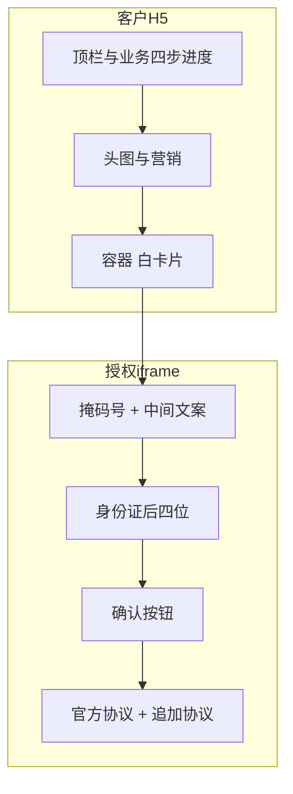

# 银杏助理 JSSDK 容器内嵌：Figma UI 可行性分析

> 版本：v1.0  
> 日期：2026-09-01  
> 对照方案：`银杏助理JSSDK容器内嵌本期方案.md`（本期只做容器内嵌，不含 `mount`）  
> 设计稿：[Figma Untitled](https://www.figma.com/design/uJdWIH4EqWLtZ81bqvqEhG/Untitled?node-id=0-1&p=f&t=2cn0OtZO1AuRPKP2-0)  
> 结论：**客户外壳可行；白卡片不能按现稿 1:1 作为授权区。** 卡片必须整块作为我们的授权 iframe，并补齐强制元素。

---

## 目录

1. [结论](#一结论)
2. [稿面结构](#二稿面结构)
3. [与本期方案的对应关系](#三与本期方案的对应关系)
4. [可行项](#四可行项)
5. [冲突项（必须改稿或改预期）](#五冲突项必须改稿或改预期)
6. [建议切分](#六建议切分)
7. [本期 / 后续边界](#七本期--后续边界)
8. [设计改稿清单](#八设计改稿清单)

---

## 一、结论

| 判断 | 说明 |
| --- | --- |
| 外壳 UI | **可行。** 顶栏、业务四步进度、橙色头图、吉祥物、营销文案由客户 H5 绘制。 |
| 白卡片 = 整块授权 iframe | **可行，但现稿不够。** 须补掩码号与中间文案，去掉卡片内业务进度，修正按钮文案与协议。 |
| 白卡片按现稿视觉 1:1 嵌入 | **不可行。** 缺强制元素，且把客户流程 UI 画进了授权区。 |
| 只把四格交给我们、其余客户自绘 | **不可行。** 本期是整页授权 iframe 插入容器，不能拆控件。 |
| 打开业务页即看到卡片内容 | **本期不做。** 仍须用户触发 `sdk.open()`；进页展示见后续 `mount` 方案。 |

本期能力一句话：客户预留容器，`open()` 后 JSSDK 把**同一套授权页**（掩码号、中间文案、四格、确认、底部协议）插入该容器，无遮罩、无底部弹层。号码栏、确认、协议不得做成客户 DOM，也不得隐藏。

---

## 二、稿面结构

稿为两屏手机稿（四格空态 / 填入态），结构相同。

### 2.1 客户外壳（宿主 H5）

- 状态栏、顶栏关闭「X」与「…」
- 四步进度：登录 → 完善信息 → 开通保障 → 确认信息（外层高亮「登录」）
- 橙色头图、吉祥物
- 文案：「hi, 欢迎登录 为您甄选推荐」「600万健康守护金」

### 2.2 白卡片（稿上的交互区）

- **卡片内又一条**四步进度（稿上高亮「完善信息」，与外层「登录」不一致）
- 说明：「输入本人身份证后四位」
- 四个方格输入（左屏空、右屏示例「8」）
- 主按钮：「立即保障」，右侧有手指点击示意
- 未勾选圆点 + 蓝色协议链（重大疾病保险、产品方案、健康告知、服务协议、隐私政策等）

稿底部另有「立即保障」按钮与手指图标的切图，视为组件素材。

---

## 三、与本期方案的对应关系

| 稿面区域 | 本期该谁渲染 | 说明 |
| --- | --- | --- |
| 顶栏、外层四步进度、头图、吉祥物、营销文案 | 客户 H5 | 与授权 iframe 无关，可行 |
| 白卡片整体 | 必须是我们 iframe 的容器 | 客户只留 `div`，不写号码/四格/协议 |
| 卡片内业务进度条 | 不应进入 iframe | 属客户流程，应只留在外壳 |
| 掩码手机号、运营商中间文案 | iframe 内强制保留 | **现稿缺失** |
| 身份证后四位四格 | iframe 内，可保留视觉 | 与现网四格能力一致 |
| 「立即保障」按钮 | iframe 内官方确认按钮 | 文案须含确认/授权等合规字样 |
| 底部协议 | iframe 内由我方维护 | 可 `agreements` 追加保险条款，不能替换官方协议 |

iframe 仍由 JSSDK 在 `open()` 时插入，客户不用自己写 `<iframe>`。

---

## 四、可行项

1. **去弹层、做成业务页一块**  
   客户画外壳与头图，中间用白卡片作 `container`。圆角、叠在橙色背景上，用客户 CSS 即可，符合本期「容器内嵌」。

2. **四格输入**  
   与现网身份证后四位一致，空态/输入态都可做。

3. **协议放在授权区底部**  
   结构正确；内容须包含移动认证相关协议，保险条款只能追加。

4. **触发时机**  
   若白卡片出现在用户点击「登录」之后再 `open()`，与本期一致。  
   若要求一进 H5 就已有四格，则不属于本期。

5. **手指动效 / 营销切图**  
   可放在客户层、不要盖住号码栏和协议。不要作为 iframe 内必做项。

---

## 五、冲突项（必须改稿或改预期）

### 5.1 卡片内没有掩码号和中间文案

本期及移动安全基座要求：号码栏、中间提示不可隐藏、不可由客户自绘替代。

现稿白卡片从「输入身份证后四位」起跳，**按现稿落地会审查不合格。**

**改法：** 卡片顶部增加官方掩码手机号 + 本机号等中间文案，再接下四位。

### 5.2 卡片内重复的业务进度条

「登录 / 完善信息 / 开通保障 / 确认信息」是客户业务流程，不应画进授权页。

稿上还出现外层停在「登录」、内层停在「完善信息」，状态不一致。

**改法：** 进度只保留在客户外壳；iframe 内删除第二条进度。

### 5.3 主按钮「立即保障」

移动要求授权按钮文案包含「同意」「授权」「确认」「登录」「注册」「绑定」等，不得纯营销诱导。

**改法：** 例如「确认并立即保障」，或 `submitBtnStyle.name` 使用含「确认 / 授权」的文案。颜色可用橙色以贴近稿面。

### 5.4 底部仅有保险类协议

iframe 必须保留我方维护的移动认证 / 收付通 / 数盾等协议。客户产品条款通过 `agreements` 追加，不能替换。

**改法：** 官方协议保留（或收在「用户服务协议」二级）；保险相关链接追加在后。勾选框默认未勾选，与官方习惯一致。

### 5.5 不能「掏空」只嵌四格

若期望号码、进度、按钮、协议均为客户 DOM，仅四格由我们提供——**本期与完整嵌入方案均不允许。**

只能：白卡片整块 = 授权 iframe（号 + 文案 + 四格 + 按钮 + 协议）。

---

## 六、建议切分

```text
客户 H5（外壳，客户绘制）
  ├─ 顶栏 X / …
  ├─ 四步进度：登录 | 完善信息 | 开通保障 | 确认信息
  ├─ 橙色头图、吉祥物、「600万健康守护金」等
  └─ <div id="ums-auth-slot">                 ← 白卡片容器
        └─ iframe（用户 open 后由 JSSDK 插入）
              ├─ 掩码手机号 + 中间文案          ← 现稿需补
              ├─ 「输入本人身份证后四位」+ 四格
              ├─ 确认类主按钮（可橙色）
              └─ 官方协议 + 客户追加的保险协议
```



---

## 七、本期 / 后续边界

| 项 | 本期容器内嵌 | 后续完整嵌入（mount，原文档不改） |
| --- | --- | --- |
| iframe 位置 | 客户白卡片容器 | 同左 |
| 何时出现授权区 | `sdk.open()` 之后 | 进页 `mount()`，骨架可先出 |
| 强制元素 | 号 / 文案 / 四格 / 确认 / 协议 | 同左 |
| 与本 Figma | 外壳 + 改后的整卡 iframe | 若需首屏即卡片内容，等 mount |

---

## 八、设计改稿清单

改稿通过后再联调 UI，建议按下列勾选：

- [ ] 外壳：顶栏、外层进度、头图、营销保留，由客户 H5 实现  
- [ ] 白卡片内删除业务四步进度  
- [ ] 白卡片顶部增加掩码手机号 + 运营商中间文案（官方组件位，不可改成纯文字冒充）  
- [ ] 保留「输入本人身份证后四位」+ 四格  
- [ ] 主按钮文案含确认或授权；手指装饰不遮挡号码与协议  
- [ ] 协议区含官方必选协议，保险条款作为追加  
- [ ] 外层进度与真实步骤一致（避免内外两套进度互相矛盾）  
- [ ] 标注 `#ums-auth-slot` 即整张白卡片；注明卡片内容为 iframe，客户不在卡片内再画一套控件  
- [ ] 若交互是「进页就有卡片」：在稿上标注依赖后续 mount，不纳入本期验收  

---

## 附录：本期硬约束（摘录）

1. 授权 UI 必须在我方域名 iframe 内（官方号码栏、确认、协议）。  
2. 不得用 CSS 覆盖或裁切号码栏、协议。  
3. `display: 'inline'` + `container`，触发仍为 `open()`。  
4. 找不到容器则失败，不自动降级为弹层。  

详细接口与改造清单见 `银杏助理JSSDK容器内嵌本期方案.md`。
