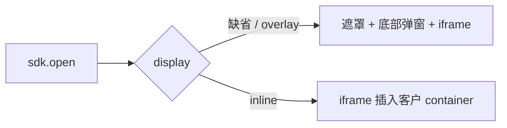

# 银杏助理 JSSDK：容器内嵌（本期，不含 mount）

> 版本：v1.0  
> 日期：2026-09-01  
> 本期范围：**只改展示位置**——iframe 放进客户预留容器，去掉遮罩和底部弹层。  
> **不做：** `mount` / `unmount`、进页预加载、加载时同步展示授权区。  
> 完整目标（含 mount）见《银杏助理JSSDK完整页面嵌入自有H5落地方案.md》，该文档不改，后续再做。  
> 结果链路不变：`token / idLast4 / keyA` → 客户后端 check / query。

---

## 目录

1. [本期做什么、不做什么](#一本期做什么不做什么)
2. [形态对比](#二形态对比)
3. [核心原则](#三核心原则)
4. [接口约定](#四接口约定)
5. [客户接入](#五客户接入)
6. [我方改造](#六我方改造)
7. [元素与样式](#七元素与样式)
8. [异常与验收](#八异常与验收)
9. [与后续 mount 的衔接](#九与后续-mount-的衔接)

---

## 一、本期做什么、不做什么

### 1.1 做什么

客户 H5 预留一个容器。用户仍调用现网的 `sdk.open()`。JSSDK 不再盖遮罩、不再底部弹出，而是把**同一个授权 iframe** 插入该容器。

### 1.2 不做什么（留给《完整页面嵌入》文档）

| 本期不做 | 说明 |
| --- | --- |
| `sdk.mount()` / `sdk.unmount()` | 不新增进页挂载 API |
| 业务页一打开就出现授权区 | 仍是用户触发 `open()` 之后才插 iframe、才取号 |
| 进页骨架 / 同步展示二要素 | 不承诺打开页面即看到号码栏 |
| 改变 check / query | 与现网弹层相同 |
| 废弃 overlay | 不传 `display` 时仍是弹层 |

---

## 二、形态对比

### 2.1 现网 overlay

```text
客户点击 sdk.open()
  └─ SDK 插入全屏遮罩 + 底部弹窗
        └─ iframe → /verification
```

### 2.2 本期 inline

```text
客户点击 sdk.open()
  └─ SDK 找到 #ums-auth-slot
        └─ iframe 直接插入该容器 → 同一 /verification
        └─ 无遮罩、无弹出动画
```



iframe 仍由 **JSSDK 运行时创建**，客户不用写 `<iframe>`。变的只是插入点：弹窗盒子 → 客户的 div。

---

## 三、核心原则

1. 号码栏、确认按钮、协议必须在我方授权页 iframe 内，客户不可自绘。
2. 不得用 CSS 覆盖或裁切 iframe 内号码栏、协议。
3. 客户不配置授权页 URL。
4. 同一页一个 SDK 实例；`appId` 只在创建时传；`appKey` 不下发浏览器。
5. `display: 'inline'` 时 `container` 必填；找不到容器则失败，**不自动改回弹层**。

---

## 四、接口约定

在现网 `createAssistanceMobileAuthSdk`、`open`、`close`、`destroy`、`precheck` 上增量。不新增 `mount`。

### 4.1 创建实例

```js
const sdk = createAssistanceMobileAuthSdk({
  appId: '<your_app_id>',
  display: 'inline',              // 本期新增。默认 'overlay'
  container: '#ums-auth-slot',    // display=inline 时必填，选择器或 HTMLElement
  authWindowHeightMode: 'auto',   // 内嵌建议 auto
  useCustomKeyboard: true,
  onReady() {},
  onPhoneReady(payload) {},
  onSuccess(payload) {},
  onCancel() {},
  onError(error) {},
  onErrorNotice(payload) {},
  onClose() {},
  styleOption: {},
  agreements: [{ name: '《业务方用户协议》', link: 'https://...' }],
})
```

| 参数 | 必填 | 说明 |
| --- | --- | --- |
| `display` | 否 | `'overlay'` 默认；`'inline'` 插入 `container` |
| `container` | inline 时是 | 调用 `open()` 时节点必须已在 DOM 中 |
| `closable` | 否 | inline 下默认 `false`（无弹窗 X）；客户用自有返回 |

`display: 'inline'` 且无 `container`，或 `open()` 时节点不存在：`onError`，建议码 `CONTAINER_MISSING` / `CONTAINER_NOT_IN_DOM`。

### 4.2 发起授权（沿用 open）

与现网一样，用户动作后调用：

```js
const result = await sdk.open({
  scene: 'native-number',
  requestId: 'merchant-request-202609010001',
})
```

inline 下 `open()` 行为：

1. 校验 `container` 存在。  
2. 若容器内尚无 iframe：创建并插入，加载 `/verification`，发起取号。  
3. 不创建遮罩、不播弹出动画、不锁整页滚动。  
4. 用户在 iframe 内确认后，`open()` Promise / `onSuccess` 返回 `token`、`idLast4`、`keyA`。  
5. 重复 `open()`：容器内已有进行中的 iframe 则不插第二个，沿用当前会话。

`openVerification()` 与 `open()` 仍等价。

### 4.3 关闭与销毁

```js
sdk.close()     // overlay：关弹窗。inline：移除容器内 iframe，容器留空
sdk.destroy()   // 现网语义：整实例销毁，页面离开时必调
```

本期 **不提供** `unmount`。需要清掉授权区用 `close()`。

### 4.4 高度

- overlay：保持现网（默认约 `92dvh` 或 `auto`）。  
- inline：建议 `authWindowHeightMode: 'auto'`，iframe 宽 100%；授权页高度变化通过 postMessage 写回 iframe 高度，避免协议被裁切。

客户容器建议：

```css
#ums-auth-slot {
  width: 100%;
  min-height: 420px;
}
```

禁止对容器使用会挡住协议的 `overflow: hidden`。

---

## 五、客户接入

### 5.1 步骤

1. 业务页预留空容器（不要在里面写号码、四格、协议、iframe）。  
2. 引入 JSSDK（版本以本期发布为准，建议独立小版本，如 `0.3.0`）。  
3. `createAssistanceMobileAuthSdk({ display: 'inline', container: '#ums-auth-slot', appId })`。  
4. 用户点击业务按钮时 `sdk.open({ scene: 'native-number' })`。  
5. 成功后把 `token / idLast4 / keyA` 交给客户后端 check / query。  
6. 离开页面 `sdk.destroy()`。

### 5.2 页面结构

```html
<section class="biz-page">
  <h1>业务办理</h1>
  <div id="ums-auth-slot" aria-label="身份认证"></div>
  <button id="authButton">开始认证</button>
</section>
```

容器在点击前可以是空的；`open()` 之后才出现授权内容。若产品希望按钮在授权区上方/下方，由客户自己排版，与 SDK 无关。

### 5.3 示例

```js
const sdk = window.AssistanceMobileAuth.createAssistanceMobileAuthSdk({
  appId: '<your_app_id>',
  display: 'inline',
  container: '#ums-auth-slot',
  authWindowHeightMode: 'auto',
  onSuccess(payload) {
    fetch('/api/mobile-auth/check', {
      method: 'POST',
      headers: { 'Content-Type': 'application/json' },
      body: JSON.stringify({
        token: payload.token,
        idLast4: payload.idLast4,
        keyA: payload.keyA,
        requestId: payload.requestId,
      }),
    })
  },
  onError(err) { console.error(err) },
})

document.getElementById('authButton').onclick = function () {
  sdk.open({ scene: 'native-number', requestId: 'biz-20260901-001' })
}
```

Vue / React 与现网相同：创建一次实例，在点击事件里 `open()`，`onBeforeUnmount` / `useEffect` cleanup 里 `destroy()`。不要在 `onMounted` 里调不存在的 `mount()`。

### 5.4 禁止

- 容器内预置第二套认证 UI。  
- 宿主 CSS 挡住号码栏、协议。  
- 前端展示 `token` / 身份明文。  
- 直调 `session/resolve`、`session/complete`。

---

## 六、我方改造

### 6.1 JSSDK（本期）

| 编号 | 项 |
| --- | --- |
| S1 | 增加 `display` / `container`，默认 overlay 零回归 |
| S2 | `open()` 在 inline 时把 iframe 插入 `container` |
| S3 | inline 不创建遮罩、不弹出动画、不锁 body 滚动 |
| S4 | 重复 `open()` 不插入第二个 iframe |
| S5 | iframe 高度随授权页同步 |
| S6 | `CONTAINER_MISSING` / `CONTAINER_NOT_IN_DOM` |
| S7 | `close()` 在 inline 下移除容器内 iframe |
| S8 | 测试页 + 接入说明（本期） |

本期 **不实现** `mount` / `unmount`、进页预取号。

### 6.2 授权页 `/verification`

| 编号 | 项 |
| --- | --- |
| P1 | 识别 `display=inline`，去掉抽屉/弹窗皮肤（标题栏圆角等，若画在授权页上） |
| P2 | inline 默认不渲染左上角 X |
| P3 | 号码栏、中间文案、四格、确认、协议照常 |
| P4 | 高度变化通知父页面 |

骨架与进页展示放到后续 mount 方案，本期可不做独立骨架页。

### 6.3 不改

移动官方取号、`initControl`、check/query、H5 整页 `/auth`。

---

## 七、元素与样式

均在 iframe 内，客户不能拆到宿主：

| 元素 | 样式入口 |
| --- | --- |
| 掩码手机号 | `phoneStyle` |
| 中间段文案 | `localTipStyle` / `unlocalTipStyle` |
| 四位输入 | `useCustomKeyboard` |
| 确认按钮 | `submitBtnStyle` |
| 底部协议 | 我方维护；仅 `agreements` 可追加 |

时序（本期）：

```text
用户点击 → open() → 容器中出现 iframe → 取号 → onPhoneReady → 用户确认 → onSuccess
```

---

## 八、异常与验收

| 场景 | 处理 |
| --- | --- |
| 无 container / 不在 DOM | 失败，不降级 overlay |
| Wi-Fi / 非移动号 | iframe 内提示 + `onErrorNotice` |
| 授权页加载失败 | `onError` |
| 旧 SDK | 须升级到本期资源地址 |

验收：

- [ ] inline：`open()` 后授权出现在容器内，无全屏遮罩、无底部弹出  
- [ ] overlay 缺省行为与现网一致  
- [ ] 号码、文案、四格、确认、协议可见且未被裁切  
- [ ] 成功回传 `token / idLast4 / keyA`，check / query 通过  
- [ ] `close` / `destroy` 后容器无残留 iframe  
- [ ] 微信 / Safari / Android WebView 真机：键盘不挡确认和协议  

待确认：本期 SDK 版本号与资源 URL；试点页 URL 与容器选择器。

---

## 九、与后续 mount 的衔接

| | 本期（本文） | 后续（《完整页面嵌入》原文，不改） |
| --- | --- | --- |
| 插入位置 | 客户容器 | 同左 |
| 触发 | `open()` | 进页 `mount()`，`open()` 只复用 |
| 进页即展示 | 否 | 是（骨架 + 取号） |
| 新 API | 无 mount | `mount` / `unmount` |

本期接口（`display` + `container` + `open`）后续可原样保留；`mount` 作为增量，不推翻本期接入。

---

## 附录

| 说法 | 本期含义 |
| --- | --- |
| 容器内嵌 iframe | `open()` 时把 JSSDK 自带的 iframe 塞进客户 div |
| 和弹层的区别 | 没有遮罩和抽屉，授权区在业务排版里 |
| 和 mount 的区别 | 仍要用户点一下才会出现授权区 |
