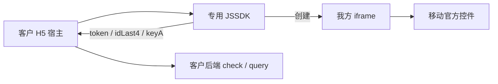

# 银杏助理 JSSDK＋iframe 新方案摘要

> 版本：v1.0  
> 日期：2026-10-15  
> 对应全文：`银杏助理JSSDK＋iframe新方案架构.md`  
> **不改：** `银杏助理JSSDK完整页面嵌入自有H5落地方案.md`（含 mount）

---

## 一、方案是什么

**iframe 是新方案的核心运行时。**

客户页只做宿主；授权 UI、移动签名、官方号码栏／确认／协议都在我们 JSSDK 创建的 iframe 里。客户不写 `<iframe>`、不配授权页 URL、不在浏览器做移动签名。

成功后仍回 `token`、`idLast4`、`keyA`，由客户既有后端 `check` → `query`。SDK 成功不等于银商核验成功。

---

## 二、对齐的三份材料

| 维度 | 材料 | 对齐结论 |
| --- | --- | --- |
| **客户契约** | `iframe/银商助理测试页 · 多点健康 TEMP 0.3.2.html` | 动态引入 SDK、五个回调、`precheck` → `open`。不传 `appId`／`authParams`，不引入取参助手。签名在我方 iframe 内完成。 |
| **内部链路** | `iframe/移动认证内部完整时序图（JSSDK＋iframe，0.3.1）.docx` | 专用 SDK、预检隐藏 iframe、授权 iframe 握手（`CUSTOM_BOOT` → `PRESENTATION_READY`）、移动控件、客户后端 `check`／`query`。 |
| **展示演进** | `iframe/银杏助理 JSSDK：容器内嵌（本期，不含 mount）.docx` | 默认仍是弹层。本期可选把**同一个 iframe** 插入客户容器，去掉遮罩和底部弹层。不做 `mount`。 |

---

## 三、一句话结论

客户页是宿主；**授权页是我们的 iframe**；银商 check／query 仍走客户现有后端。

| 谁 | 做什么 |
| --- | --- |
| 客户 H5 | 换专用 SDK 地址；沿用现网引入与回调；预检通过后 `open` |
| 我方 iframe | 签名、取号、挂载号码栏／四格／确认／协议，回传 `keyA` |
| 客户后端 | 按既有协议核验与查询，不因本次 SDK 升级新增签发接口 |

号码栏、确认按钮、官方协议不能拆到客户 DOM，也不能只把四格交给我们。
