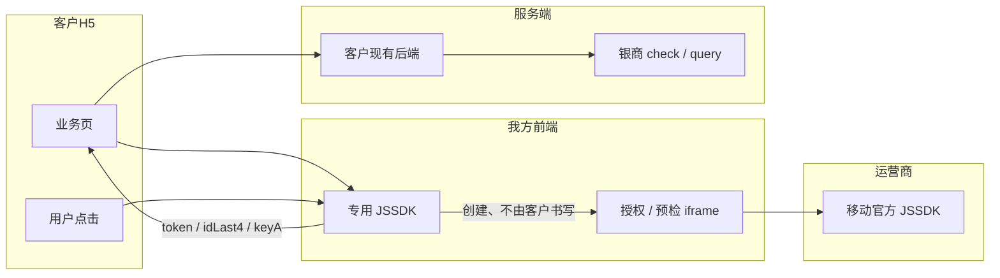
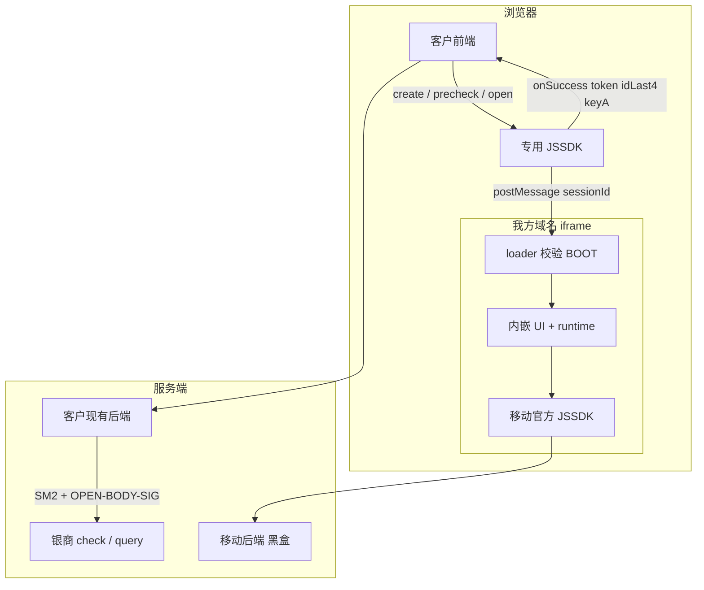
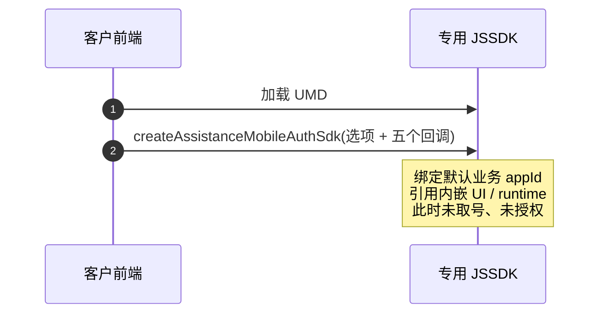
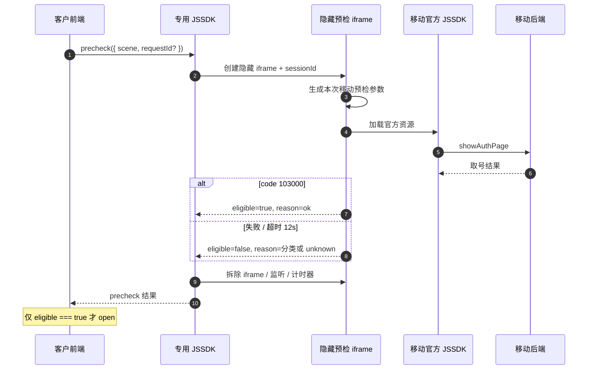
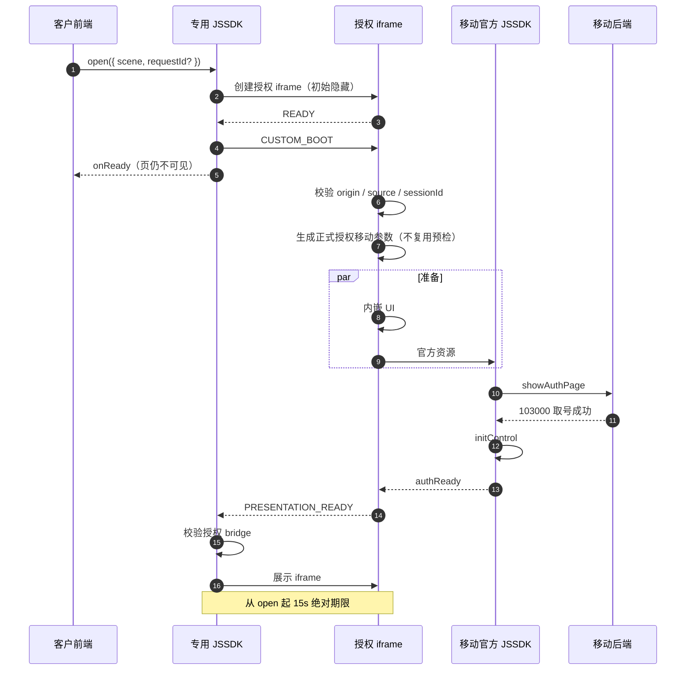
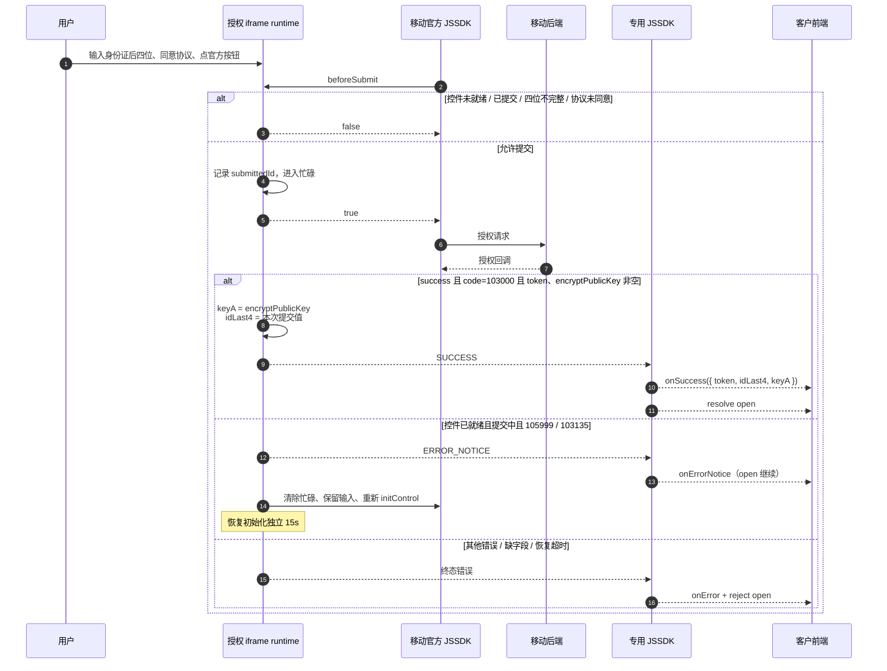
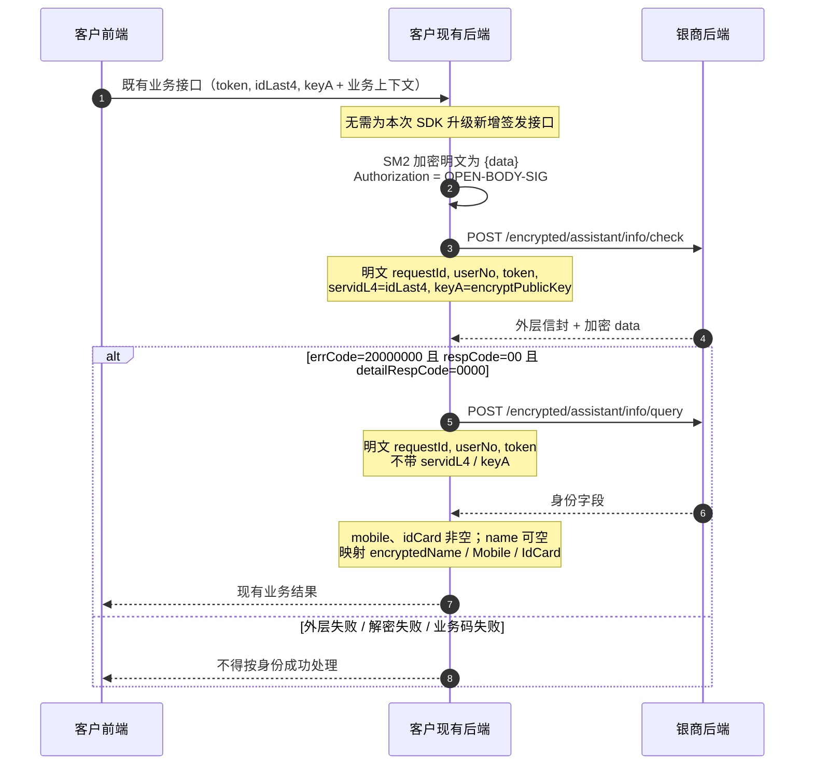
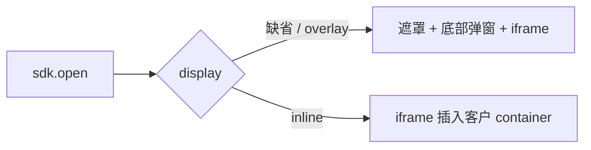
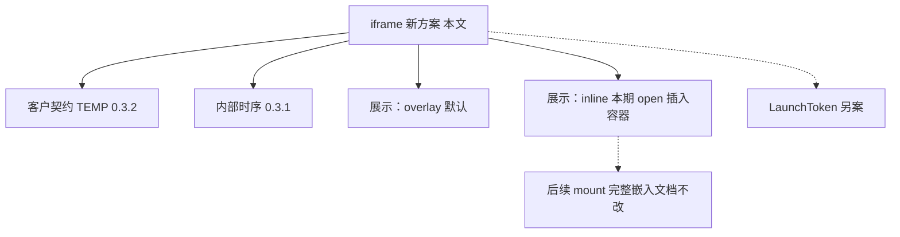
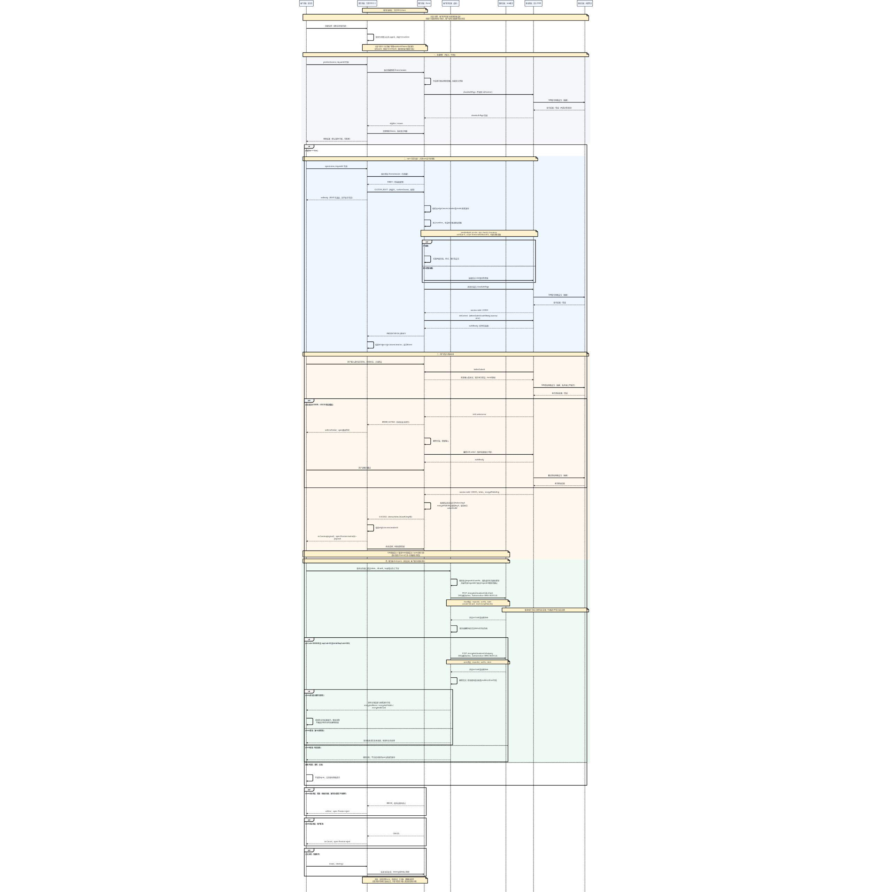

# 银杏助理 JSSDK＋iframe 新方案架构

> 版本：v1.0  
> 日期：2026-10-15  
> 定位：**iframe 为新方案的核心运行时**。授权 UI、移动参数签名、官方号码栏／确认／协议均在我方 iframe 内完成；客户 H5 只引入专用 SDK、预检后打开、回传授权结果。  
> 客户接入契约：`iframe/银商助理测试页 · 多点健康 TEMP 0.3.2.html`  
> 内部链路：`iframe/移动认证内部完整时序图（JSSDK＋iframe，0.3.1）.docx`  
> 展示演进（不含 mount）：`iframe/银杏助理 JSSDK：容器内嵌（本期，不含 mount）.docx`，对应已落地说明见 `银杏助理JSSDK容器内嵌本期方案.md`  
> **不改：** `银杏助理JSSDK完整页面嵌入自有H5落地方案.md`（含 mount，后续再做）

---

## 目录

1. [结论](#一结论)
2. [依据与范围](#二依据与范围)
3. [总体架构](#三总体架构)
4. [客户接入契约（TEMP 0.3.2）](#四客户接入契约temp-032)
5. [内部运行时：专用 SDK 与 iframe](#五内部运行时专用-sdk-与-iframe)
6. [完整时序](#六完整时序)
7. [展示形态：overlay 与 inline](#七展示形态overlay-与-inline)
8. [关键变量与传递边界](#八关键变量与传递边界)
9. [回调、错误与生命周期](#九回调错误与生命周期)
10. [与其他方案的关系](#十与其他方案的关系)
11. [改造范围](#十一改造范围)
12. [验收要点](#十二验收要点)

---

## 一、结论

| 判断 | 说明 |
| --- | --- |
| 新方案是什么 | **JSSDK 运行时自带 iframe**。客户不写 `<iframe>`、不配授权页 URL、不在浏览器做移动签名。 |
| 客户改什么 | 换专用 SDK 资源地址；沿用动态 script 引入、`createAssistanceMobileAuthSdk`、五个回调、`precheck` → `open`。**不传 `appId` / `authParams`，不引入取参助手。** |
| iframe 里做什么 | 生成本次移动参数并签名；加载移动官方 JSSDK；取号、挂载号码栏／四格／确认／协议；把 `encryptPublicKey` 映射为 `keyA` 回传。 |
| 结果链路 | 前端成功载荷仍是 `token`、`idLast4`、`keyA`。客户后端按既有协议 `check` → `query`。SDK 成功 ≠ 银商核验成功。 |
| 展示位置 | TEMP 0.3.2 测试页为弹层（`closable` + 高度）。本期可选 `display: 'inline'`，把**同一个 iframe** 插入客户容器。不做 `mount`。 |
| 不能拆的内容 | 号码栏、确认按钮、官方协议必须留在我方 iframe。不能只把四格交给我们、其余由客户 DOM 自绘。 |

一句话：客户页是宿主；**授权页是我们的 iframe**；银商 check／query 仍走客户现有后端。



---

## 二、依据与范围

### 2.1 材料

| 材料 | 用途 |
| --- | --- |
| `iframe/银商助理测试页 · 多点健康 TEMP 0.3.2.html` | **客户侧接入契约。** 与甲方现网引入方式一致，仅 SDK URL 换为 TEMP 0.3.2。 |
| `iframe/移动认证内部完整时序图（JSSDK＋iframe，0.3.1）.docx` | **内部五层链路。** 专用 SDK、iframe、移动控件、银商 check／query 的职责与时序。 |
| `iframe/银杏助理 JSSDK：容器内嵌（本期，不含 mount）.docx` | **展示位置增量。** `open()` 后把 iframe 插入客户容器，去掉遮罩和底部弹层。 |

测试页来源：`https://ginkgo.chinaums.com/sign-pay-pro-temp/test-duodian-health-temp-0.3.2.html`  
专用 SDK（TEMP 0.3.2）：

```text
https://ginkgo.chinaums.com/sign-pay-pro-temp/assist/0.3.2/assistance-mobile-auth/assistance-mobile-auth.duodian-health.0.3.2.umd.cjs
```

### 2.2 本文覆盖 / 不覆盖

| 覆盖 | 不覆盖 |
| --- | --- |
| 多点专用 0.3.x：SDK＋iframe 架构 | LaunchToken 兑换／只回 `resultCode`（另见 LaunchToken 方案） |
| 客户现网回调与 `precheck` → `open` | `mount` / `unmount`、进页预加载（完整嵌入文档，不改） |
| 预检隐藏 iframe 与授权 iframe | 客户私有后端实现细节（未提供仓库，只描述应沿用的交接） |
| overlay 与本期 inline | 移动后端私有接口、银商到移动的下游（作黑盒） |

内部时序以 0.3.1 文档可核对实现为准；客户集成形态以 0.3.2 测试页为准。二者同属专用包链路，不是两套认证协议。

---

## 三、总体架构

### 3.1 五层（内部拆为六／七个参与方）

我们前端拆成「专用 SDK」和「iframe」两层，避免把「客户页里的脚本」和「授权运行时」混为一谈。客户现有后端单独列出，因为银商凭据不能进浏览器。

| 层／参与方 | 负责什么 | 输入、输出与边界 |
| --- | --- | --- |
| 客户前端／宿主页 | 创建实例，预检后打开，接收授权结果，提交既有业务接口并更新页面 | 输入 `scene` 与可选 `requestId`；接收 `token`、`idLast4`、`keyA`。只在 `eligible === true` 时 `open`。SDK 成功与后端业务成功分开判断 |
| 我们前端：专用 SDK | 管理隐藏预检／授权 iframe、内嵌 UI／runtime、消息桥、展示和回调 | 持有本专用版本**默认业务 appId**；下发 `CUSTOM_BOOT`；校验授权 bridge；等待展示就绪；终态清理并结束 `open` Promise |
| 我们前端：iframe | 预检只取号；授权页生成移动参数、运行页面并接入移动控件 | 校验 BOOT 身份；向移动前端调用 `showAuthPage` / `initControl`；将 `encryptPublicKey` 映射为 `keyA`，回传展示就绪及授权结果 |
| 客户现有后端 | 接收授权结果，按银商协议核验、查询并返回业务结果 | 持有银商接口凭据及加解密密钥；进行 SM2、`OPEN-BODY-SIG` 和响应解析。具体路径以客户现有系统为准 |
| 银商后端 | 提供 check 核验和 query 身份查询 | 接收服务端加密请求并返回业务码与加密响应。不能等同于移动后端 |
| 移动前端 | 中国移动官方 JSSDK（当前材料为 1.0.6），执行取号和控件授权交互 | `showAuthPage` 取号；`initControl` 挂载控件；`authReady` 表示控件就绪 |
| 移动后端 | 承接官方 SDK 的移动认证网络服务 | 只表达可由 SDK 调用／回调观察到的取号、授权往返，不展开私有接口 |



### 3.2 为什么必须是我们的 iframe

| 约束 | 含义 |
| --- | --- |
| 官方控件不可拆 | 号码栏、协议、确认按钮由移动 `initControl` 挂在授权页文档里，不能画到客户 DOM |
| 签名不下发 | 移动 `sign` 在 iframe 内生成；客户不拿取参助手、不传 `authParams` |
| 跨源隔离 | 授权页与宿主不同源；`postMessage` 校验 parent origin、window source、`sessionId` |
| 密钥隔离 | 银商 `appId`／`appKey`、SM2 私钥只留客户服务端；浏览器只有一次性 `token`／`keyA` |

客户 H5 **不是**授权页，也 **不是** iframe 的作者。它只是宿主：提供点击时机、接收回调、把结果交给自己的后端。

### 3.3 三类 appId（不要混用）

| 名称 | 持有与使用位置 | 是否出现在客户前端 |
| --- | --- | --- |
| 业务 appId | 专用 SDK 内置默认值，随配置进入 iframe | **多点专用包不要求客户传入**（0.3.2 测试页明确不传） |
| 移动 `providerAppId`（移动参数名 `appId`） | iframe 移动参数生成器 → 官方 JSSDK | 否。不得把业务 appId 当作此字段 |
| 银商接口 appId／appKey | 客户服务端，生成 `OPEN-BODY-SIG` | 否。`appKey` 绝不下发浏览器或 iframe |

---

## 四、客户接入契约（TEMP 0.3.2）

测试页用于证明：**甲方现网接入方式可以原样接到专用 iframe 方案**，只换资源 URL。

### 4.1 必须保持的接入方式

1. 动态 `script` 引入 UMD，全局 `window.AssistanceMobileAuth.createAssistanceMobileAuthSdk`。  
2. 创建时四个选项 + 五个回调：`closable`、`authWindowHeight`、`authWindowMaxHeight`、`useCustomKeyboard`；`onReady` / `onSuccess` / `onCancel` / `onError` / `onClose`。  
3. 顺序：`precheck({ scene: 'native-number' })`，仅 `eligible === true` 时 `open({ scene: 'native-number' })`。  
4. **不传 `appId` 或 `authParams`，不引入取参助手。** 签名由我方 iframe 内部处理。  
5. `onSuccess` 拆出 `{ token, idLast4, keyA }` 交给既有后端（测试页只展示字段，不请求甲方接口）。

```js
const sdkUrl =
  'https://ginkgo.chinaums.com/sign-pay-pro-temp/assist/0.3.2/assistance-mobile-auth/assistance-mobile-auth.duodian-health.0.3.2.umd.cjs';

async function startAuth() {
  await loadScript(sdkUrl);
  const sdk = window.AssistanceMobileAuth.createAssistanceMobileAuthSdk({
    closable: true,
    authWindowHeight: '72vh',
    authWindowMaxHeight: '82vh',
    useCustomKeyboard: true,
    onReady: () => {},
    onSuccess: async (result) => {
      const { token, idLast4, keyA } = result;
      // 保留原有 shuYinAuth({ token, idLast4, keyA }) 及结果处理
    },
    onCancel: () => {},
    onError: () => {},
    onClose: () => {},
  });
  sdk.precheck({ scene: 'native-number' }).then((result) => {
    if (result.eligible === true) {
      sdk.open({ scene: 'native-number' });
    } else {
      // 预检不通过时的既有降级
    }
  });
}
```

### 4.2 测试页行为边界

| 项 | 测试页做法 |
| --- | --- |
| 触发 | 按钮「测试多点健康三要素授权」 |
| 预检 | 展示完整预检结果；未通过则不 `open` |
| 成功 | 展示完整回调，并单独列出交给后端的 `{ token, idLast4, keyA }` |
| 后端 | **不调用**甲方业务接口；页面成功不代表身份核验成功 |
| 清理 | `pagehide` 时 `sdk.destroy()` |
| 安全 | 认证数据不写日志、不写浏览器存储 |

### 4.3 客户需要理解的语义

| 回调／返回 | 含义 |
| --- | --- |
| `onReady` | BOOT 已发送，**授权页此时仍不可见** |
| `precheck.eligible === true` | 本机取号阶段看起来可继续；**不能替代正式授权** |
| `onSuccess` / `open` resolve | 本次 SDK 授权成功，已拿到 `token`／`idLast4`／`keyA` |
| 客户后端 check／query | 身份核验与助填数据是否可用，须另行判断 |

同一成功载荷可通过回调或 `await sdk.open()` 取得，业务提交只选一处，避免重复请求。

---

## 五、内部运行时：专用 SDK 与 iframe

### 5.1 专用包相对通用弹层的变化

| 能力 | 专用 0.3.x（本方案） | 客户侧是否感知 |
| --- | --- | --- |
| 授权 UI HTML／样式／图片／runtime 打进专用包 | 是 | 否。看起来仍是 `create` + `open` |
| 默认业务 appId | 是 | 客户不传 |
| 移动参数与签名 | iframe 内每次生成 | 客户不传 `authParams` |
| 共享 iframe、控件样式、移动官方 JSSDK | 运行时仍要加载，**不是完全离线** | 否 |
| 预检 iframe 与授权 iframe 分离 | 是，会话与移动参数均不复用 | 客户只看到 `precheck` / `open` |

创建实例只准备脚本与配置，不代表已取号、已授权或已核验。

### 5.2 两个 iframe

```text
precheck()
  └─ 隐藏 iframe（独立 sessionId）
        └─ 只 showAuthPage，不 initControl，不展示授权页
        └─ 结束即拆除

open()
  └─ 新的授权 iframe（新 sessionId，初始隐藏）
        └─ CUSTOM_BOOT → 准备 UI 与官方资源 → showAuthPage → initControl
        └─ authReady 后 PRESENTATION_READY，外层才展示
```

预检成功不能把参数或内部会话交给后续 `open`。正式授权的 `version`／`sign`／`traceId`／`timestamp` 必须重新生成。

### 5.3 握手与展示门槛

1. 授权 iframe 发出 `READY`：loader 可接收配置。  
2. SDK 发送 `CUSTOM_BOOT`（UI 定义、`runtimeSource`、配置），并触发客户 `onReady`。  
3. loader 校验父页面 origin、window source、消息 `sessionId`，以及配置 `mode`／`sessionId`／`parentOrigin`，才执行 runtime。  
4. runtime 并行准备内嵌 UI 与移动官方资源，完成后才 `showAuthPage`。  
5. `showAuthPage` 成功码 `103000` 只表示**取号阶段成功**，随后 `initControl` 注册 `beforeSubmit`、`authReady`、`success`、`error`。  
6. 收到 `authReady` 后 iframe 发 `PRESENTATION_READY`；外层再校验授权 bridge 的 origin／source／`sessionId`，**才把 iframe 从隐藏改为可见**。该消息不新增客户回调。

首次初始化从 `open` 起共用 **15 秒绝对期限**（握手、BOOT、UI／资源、首次控件就绪）。不是每一步各 15 秒，也不覆盖用户输入或后端 check／query。超时终止本次 `open`。

### 5.4 授权页内的强制元素

均在 iframe 文档内，客户不可自绘、不可 CSS 挖空：

| 元素 | 说明 |
| --- | --- |
| 掩码手机号 | 移动控件号码栏 |
| 中间文案 | 本机号等提示 |
| 身份证后四位 | 可走 `useCustomKeyboard` |
| 官方确认按钮 | 文案须符合移动对授权按钮的要求 |
| 底部协议 | 我方维护官方协议；客户协议只能追加 |

`authType=0`，`scope=3ElementsAuthAssistFill`。这是移动调用范围，不是预检成功或银商核验状态。

---

## 六、完整时序

原图见：`iframe/移动认证内部完整时序图-JSSDK＋iframe-0.3.1.jpeg`。下面按阶段展开，便于评审与排障。

### 6.1 初始化



### 6.2 隐藏预检



专用 SDK 预检默认超时 **12 秒**，可用预检 `timeoutMs` 调整。超时：`eligible=false`、`reason=unknown`。

### 6.3 open、握手与首次展示



### 6.4 用户提交、移动授权与可恢复错误



迟到的 success 若对不上本次提交，不能直接当业务成功。对客户只给安全提示，不透出完整原始错误。

### 6.5 SDK 成功之后：客户后端 check／query



补充边界：

- 前端可选 `requestId` 只作关联上下文，**不能假定等于**协议 `requestId`。协议 `requestId`／`userNo` 由服务端配置／映射决定。  
- HTTP 200 或移动 JSSDK `success` 都不能替代 check 三码同时成立。  
- 解密响应信封 **不等于** `name`／`mobile`／`idCard` 已是明文；当前材料没有字段级解密依据，不宣称可直接明文助填。  
- check 通过但 query 失败或缺字段，仍不能视为身份信息已可用。  
- SDK 授权成功后发生的 check／query 失败，属于后端业务结果，**不回溯改写**已经结束的 `open` Promise。

---

## 七、展示形态：overlay 与 inline

iframe **所有权不变**（始终由 JSSDK 创建）。变的只是插入点。

### 7.1 TEMP 0.3.2（当前验证页）

测试页走弹层参数：`closable: true`，`authWindowHeight: '72vh'`，`authWindowMaxHeight: '82vh'`。用户点击后出现授权窗口，不是进页即展示。

```text
客户点击 → precheck → open()
  └─ SDK 插入遮罩 + 底部弹窗
        └─ 授权 iframe（我方创建）
```

### 7.2 本期容器内嵌（不含 mount）

客户预留空容器。仍调用 `open()`。SDK 不再盖遮罩、不再底部弹出，把**同一个授权 iframe** 插入该容器。

```text
客户点击 → precheck → open()
  └─ SDK 找到 #ums-auth-slot
        └─ iframe 直接插入该容器
        └─ 无遮罩、无弹出动画
```



| 规则 | 说明 |
| --- | --- |
| `display: 'inline'` 时 `container` 必填 | 找不到节点则失败，**不自动改回弹层** |
| 不新增 `mount` | 业务页打开时容器可以是空的；`open()` 之后才出现授权内容 |
| `close()` | overlay 关弹窗；inline 移除容器内 iframe，容器留空 |
| 高度 | inline 建议 `authWindowHeightMode: 'auto'`，高度经 postMessage 写回，禁止容器 `overflow: hidden` 裁切协议 |
| 重复 `open()` | 容器内已有进行中的 iframe 则不插第二个 |

接口增量、错误码、验收清单以 `银杏助理JSSDK容器内嵌本期方案.md` 为准。本文只把展示形态接到同一套 iframe 架构上。

多点专用包与 inline **正交**：专用包解决「谁签名、谁渲染授权 UI」；`display` 解决「iframe 插在遮罩里还是客户 div 里」。inline 时仍不要求客户改传 `appId`／`authParams`。

---

## 八、关键变量与传递边界

| 变量／字段 | 产生／持有方 | 传递方向 | 含义与边界 |
| --- | --- | --- | --- |
| `scene` | 客户业务上下文 | 客户前端 → SDK → iframe | 业务场景，不是认证凭据。测试页为 `native-number` |
| 前端 `requestId`（可选） | 客户前端 | 客户 → SDK → iframe → 成功载荷回传 | 关联本次请求；与协议 `requestId` 不能因同名视为同一值 |
| 业务 appId | 专用 SDK 配置 | SDK → iframe | 本专用包有默认值。不同于移动及银商接口 appId |
| 移动 `providerAppId` | iframe 参数生成器 | iframe → 官方 JSSDK | 取号／授权身份。本文不列实际值 |
| `version` / `sign` / `traceId` / `timestamp` | iframe | iframe → `showAuthPage` | 预检与授权分别生成。`sign` 不是银商 `OPEN-BODY-SIG` |
| `authType` / `scope` | 移动参数配置 | iframe → 官方 JSSDK | 当前 `0` / `3ElementsAuthAssistFill` |
| `eligible` / `reason` | 预检页及 SDK | 隐藏 iframe → SDK → 客户 | 仅 `true` 才 `open`。默认 12 秒超时为 `false`／`unknown` |
| 内部 `sessionId` | SDK 每次创建 iframe | SDK ↔ 对应 iframe | 消息隔离。预检与授权独立。客户无需维护 |
| `status` / `message` | iframe／bridge | iframe → SDK → 客户 | 成功 `status=success`；当前 message「验证完成」。只表示 SDK 成功 |
| `token` | 移动 `initControl.success` | 移动 → iframe → SDK → 客户前端 → 客户后端 → check／query | 非空、敏感；不写日志或页面 |
| `idLast4` → `servidL4` | 用户在 iframe 输入 | iframe → … → check | 取**本次提交**的四位 |
| `encryptPublicKey` → `keyA` | 移动回调；iframe 映射 | 移动 → … → check | 对外字段 `keyA`。不是银商平台公钥或 `appKey` |
| 协议 `requestId` / `userNo` | 客户后端 | 客户后端 → 银商明文（再加密） | 服务端配置／映射 |
| 银商 appId／appKey | 客户服务端 | Authorization | 秘密，不下发浏览器 |
| `OPEN-BODY-SIG` | 服务端 | 客户后端 → 银商 | 凭据 + 时间戳 + nonce + 请求体摘要 |
| SM2 公钥／私钥 | 服务端 | 加密请求／解密信封 `data` | 与移动 `keyA` 用途不同 |
| `errCode` / `respCode` / `detailRespCode` | 银商响应 | 银商 → 客户后端 | `20000000` + `00` + `0000` 同时满足才业务成功 |
| `name` / `mobile` / `idCard` | query 响应 | 银商 → 客户后端 | 现有映射为加密身份字段 |

`token`、`keyA`、身份证输入、移动签名、银商凭据和完整错误原文不输出到页面或日志。

---

## 九、回调、错误与生命周期

### 9.1 客户回调

| 回调 | 是否终态 | 说明 |
| --- | --- | --- |
| `onReady` | 否 | BOOT 已发出，授权页未必可见 |
| `onSuccess(payload)` | 是 | 与 `open` resolve 同一载荷：`status`、`token`、`idLast4`、`keyA`，可选 `message`／`requestId` |
| `onCancel` | 是 | 用户取消；`open` reject |
| `onError` | 是 | 资源／初始化失败、缺 `token`／`keyA`、不可恢复错误、首次展示超时等 |
| `onErrorNotice` | 否 | 可恢复提示（如 `105999`／`103135`），本身不结束 `open`。0.3.2 测试页未接此回调，专用 runtime 仍会发 |
| `onClose` | 窗口关闭 | `close()` 或用户关窗；未完成的 `open` 随之结束 |

### 9.2 清理

成功、取消、致命错误或关闭时：拆除 iframe、消息监听、计时器、观察器与移动控件，并阻止迟到回调影响已结束会话。

| API | 行为 |
| --- | --- |
| `close()` | overlay：关弹窗。inline：移除容器内 iframe |
| `destroy()` | 整实例销毁；中止活动预检；页面离开时必调（测试页在 `pagehide` 调用） |

本期不提供 `unmount`。需要清掉授权区用 `close()`。

---

## 十、与其他方案的关系

| 文档 | 关系 |
| --- | --- |
| 本文 | **iframe 新方案架构总览**：谁创建 iframe、内部如何取号／授权、客户如何保持现网接入、结果如何进 check／query |
| `银杏助理JSSDK容器内嵌本期方案.md` | 本文第 7 章的接口细节。只改插入位置，不含 `mount` |
| `银杏助理JSSDK完整页面嵌入自有H5落地方案.md` | **不改。** 后续 `mount`／进页骨架／同步展示二要素放在那里 |
| `银杏助理JSSDK容器内嵌Figma-UI可行性分析.md` | 外壳归客户；白卡片必须是整块授权 iframe，不能 1:1 按缺号稿嵌入 |
| LaunchToken 两份方案 | 另一条安全升级：服务端令牌、前端可能只回 `resultCode`。与当前 0.3.2「回传 `token`／`idLast4`／`keyA`」不是同一契约，不能混进本次客户接入 |



---

## 十一、改造范围

### 11.1 客户（多点健康现网）

| 项 | 是否改 |
| --- | --- |
| 动态引入脚本的 URL | 改为专用包地址（TEMP 验证用 0.3.2 URL，正式发布以当时版本为准） |
| `create` 选项与五个回调 | **保持** |
| `precheck` → `open`、`scene: 'native-number'` | **保持** |
| 传入 `appId`／`authParams`／取参助手 | **不要新增** |
| `onSuccess` 后 `token`／`idLast4`／`keyA` 交既有后端 | **保持** |
| check／query 协议 | **保持** |
| 若采用 inline | 预留空容器，增加 `display`／`container`；仍不自己写 iframe |

### 11.2 我方前端

| 编号 | 项 |
| --- | --- |
| R1 | 专用 UMD：内置业务 appId、内嵌 UI／runtime |
| R2 | 隐藏预检 iframe：只 `showAuthPage`，12 秒超时，用后即拆 |
| R3 | 授权 iframe：`CUSTOM_BOOT`、origin／session 校验、15 秒首次展示期限 |
| R4 | iframe 内生成移动参数并签名；`providerAppId` 与业务 appId 分离 |
| R5 | `initControl` 接入；`encryptPublicKey` → `keyA`；提交态校验 |
| R6 | `105999`／`103135` 可恢复；其余终态错误 |
| R7 | 默认 overlay 与 0.3.2 测试页行为一致 |
| R8 | 本期可选 inline：插入 `container`，无遮罩；不做 `mount` |

### 11.3 不改

- 移动官方取号与 `initControl` 协议  
- 客户后端 SM2 ＋ `OPEN-BODY-SIG` 的 check／query  
- H5 整页 `/auth` 另一条入口（若仍保留）  
- 完整嵌入文档中的 `mount` 设计  

---

## 十二、验收要点

以 TEMP 0.3.2 测试页为客户契约基线，再按是否开启 inline 加验展示。

**接入契约**

- [ ] 仅换 SDK URL 即可走完「加载 → 预检 → 打开 → 回调」  
- [ ] 不传 `appId`／`authParams` 仍能完成签名与取号  
- [ ] `eligible !== true` 时不出现授权窗  
- [ ] 成功载荷含非空 `token`、`idLast4`、`keyA`  
- [ ] 测试页不把认证结果写入存储或日志  

**内部 iframe**

- [ ] 预检 iframe 不可见，结束后无残留  
- [ ] `onReady` 时授权页仍隐藏，直至 `PRESENTATION_READY`  
- [ ] 号码栏、四格、确认、协议均在 iframe 内且未被裁切  
- [ ] 预检参数不复用于 `open`  
- [ ] 首次展示超过 15 秒进入终态错误  

**结果链路**

- [ ] 客户后端 check 三码通过后才 query  
- [ ] query 缺 `mobile`／`idCard` 不得当身份成功  
- [ ] SDK 成功后的后端失败不改写已结束的 `open`  

**展示（若做本期 inline）**

- [ ] `open()` 后授权出现在容器内，无全屏遮罩、无底部弹出  
- [ ] 缺省 overlay 与 0.3.2 测试页一致  
- [ ] `close`／`destroy` 后无残留 iframe  
- [ ] 微信／Safari／Android WebView：键盘不挡确认和协议  

---

## 附录 A 术语

| 说法 | 含义 |
| --- | --- |
| iframe 新方案 | 授权运行时由我方 JSSDK 创建 iframe，在 iframe 内签名并挂载移动控件 |
| 宿主 | 客户 H5。不负责授权 UI 和移动签名 |
| 专用包 | 多点健康定制 UMD（如 `assistance-mobile-auth.duodian-health.0.3.2.umd.cjs`） |
| 容器内嵌 | `open()` 时把上述 iframe 插入客户 `div`，不是客户自己写 iframe |
| 与 mount 的区别 | 本期仍要用户触发才会出现授权区 |

## 附录 B 测试页与资源

| 项 | 值 |
| --- | --- |
| 测试页 | `https://ginkgo.chinaums.com/sign-pay-pro-temp/test-duodian-health-temp-0.3.2.html` |
| SDK | `https://ginkgo.chinaums.com/sign-pay-pro-temp/assist/0.3.2/assistance-mobile-auth/assistance-mobile-auth.duodian-health.0.3.2.umd.cjs` |
| 全局工厂 | `window.AssistanceMobileAuth.createAssistanceMobileAuthSdk` |
| 场景 | `native-number` |
| 成功交给后端的字段 | `token`、`idLast4`、`keyA` |

## 附录 C 内部时序原图


