# 银杏助理 LaunchToken 安全接入方案

> 来源：`银杏助理LaunchToken安全接入方案(1).docx`  
> 主题：面向客户的移动认证 JSSDK Launch Token 安全接入与联调方案  
> 说明：本文在原文基础上完成结构梳理，并补齐流程图（Mermaid）。接口地址、字段名称、签名方式和错误码以接口详细设计为准。

---

## 目录

1. [方案概述](#一方案概述)
2. [总体架构与职责边界](#二总体架构与职责边界)
3. [方案流程](#三方案流程)
4. [LaunchToken 设计](#四launchtoken-设计)
5. [服务接口建议](#五服务接口建议)
6. [安全控制](#六安全控制)
7. [异常处理原则](#七异常处理原则)
8. [双方改造范围](#八双方改造范围)
9. [联调建议](#九联调建议)

---

## 一、方案概述

为确保银杏助理 JSSDK 仅在已授权的业务场景中被发起，本方案在现有前端接入链路前增加 **LaunchToken（启动令牌）** 校验机制。

**核心原则：**

- LaunchToken 由**客户服务端**在完成当前用户、业务订单或业务流水校验后，向我方服务端申请。
- 客户前端只负责接收该令牌并调用 JSSDK。
- 我方授权服务校验令牌有效后，才允许进入后续流程。

该机制将一次前端拉起行为与客户身份、业务场景、指定页面来源及业务流水绑定，可降低非授权页面调用、令牌重放和跨场景复用等风险。

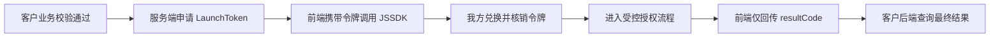

---

## 二、总体架构与职责边界

方案由客户前后端、我方前端授权组件及我方 LaunchToken 服务共同组成。

### 2.1 职责划分

| 组成部分 | 主要职责 |
| --- | --- |
| 客户前端 | 获取 LaunchToken；调用 JSSDK；将一次性结果凭证提交给客户后端 |
| 客户后端 | 校验登录态和业务上下文；申请 LaunchToken；服务端查询最终认证结果 |
| 我方 JSSDK 与授权页面 | 接收 LaunchToken；建立受控授权窗口；完成页面来源校验；返回一次性结果凭证 |
| 我方 LaunchToken 服务 | 认证客户服务端身份；签发、兑换和核销 LaunchToken；绑定认证结果并提供结果查询 |

### 2.2 架构关系图

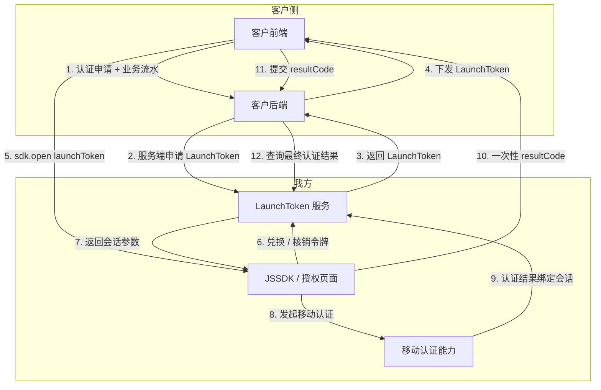

**边界要点：**

- 客户服务端凭证不进入浏览器。
- 客户前端不直接承载最终身份信息。
- JSSDK 与授权页面仅承接本次会话所需的短期凭证。

---

## 三、方案流程

流程以客户后端授权为起点，以客户后端查询最终结果为终点。JSSDK 和授权页面仅承接本次会话所需的短期凭证。

### 3.1 流程控制要点

| 流程节点 | 控制要点 |
| --- | --- |
| 签发前 | 客户后端先校验当前用户、业务状态和请求权限，再向我方申请 LaunchToken |
| 兑换时 | 我方服务校验令牌状态及绑定上下文，成功后原子核销，不允许再次兑换 |
| 结果查询 | 客户前端仅转交一次性 `resultCode`，最终结果由客户后端服务端查询 |

### 3.2 总体时序图

> 对应原文「图 1 LaunchToken 安全接入总体时序」。

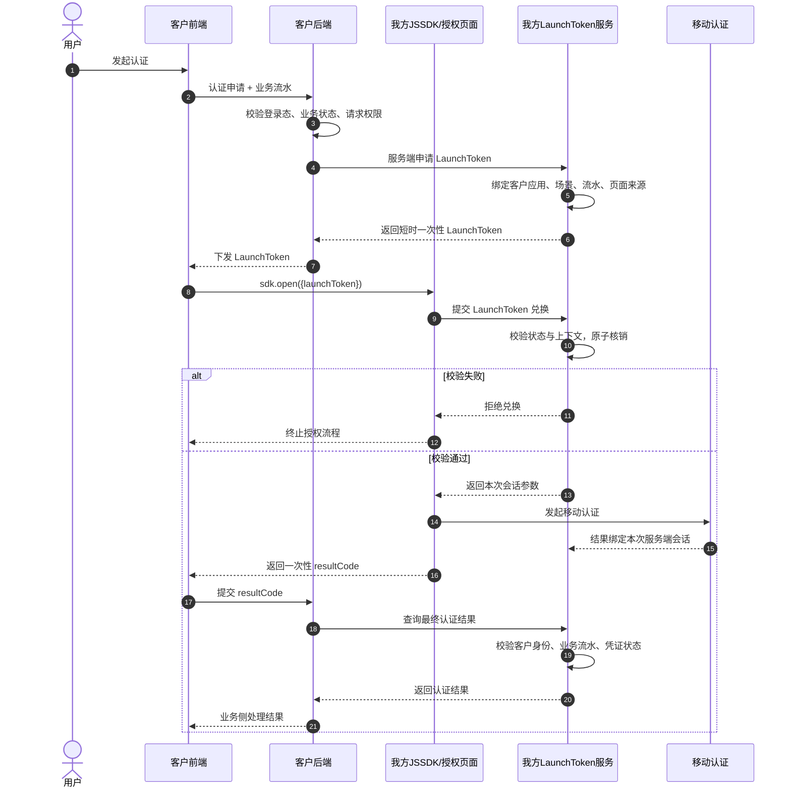

### 3.3 三阶段流程总览

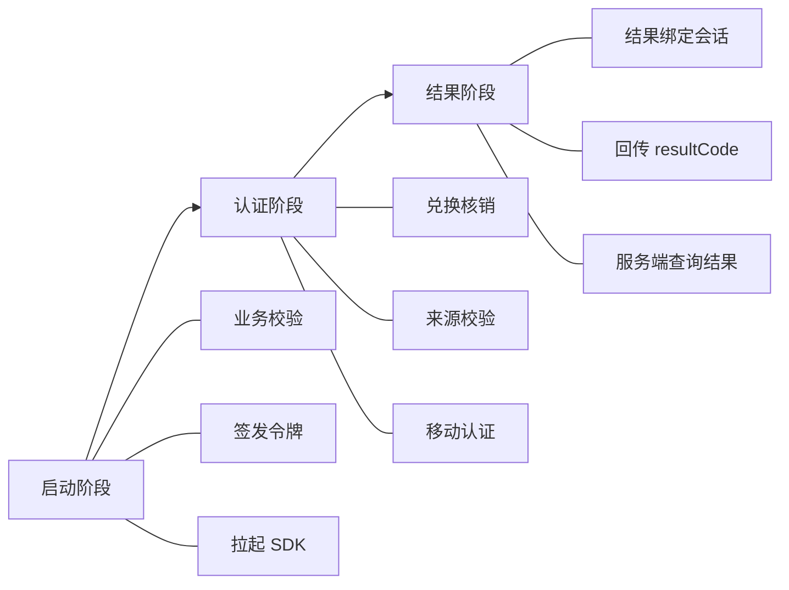

### 3.4 （一）启动阶段

1. 客户前端向客户后端发起认证申请，并携带当前业务流水。
2. 客户后端校验用户登录态、业务状态及请求权限。
3. 客户后端通过服务端认证方式向我方申请 LaunchToken。
4. 我方服务将 LaunchToken 与客户应用、业务场景、业务流水及允许的页面来源进行绑定。
5. 客户前端取得 LaunchToken 后，调用 `sdk.open({launchToken})` 拉起授权页面。

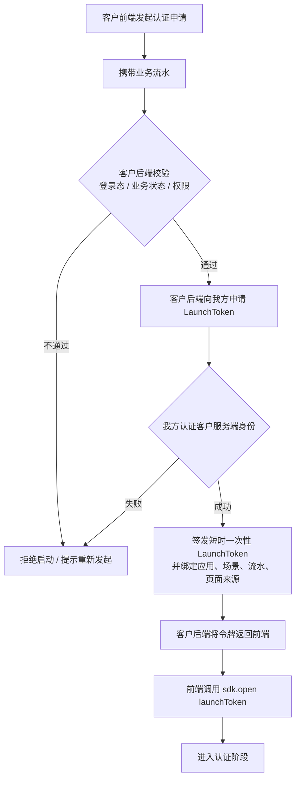

### 3.5 （二）认证阶段

1. 授权页面将 LaunchToken 提交至我方服务端进行兑换。
2. 我方服务端校验令牌状态及上下文，校验通过立即核销该令牌。
3. 授权页面获得本次认证所需的会话参数，并发起移动认证。
4. 令牌缺失、过期、已使用或上下文不匹配时，授权流程直接终止。

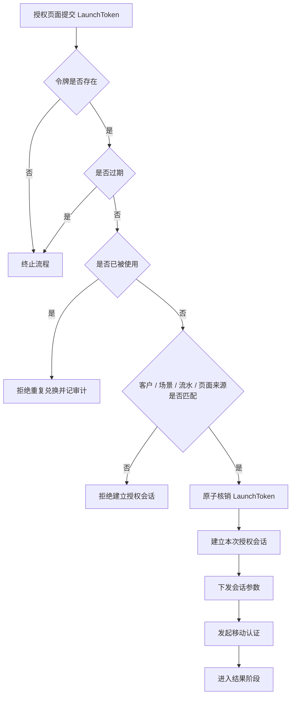

### 3.6 （三）结果阶段

1. 移动认证完成后，结果首先与本次服务端会话绑定。
2. 客户前端仅接收一次性 `resultCode`，不直接承载最终身份信息。
3. 客户后端使用 `resultCode` 向我方服务端查询最终认证结果。
4. 我方服务端再次校验客户身份、业务流水及结果凭证状态后返回结果。

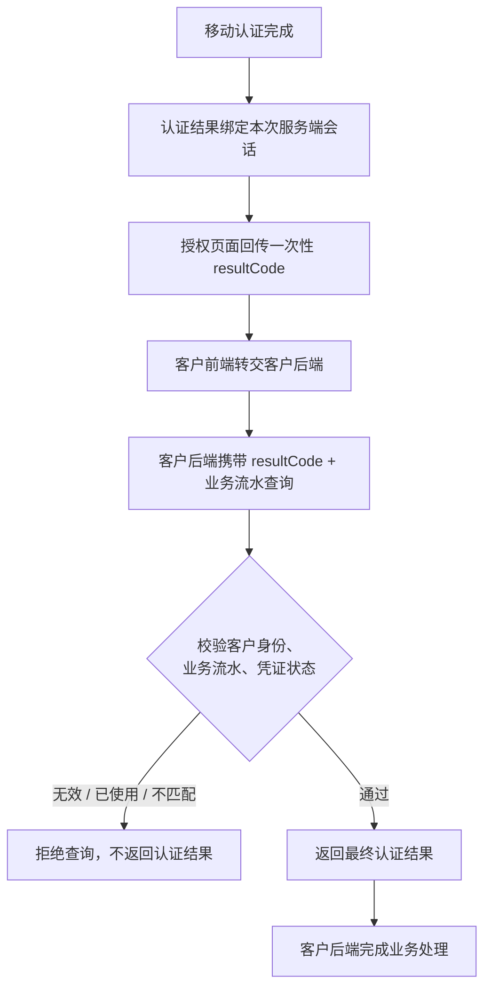

---

## 四、LaunchToken 设计

| 设计项 | 方案说明 |
| --- | --- |
| 令牌形态 | 采用不可预测的随机字符串，令牌本身不承载业务明文 |
| 签发主体 | 仅向已完成服务端身份认证的客户应用签发 |
| 有效期 | 短时有效，具体时长由双方在联调阶段确认 |
| 使用次数 | 单次兑换；成功兑换后立即失效 |
| 绑定信息 | 客户应用、业务场景、业务流水、允许的页面来源及本次请求标识 |
| 传递范围 | 仅在客户后端、客户前端、JSSDK 授权页面及我方服务之间传递 |
| 存储方式 | 服务端保存受保护的令牌摘要及状态，不记录令牌明文 |
| 异常策略 | 校验失败时默认拒绝，不回退到无令牌流程 |

### 4.1 令牌状态机

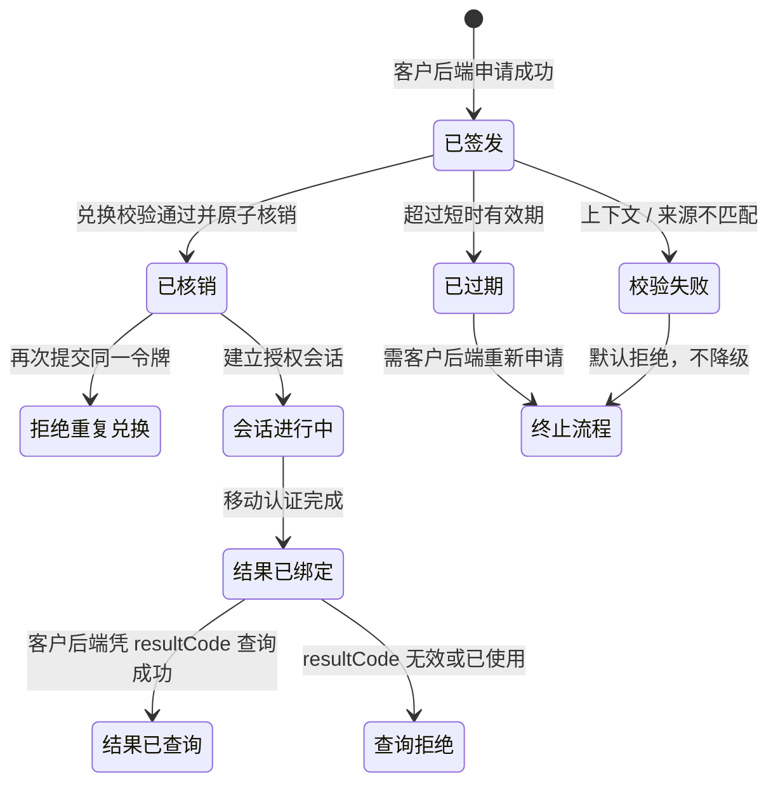

### 4.2 绑定上下文

LaunchToken 一经签发，即与以下信息绑定，兑换与结果查询均需一致：

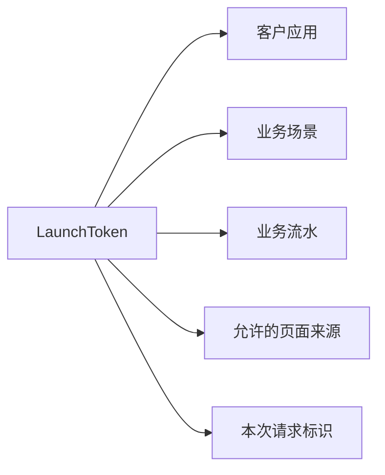

---

## 五、服务接口建议

以下为双方联调时需要形成的接口能力。具体地址、字段名称、签名方式和错误码在接口详细设计阶段另行确认。

### 5.1 接口总览

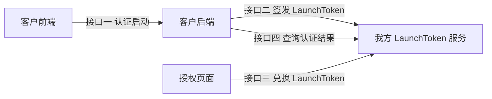

### 5.2 （一）客户侧认证启动接口

客户前端调用客户后端，由客户后端完成业务校验并返回 LaunchToken。建议请求上下文包括：

- 业务流水号
- 认证场景
- 当前页面来源
- 客户侧幂等请求标识

### 5.3 （二）LaunchToken 签发接口

由客户后端服务端调用我方服务端。接口验证客户服务端身份后，返回短时、一次性的 LaunchToken。

### 5.4 （三）LaunchToken 兑换接口

由我方授权页面调用。接口原子校验并核销 LaunchToken，兑换成功后建立本次授权会话。

### 5.5 （四）认证结果查询接口

由客户后端服务端调用。客户后端提交一次性 `resultCode` 和对应业务流水，我方校验一致性后返回认证结果。

### 5.6 接口调用时序

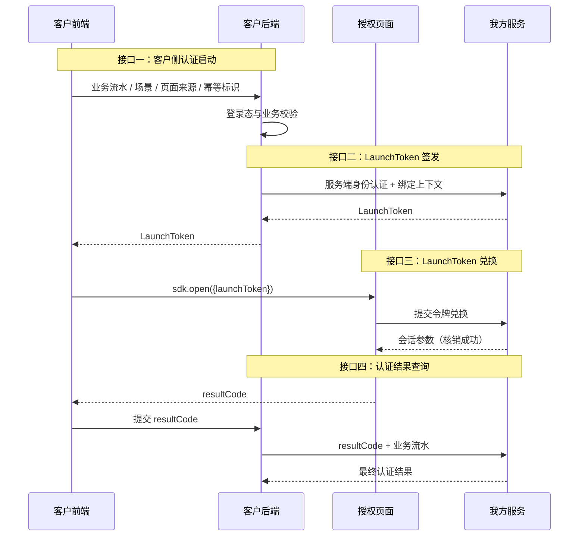

---

## 六、安全控制

| 控制域 | 关键机制 | 预期作用 |
| --- | --- | --- |
| 服务端身份认证 | LaunchToken 仅通过服务端到服务端接口签发 | 客户服务端凭证不进入浏览器 |
| 令牌生命周期 | 短时有效、单次兑换、原子核销 | 降低令牌重放和重复使用风险 |
| 业务上下文 | 绑定客户应用、场景、业务流水和请求标识 | 防止跨客户、跨场景或跨业务复用 |
| 页面来源 | 绑定并校验精确页面来源 | 确保在双方约定的页面上下文中使用 |
| 结果最小化 | 前端只接收一次性 `resultCode` | 最终结果保持服务端闭环 |
| 传输与审计 | HTTPS、脱敏日志、限流、告警和凭证轮换 | 满足日常运营与安全追踪需要 |

### 6.1 安全闭环示意

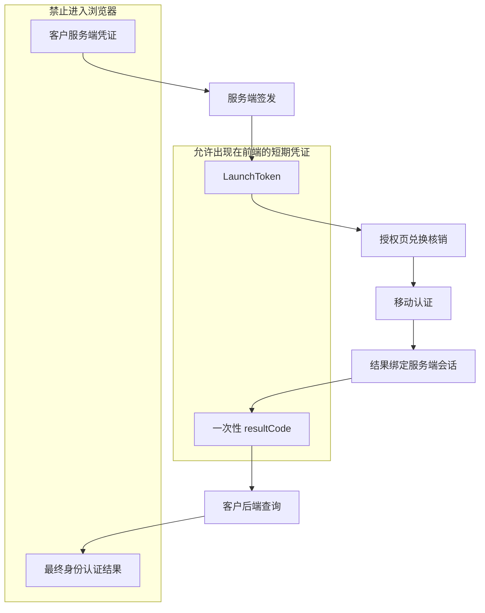

---

## 七、异常处理原则

校验失败时默认拒绝，**不回退到无令牌流程**，也**不降级到无校验链路**。

| 异常场景 | 处理原则 |
| --- | --- |
| 未提供 LaunchToken | 终止流程，提示重新发起 |
| LaunchToken 已过期 | 终止流程，由客户后端重新申请 |
| LaunchToken 已被使用 | 拒绝重复兑换并记录审计事件 |
| 客户、场景或业务流水不匹配 | 拒绝请求，不进入移动认证 |
| 页面来源不匹配 | 拒绝建立授权会话 |
| 结果凭证无效或已使用 | 拒绝查询，不返回认证结果 |
| 服务暂时不可用 | 返回统一失败状态，不降级到无校验链路 |

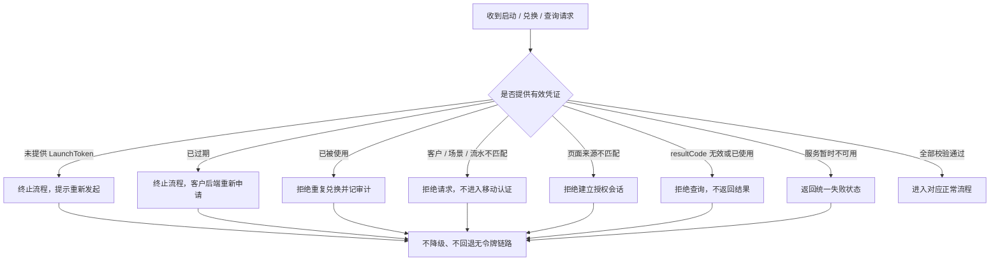

---

## 八、双方改造范围

### 8.1 （一）客户侧

1. 客户后端增加认证启动接口。
2. 客户后端接入 LaunchToken 签发及结果查询接口。
3. 客户后端完成登录态、业务流水和幂等校验。
4. 客户前端调整为先获取 LaunchToken，再调用 `sdk.open()`。
5. 客户前端将 `resultCode` 提交给客户后端，不直接处理最终认证数据。

### 8.2 （二）我方

1. 建设 LaunchToken 签发、兑换、核销及结果查询服务。
2. JSSDK 增加 `launchToken` 启动参数和必填校验。
3. 授权页面增加令牌兑换、页面来源校验和受控消息回传。
4. 建立令牌状态、接口调用及异常事件的审计与监控。
5. 提供测试环境、联调说明和错误处理约定。

### 8.3 改造依赖关系

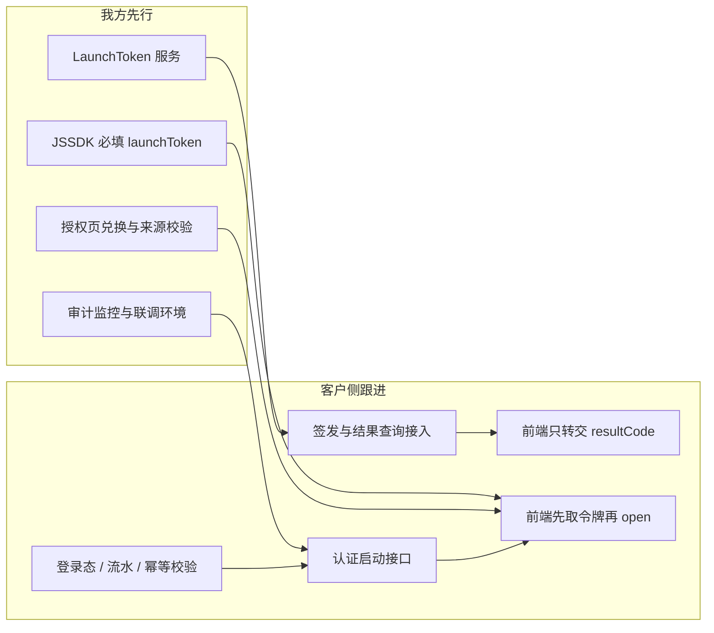

---

## 九、联调建议

1. **先联调签发与兑换**：确认 LaunchToken 短时有效、单次核销、上下文绑定生效。
2. **再联调结果查询**：确认前端只转交 `resultCode`，最终结果由客户后端闭环获取。
3. **覆盖异常用例**：缺失、过期、已使用、上下文不匹配、页面来源不匹配、结果凭证重复查询、服务不可用。
4. **确认不降级**：任一步校验失败均不得回退到无 LaunchToken 的原调用方式。
5. **待双方确认项**：令牌有效时长、接口地址与字段、签名方式、错误码、精确页面来源白名单。
