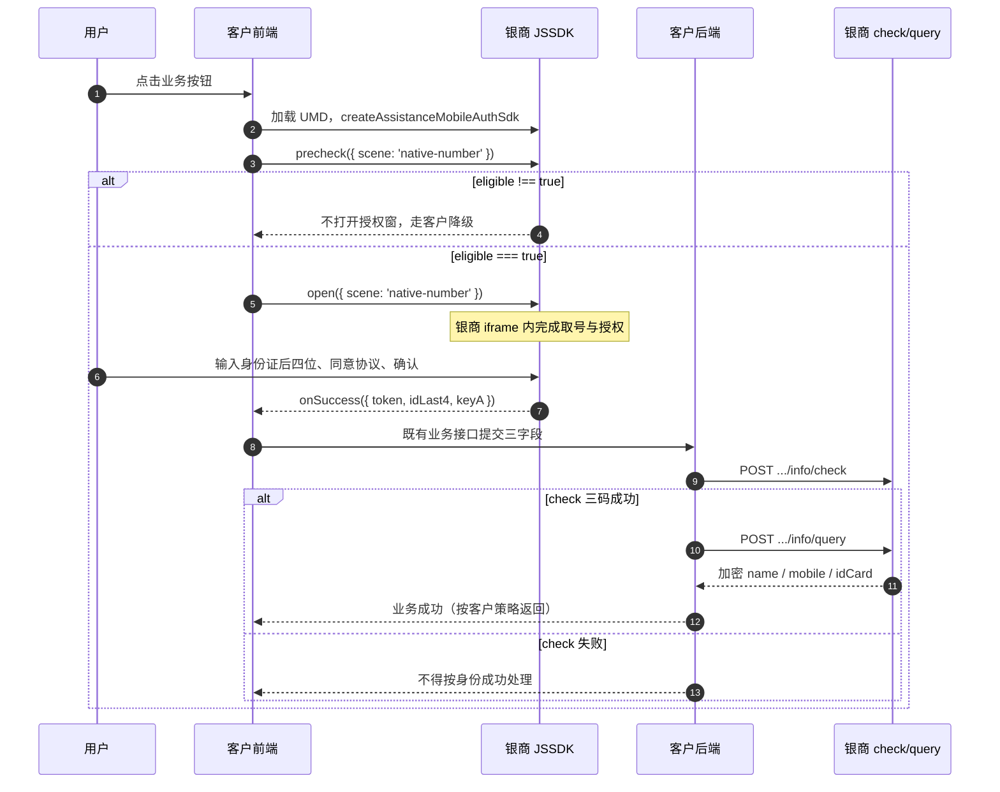

# 银杏助理客户接入文档（JSSDK 前端 ＋ 银商后端）

> 版本：v1.0  
> 日期：2026-10-16  
> 读者：客户前端、客户后端、联调负责人  
> 口径：把 **银商 JSSDK（前端）** 与 **银商 check／query（后端）** 视为同一套产品。客户只需接这两段；移动取号、签名、授权页均由银商 SDK 在自有 iframe 内完成。  
> 前端契约：`iframe/银商助理测试页 · 多点健康 TEMP 0.3.2.html`  
> 后端契约：`POST /v1/datacenter/smartverification/encrypted/assistant/info/check`、`.../query`  
> 内部实现说明见 `银杏助理JSSDK＋iframe新方案架构.md`（客户接入不必按该文档改造）。  
> **不改：** `银杏助理JSSDK完整页面嵌入自有H5落地方案.md`（含 `mount`，后续能力）。本文不包含 LaunchToken／`resultCode`。

---

## 目录

1. [产品怎么接](#一产品怎么接)
2. [职责划分](#二职责划分)
3. [端到端流程](#三端到端流程)
4. [接入准备](#四接入准备)
5. [前端接入](#五前端接入)
6. [后端接入](#六后端接入)
7. [字段对照](#七字段对照)
8. [错误、降级与生命周期](#八错误降级与生命周期)
9. [安全要求](#九安全要求)
10. [可选：授权区插入业务页](#十可选授权区插入业务页)
11. [验收清单](#十一验收清单)
12. [禁止事项](#十二禁止事项)

---

## 一、产品怎么接

客户业务页引入银商 JSSDK。用户授权时，SDK 自己创建授权窗口（iframe），完成移动认证。前端成功后只会拿到三个续调参数，交给**客户自己的后端**；客户后端再调银商 `check` 核验、`query` 取三要素。

```text
客户 H5                    银商提供（对客户是一个整体）                 客户后端
  │                        ┌─────────────────────────┐
  │  1. 引入 SDK            │  JSSDK + 授权 iframe     │
  │  2. precheck → open  ─►│  移动签名 / 取号 / 授权   │
  │  3. 收到 token 等    ◄─│                         │
  │  4. 提交给自有后端 ────────────────────────────────►  5. check
  │                                                      6. query
  │                         银商数盾加密接口 ◄──────────  7. SM2 + OPEN-BODY-SIG
  │  8. 业务继续      ◄────────────────────────────────  身份结果（加密三要素）
```

**SDK 成功 ≠ 身份核验成功。** 只有客户后端 `check` 业务成功后再 `query`，并且 `mobile`、`idCard` 非空，才能当作身份信息可用。

客户不写 `<iframe>`、不配授权页 URL、不传移动 `appId`、不在浏览器做移动签名、不直连移动官方 JSSDK。

---

## 二、职责划分

| 角色 | 做什么 | 不做什么 |
| --- | --- | --- |
| 客户前端 | 动态引入 SDK；`create`；用户动作后 `precheck` → `open`；把 `token`／`idLast4`／`keyA` 交给自有后端；页面离开时 `destroy` | 不画号码栏／四格／确认／官方协议；不保存或展示 token 与身份明文 |
| 客户后端 | 持有银商开放平台 `appId`／`appKey`、SM2 密钥；把前端三字段映射进 `check`／`query`；解密响应；把允许的业务结果给前端 | 不把 `appKey`、私钥下发浏览器；不跳过 check 直接 query |
| 银商 JSSDK | 创建授权 iframe；内部完成移动参数签名、取号、官方控件、回传续调参数 | 不代替客户调 check／query；不在回调里给三要素明文 |
| 银商后端 | 校验调用方身份；用移动 `token` 核验授权；返回加密三要素 | 不把银商 `appKey` 当成 query 里的 `token` |
| 移动认证 | 在银商 iframe 内完成；对客户透明 | 客户不直接对接 |

三类「appId」不要混用：

| 名称 | 谁持有 | 客户要不要传 |
| --- | --- | --- |
| 移动应用 `appId`（内部 `providerAppId`） | 银商 iframe 调官方 JSSDK 时使用 | **不要传** |
| 业务 appId | 多点专用 SDK 内置 | **不要传**（0.3.2 测试页明确不传） |
| 银商开放平台 `appId`／`appKey` | 客户后端 | **只在服务端**用于 `OPEN-BODY-SIG` |

---

## 三、端到端流程



阶段含义：

1. **预检**：判断当前环境能否走本机号授权（移动网络等）。通过也不等于已经授权。  
2. **授权**：用户在银商窗口内完成官方流程。成功只得到续调参数。  
3. **check**：客户后端请银商核验这次移动授权是否有效。  
4. **query**：核验通过后，按同一个移动 `token` 取回加密三要素。

---

## 四、接入准备

| 项 | 说明 |
| --- | --- |
| 银商开放平台应用 | 获得接口 `appId`、`appKey`，以及 SM2 平台公钥、客户侧解密私钥 |
| 协议字段 | 确认 `userNo`、协议 `requestId` 的取值规则（由客户后端配置／映射，不是前端随便传一个同名参数） |
| 域名 | 业务 H5 域名按银商侧要求做白名单（以开通结果为准） |
| SDK 资源 | 验证环境见下方 TEMP 0.3.2；正式地址以发布公告为准 |
| 真机网络 | 本机号授权需移动蜂窝网络；Wi-Fi／非移动号会预检失败或授权页提示，需客户降级 |
| 前后端通道 | 客户自有 HTTPS 接口，用于接收 `token`／`idLast4`／`keyA`。银商不规定该接口路径 |

验证页与 SDK（TEMP 0.3.2）：

```text
测试页：
https://ginkgo.chinaums.com/sign-pay-pro-temp/test-duodian-health-temp-0.3.2.html

SDK：
https://ginkgo.chinaums.com/sign-pay-pro-temp/assist/0.3.2/assistance-mobile-auth/assistance-mobile-auth.duodian-health.0.3.2.umd.cjs
```

银商后端（现网数盾加密域）：

```text
https://api-mop.chinaums.com/v1/datacenter/smartverification/encrypted/assistant/info/check
https://api-mop.chinaums.com/v1/datacenter/smartverification/encrypted/assistant/info/query
```

联调时建议先打开测试页走通授权回调，再接客户后端 check／query。测试页**不调用**客户业务接口。

---

## 五、前端接入

与甲方现网方式一致：**动态 script 引入、四个展示选项、五个回调、`precheck` 通过后再 `open`。不传 `appId` 或 `authParams`，不引入取参助手。**

### 5.1 推荐步骤

1. 用户点击后再加载 SDK（或进入支付页预加载，但不要一进页就 `open`）。  
2. `window.AssistanceMobileAuth.createAssistanceMobileAuthSdk({ ... })`。同一页一个实例。  
3. `precheck({ scene: 'native-number' })`。仅 `eligible === true` 时 `open`。  
4. 在 `onSuccess` **或** `await open()` 两处之一把 `{ token, idLast4, keyA }` 交给自有后端，避免重复提交。  
5. 路由离开／`pagehide` 时 `sdk.destroy()`。

### 5.2 示例（与 TEMP 0.3.2 测试页一致）

```js
const sdkUrl =
  'https://ginkgo.chinaums.com/sign-pay-pro-temp/assist/0.3.2/assistance-mobile-auth/assistance-mobile-auth.duodian-health.0.3.2.umd.cjs';

function loadScript(url) {
  return new Promise((resolve, reject) => {
    if (document.querySelector('script[src="' + url + '"]')) {
      resolve();
      return;
    }
    const script = document.createElement('script');
    script.type = 'text/javascript';
    script.src = url;
    script.addEventListener('load', () => resolve(), false);
    script.addEventListener('error', (error) => reject(error), false);
    document.head.appendChild(script);
  });
}

async function startAuth() {
  await loadScript(sdkUrl);
  const sdk = window.AssistanceMobileAuth.createAssistanceMobileAuthSdk({
    closable: true,
    authWindowHeight: '72vh',
    authWindowMaxHeight: '82vh',
    useCustomKeyboard: true,
    onReady: () => {
      // 授权窗口配置已下发，页面此时仍可能尚未可见。可做埋点、输入框失焦。
    },
    onSuccess: async (result) => {
      const { token, idLast4, keyA } = result;
      // 提交给客户后端，由后端调银商 check → query。
      // 此处成功不代表身份核验成功。
    },
    onCancel: () => { /* 用户取消 */ },
    onError: () => { /* 授权失败，走降级 */ },
    onClose: () => { /* 窗口关闭 */ },
  });

  sdk.precheck({ scene: 'native-number' }).then((result) => {
    if (result.eligible === true) {
      sdk.open({ scene: 'native-number' });
    } else {
      // 预检不通过：Wi-Fi、非移动号等，走客户既有降级
    }
  }).catch(() => {
    // 预检异常，走降级
  });
}

// 在原业务流程中调用 startAuth()
```

Vue / React：创建一次实例，在点击事件里 `open`，在 `onBeforeUnmount` / `useEffect` cleanup 里 `destroy()`。不要在挂载时调用不存在的 `mount()`。

### 5.3 创建选项（基线）

| 参数 | 必填 | 说明 |
| --- | --- | --- |
| `closable` | 否 | 弹层是否显示关闭。测试页为 `true` |
| `authWindowHeight` | 否 | 测试页 `'72vh'` |
| `authWindowMaxHeight` | 否 | 测试页 `'82vh'` |
| `useCustomKeyboard` | 否 | 身份证后四位自定义键盘，测试页 `true` |
| `appId` | 否 | **专用包不要传** |
| `authParams` | 否 | **不要传**；移动签名在银商 iframe 内完成 |

可选 `open({ scene, requestId })` 里的前端 `requestId` 只用于关联本次请求，**不能当成**银商 check／query 明文里的协议 `requestId`。

### 5.4 回调

| 回调 | 是否终态 | 客户怎么处理 |
| --- | --- | --- |
| `onReady` | 否 | 窗口配置已发出，**不等于授权页已可见** |
| `onSuccess(payload)` | 是 | 取 `token`、`idLast4`、`keyA` 交后端。`status` 现为成功，`message` 现为「验证完成」，只表示 SDK 授权成功 |
| `onCancel` | 是 | 用户取消，不交 check |
| `onError` | 是 | 初始化失败、缺字段、超时、不可恢复错误等，走降级 |
| `onErrorNotice` | 否 | 可恢复提示（如网络闪断类），**不结束**本次 `open`。测试页未接此回调，需要提示时再接 |
| `onClose` | 窗口关闭 | `close()` 或用户关窗；未完成的 `open` 随之结束 |

`onSuccess` 与 `await sdk.open()` resolve **同一份成功载荷**，业务提交只做一次。

成功载荷：

```json
{
  "status": "success",
  "token": "<移动授权 token>",
  "idLast4": "<本次提交的身份证后四位>",
  "keyA": "<移动 encryptPublicKey 的对外映射>",
  "message": "验证完成",
  "requestId": "<若 open 时传了则回传>"
}
```

`token` 是**移动**签发的授权结果，不是银商 `appKey`，也不是 LaunchToken。`keyA` 不是银商 SM2 公钥。

### 5.5 预检结果

| 字段 | 含义 |
| --- | --- |
| `eligible === true` | 可以 `open` |
| `eligible === false` | 不要 `open`，按 `reason` 降级 |
| `reason` | 失败分类；无法判断时为 `unknown` |
| 默认超时 | 12 秒，超时视为 `eligible=false`、`reason=unknown` |

预检只做取号探测，**不会**返回业务 `token`，也不能把预检会话复用给 `open`。

### 5.6 关闭与销毁

```js
sdk.close();    // 关闭当前授权窗口（弹层）
sdk.destroy();  // 销毁实例；中止预检；页面离开必调
```

---

## 六、后端接入

客户后端是浏览器结果进入银商的**唯一合法通道**。凭据、签名、加解密只留服务端。

### 6.1 调用顺序

1. 接收前端 `token`、`idLast4`、`keyA` 以及业务上下文（登录态、订单号等）。  
2. 三字段任一为空：直接失败，不要调银商。  
3. `POST .../info/check`。  
4. 仅当 check **业务成功**后再 `POST .../info/query`。  
5. query 再验成功码，并确认 `mobile`、`idCard` 非空。  
6. 按客户策略解密身份字段、助填或继续签约。  
7. 把**业务结果**返回前端；不要把银商原始密文、`token`、`keyA` 打回页面。

check 失败、解密失败、query 失败或缺字段：都不能对前端宣称「认证成功」。SDK 那边的 `open` 已经结束，**不要指望 SDK 回调被后端失败改写**。

### 6.2 传输封装（check、query 相同）

| 项 | 约定 |
| --- | --- |
| 方法 | `POST` |
| Content | 业务明文 JSON，用**银商平台公钥 SM2** 加密后放入 `{ "data": "<密文>" }` |
| 认证 | `Authorization` 为 `OPEN-BODY-SIG`：银商接口 `appId`、`appKey`、时间戳、nonce、请求体摘要。算法以开放平台为准 |
| 响应 | 外层信封 + 加密 `data`。先解信封，再解析业务 JSON |

`OPEN-BODY-SIG` 用的是银商 `appKey`，与 iframe 里的移动 `sign` 不是同一套。`appKey` 绝不进入前端。

### 6.3 check：核验这次移动授权

`POST https://api-mop.chinaums.com/v1/datacenter/smartverification/encrypted/assistant/info/check`

明文（加密前）：

| 字段 | 来源 | 说明 |
| --- | --- | --- |
| `token` | 前端 `result.token` | 移动授权 token |
| `servidL4` | 前端 `result.idLast4` | 本次提交的身份证后四位 |
| `keyA` | 前端 `result.keyA` | 即移动 `encryptPublicKey` |
| `requestId` | **客户后端协议配置／映射** | 不是前端可选 `requestId` 的同名假定 |
| `userNo` | **客户后端协议配置／映射** | 用户／商户侧协议标识 |

check 业务成功必须**同时**满足：

1. 外层 `errCode = 20000000`  
2. 解密后 `respCode = 00`  
3. 解密后 `detailRespCode = 0000`  

HTTP 200 或前端 `onSuccess` 都不能代替上述判断。不满足则禁止 query。

### 6.4 query：取回加密三要素

`POST https://api-mop.chinaums.com/v1/datacenter/smartverification/encrypted/assistant/info/query`

明文（加密前）：

| 字段 | 说明 |
| --- | --- |
| `token` | **同一个**移动 `token` |
| `requestId` | 与 check 相同的协议取值规则 |
| `userNo` | 与 check 相同的协议取值规则 |

query **不要带** `servidL4`、`keyA`。

成功判定：同样要外层 `20000000` + 业务 `00`／`0000`，并且：

| 字段 | 要求 | 现网映射名 |
| --- | --- | --- |
| `name` | 可空 | `encryptedName` |
| `mobile` | **必须非空** | `encryptedMobile` |
| `idCard` | **必须非空** | `encryptedIdCard` |

这三项是**加密身份字段**。解开 SM2 响应信封，不等于已经得到可助填的明文。现网做法是客户后端再按数盾约定做 **SM4 解密**（密钥由客户持有）。明文只留服务端，不要下发浏览器展示。

query 的业务含义：在 check 已证明「这次授权有效」之后，把对应的姓名、手机号、身份证取回来，供签约／助填／开户。它不会再签发一个银商 token。

### 6.5 后端伪代码

```text
function handleMobileAuth(front) {
  assertNonEmpty(front.token, front.idLast4, front.keyA)

  checkPlain = {
    requestId: mapProtocolRequestId(front),  // 服务端规则
    userNo:    mapUserNo(front),
    token:     front.token,
    servidL4:  front.idLast4,
    keyA:      front.keyA,
  }
  checkResp = postEncrypted(CHECK_URL, checkPlain)
  if not businessOk(checkResp):
    return AUTH_VERIFY_FAILED

  queryPlain = {
    requestId: checkPlain.requestId,
    userNo:    checkPlain.userNo,
    token:     front.token,
  }
  queryResp = postEncrypted(QUERY_URL, queryPlain)
  if not businessOk(queryResp):
    return AUTH_QUERY_FAILED
  if empty(queryResp.mobile) or empty(queryResp.idCard):
    return AUTH_IDENTITY_INCOMPLETE

  identity = decryptFields(queryResp)  // 按既有 SM4 约定
  return continueBusiness(identity)
}
```

---

## 七、字段对照

| 前端看到的 | 银商 check | 银商 query | 本质 |
| --- | --- | --- | --- |
| `token` | `token` | `token` | 移动授权结果 |
| `idLast4` | `servidL4` | （不传） | 用户在授权页输入的后四位 |
| `keyA` | `keyA` | （不传） | 移动 `encryptPublicKey` |
| （无） | `requestId`／`userNo` | 同左 | 客户后端协议字段 |
| （无） | HTTP `OPEN-BODY-SIG` | 同左 | 银商 `appId`＋`appKey` |
| （无） | — | `name`／`mobile`／`idCard` | 加密三要素 |

---

## 八、错误、降级与生命周期

| 场景 | 表现 | 客户处理 |
| --- | --- | --- |
| SDK 加载失败 | script error | 检查资源 URL、网络、CSP |
| 预检 `eligible !== true` 或超时 | 不出现授权窗 | 降级（账密、他途核验等，由客户定） |
| 用户取消 | `onCancel` | 不调 check |
| 授权页超时／缺 `token`／`keyA` | `onError` | 降级；不要把半截字段送后端 |
| Wi-Fi／非移动号 | 预检失败或页内提示 + 可能 `onErrorNotice` | 引导切移动网络或降级 |
| check 三码失败 | 后端失败 | 对前端返回业务失败，不 query |
| query 失败或缺号／证 | 后端失败 | 不视为身份可用 |
| 页面离开 | 需 `destroy` | 避免残留 iframe 与监听 |

可恢复错误（如部分移动错误码）由 SDK 内部重试控件，客户只会收到 `onErrorNotice`，`open` 继续。不可恢复才 `onError`。

---

## 九、安全要求

1. `appKey`、SM2 私钥、SM4 密钥只放客户服务端。  
2. `token`、`keyA`、身份证后四位、三要素明文：不写前端日志、不写 localStorage、不进截图可复制的页面文案。  
3. 客户前端只中转续调参数，不直调银商 check／query，也不直调移动官方接口。  
4. 不调用 `session/resolve`、`session/complete`（那是另一条 H5 会话链路）。  
5. 授权 UI（号码栏、确认、官方协议）必须留在银商 iframe 内，不能用 CSS 裁切或覆盖。

---

## 十、可选：授权区插入业务页

默认与测试页相同：**底部弹层**。若产品要把授权区嵌进自有排版，可在创建实例时增加：

```js
display: 'inline',
container: '#ums-auth-slot',
authWindowHeightMode: 'auto',
```

规则：

- 仍先 `precheck` 再 `open()`，**没有** `mount`。  
- 容器必须事先在 DOM 中，找不到则失败，不会自动改回弹层。  
- 容器留空，不要预置号码、四格、协议或 `<iframe>`。  
- 不要对容器使用会挡住协议的 `overflow: hidden`。  
- 号码栏、确认、官方协议仍在银商 iframe 内，不能拆到客户 DOM。

接口细节见 `银杏助理JSSDK容器内嵌本期方案.md`。不开启 inline 时，不必改测试页这套创建参数。

---

## 十一、验收清单

**前端**

- [ ] 仅替换 SDK URL，即可完成加载 → 预检 → 打开 → 五个回调  
- [ ] 不传 `appId`／`authParams` 仍能授权  
- [ ] `eligible !== true` 时无授权窗  
- [ ] 成功载荷含非空 `token`、`idLast4`、`keyA`  
- [ ] 页面离开后无残留窗口；`destroy` 已接  
- [ ] 微信 / Safari / Android WebView 真机可完成输入与确认  

**后端**

- [ ] 前端三字段经客户 HTTPS 到达服务端，不落浏览器存储  
- [ ] check 使用 `token` + `servidL4` + `keyA`，签名用银商 `appKey`  
- [ ] 仅 check 三码成功后才 query  
- [ ] query 使用同一 `token`，不带 `keyA`／后四位  
- [ ] `mobile`、`idCard` 非空才继续业务  
- [ ] 身份明文仅服务端可见  

**联调顺序建议**

1. 打开 TEMP 测试页，确认 `onSuccess` 有三字段。  
2. 客户前端接到自有后端，日志只记「已提交／成功／失败」，不记 token 明文。  
3. 客户后端 check 成功后再 query。  
4. 用 query 结果走一笔真实业务（助填或签约）。

---

## 十二、禁止事项

- 把银商 `appId`／`appKey` 或移动 `appId` 写进前端。  
- 用银商 `appKey` 去填 check／query 的 `token`。  
- 跳过 check 直接 query，或把 SDK 成功当成开户成功。  
- 客户 DOM 自绘官方号码栏／确认／协议，或只嵌四格。  
- 前端展示或存储三要素明文。  
- 把本文与 LaunchToken（前端只回 `resultCode`）混成同一套接口。

---

## 附录 A 客户最小闭环

```text
引入 SDK
  → precheck
  → open
  → onSuccess { token, idLast4, keyA }
  → 客户后端 check
  → 客户后端 query
  → 解密三要素
  → 继续业务
```

## 附录 B 相关文档

| 文档 | 给谁看 |
| --- | --- |
| 本文 | 客户前后端接入 |
| `iframe/银商助理测试页 · 多点健康 TEMP 0.3.2.html` | 前端联调样例 |
| `银杏助理JSSDK＋iframe新方案架构.md` | 银商内部实现与时序 |
| `银杏助理JSSDK容器内嵌本期方案.md` | 可选 inline 展示 |
| LaunchToken 两份方案 | 尚未作为本接入契约 |
